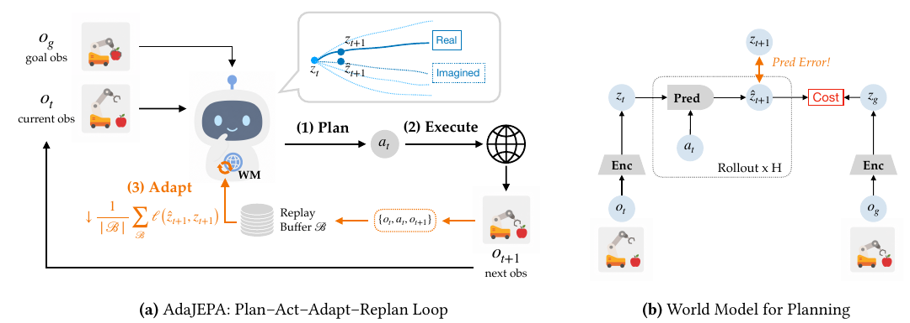
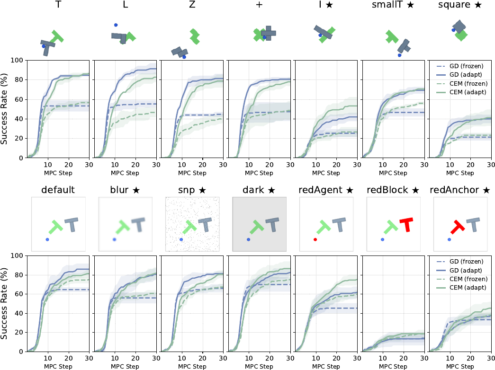
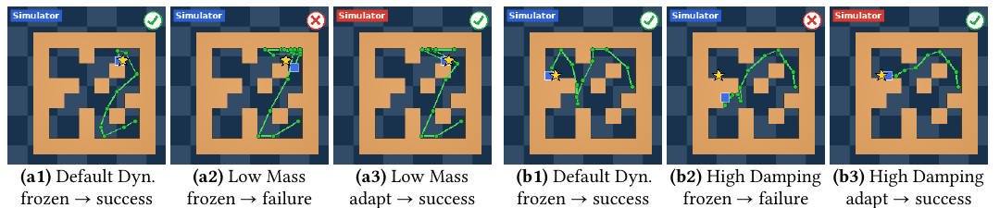
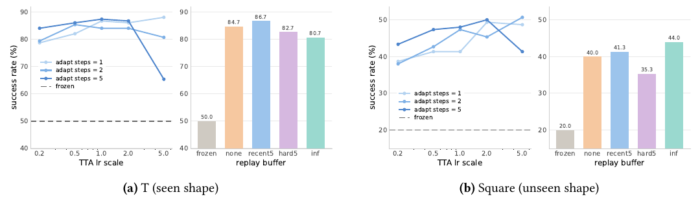
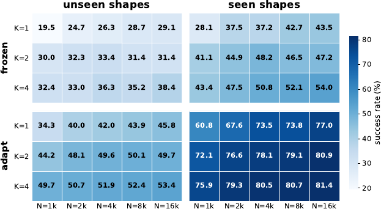

# AdaJEPA: un world model che si adatta mentre pianifica

**AdaJEPA** affronta un problema del controllo mediante modelli appresi: il sistema usa le proprie previsioni per scegliere le azioni, ma tali previsioni possono diventare inaffidabili quando cambiano aspetto o dinamica dell'ambiente. Ripetere la pianificazione dopo ogni nuova osservazione aiuta a correggere il piano, ma lascia intatto un eventuale errore sistematico del modello.

Il contributo consiste nell'inserire un **aggiornamento auto-supervisionato del world model dentro il ciclo di controllo**. Dopo aver eseguito un'azione, il sistema osserva che cosa è realmente accaduto, corregge alcuni parametri e usa subito il modello aggiornato per pianificare di nuovo.

Il riferimento è [*AdaJEPA: An Adaptive Latent World Model*](https://arxiv.org/pdf/2606.32026), di Ying Wang, Oumayma Bounou, Yann LeCun e Mengye Ren, nella versione arXiv v1 del 30 giugno 2026. L'analisi segue il testo principale e le appendici di questa versione. Il lavoro studia **goal-reaching in simulazione**: il goal è specificato attraverso un'osservazione desiderata, senza istruzioni linguistiche e senza esperimenti su robot fisici.

## Il problema: ripianificare con un modello sbagliato

Si consideri un agente che deve spingere un oggetto fino a una posa desiderata. Il modello predice quanto si sposterà l'oggetto sotto diverse azioni, e il planner sceglie la sequenza che sembra avvicinarlo maggiormente al goal. Se il contatto reale produce uno spostamento diverso da quello previsto, il piano può risultare inefficace.

Nel **Model Predictive Control (MPC)** il sistema esegue soltanto la prima parte del piano e poi pianifica nuovamente dalla nuova osservazione. Questo meccanismo, detto anche *receding horizon*, limita le conseguenze di previsioni inesatte: il controller non rimane vincolato a un'intera traiettoria decisa in precedenza.

Tuttavia, **aggiornare il punto di partenza della previsione non equivale ad aggiornare la legge con cui si predice il futuro**. Se la massa dell'agente cambia, un modello congelato può continuare a stimare lo stesso spostamento errato dopo ogni ripianificazione. Il feedback rende il piano reattivo, ma non corregge automaticamente la dinamica appresa.

AdaJEPA introduce un secondo uso del feedback. La nuova osservazione serve sia a inizializzare il planning successivo sia a costruire un esempio di apprendimento: «da questa osservazione, con questa azione, si è ottenuto questo risultato». Il sistema può quindi migliorare localmente la previsione mentre procede verso il goal.

*Il modello pianifica nello spazio latente, esegue un'azione e usa la transizione osservata per correggere le previsioni prima della ripianificazione successiva. Fonte: Wang et al., **AdaJEPA**, Figura 1.*

## Prerequisiti: rappresentazione latente e JEPA

### Dalle osservazioni a una rappresentazione utile al controllo

Il vero stato fisico dell'ambiente, indicato con $s_t$ al tempo $t$, non è normalmente disponibile in forma completa. L'agente riceve un'**osservazione** $o_t$, che può contenere immagini e informazioni propriocettive. Quando è presente, lo stato accessibile del robot viene indicato con $q_t$ e può essere incluso nell'osservazione.

Predire direttamente immagini future richiede di modellare molti dettagli. Un **latent world model** comprime invece l'osservazione in una rappresentazione numerica $z_t$, detta embedding o stato latente. Il modello cerca di conservare l'informazione necessaria a prevedere gli effetti delle azioni senza dover ricostruire ogni pixel.

AdaJEPA usa come quadro generale una **Joint-Embedding Predictive Architecture (JEPA)**. L'idea è confrontare una previsione del futuro con la rappresentazione della futura osservazione reale. La supervisione avviene quindi tra embedding, anziché tra immagini generate e immagini osservate.

Questo distingue il lavoro da un VLA: qui le azioni sono selezionate da un planner che interroga il modello predittivo. La relazione tra le due famiglie è discussa nell'[introduzione ai World Models](../../world_models/README.md).

### Encoder e predittore

Il paper descrive tre componenti: un encoder sensoriale $E_\phi$, con parametri $\phi$; un encoder delle azioni $A_\psi$, con parametri $\psi$; un predittore della dinamica $f_\theta$, con parametri $\theta$. Per rendere leggibili le equazioni, vengono qui abbreviati i nomi degli encoder rispetto alla notazione grafica del paper:

$$
z_t = E_\phi(o_t), \qquad u_t = A_\psi(a_t), \qquad \hat z_{t+1} = f_\theta(z_t,u_t)
$$

$a_t$ è l'azione eseguita, $u_t$ la sua rappresentazione e $\hat z_{t+1}$ la previsione del latent successivo. Il simbolo $\hat{\phantom z}$ distingue una quantità predetta dalla rappresentazione $z_{t+1}=E_\phi(o_{t+1})$ ricavata dall'osservazione effettiva.

La forma a un solo passo serve a spiegare il metodo. Nell'implementazione principale il predittore utilizza anche una breve storia: **3 frame**, con **frameskip 5**, cioè una spaziatura temporale di cinque passi tra i frame considerati. Una singola immagine può non bastare a dedurre velocità e direzione del movimento; la storia fornisce informazioni temporali aggiuntive.

Il modello principale combina un **encoder ResNet a feature globali** e un **predittore Transformer**. Gli embedding di azioni e propriocezione vengono combinati con quelli visivi. Il lavoro verifica inoltre il metodo con rappresentazioni spaziali a patch e con DINO-WM, senza vincolare il contributo a una sola architettura.

### Apprendimento offline e rischio di collasso

Prima del deployment, il modello apprende da un dataset offline $\mathcal D_{\mathrm{off}}$ di transizioni osservazione–azione–osservazione. Questi dati non richiedono reward o etichette di successo per addestrare la previsione latente.

Una formulazione generale dell'obiettivo è:

$$
\mathcal L_{\mathrm{pred}} = \frac{1}{K}\sum_{k=1}^{K}\ell_{\mathrm{pred}}(\hat z_{t+k},z_{t+k})
$$

$K$ è il numero di passi futuri considerati e $\ell_{\mathrm{pred}}$ misura la discrepanza tra embedding previsto e osservato, per esempio tramite errore quadratico medio. Il pedice distingue questa funzione dall'istruzione linguistica $l$, che non compare nei task del lavoro.

Quando anche l'encoder è appreso, esiste una soluzione degenerata: rappresentare ogni osservazione con lo stesso vettore. L'errore predittivo sarebbe basso, ma la rappresentazione non distinguerebbe più oggetti, posizioni o goal. Questo fenomeno viene chiamato **representation collapse**.

Le implementazioni JEPA impiegano accorgimenti per evitarlo. Nel modello principale vengono usati lo **stop-gradient** sul ramo target e una regolarizzazione della curvatura delle traiettorie latenti, derivata dal lavoro sul *temporal straightening*. Quest'ultima favorisce traiettorie latenti più rettilinee e agevoli da usare nel planning. Le strategie specifiche dipendono dal world model di partenza: AdaJEPA ne riutilizza la struttura predittiva.

## Pianificare verso un goal nello spazio latente

Il task viene specificato mediante un'osservazione goal $o_g$. Applicando l'encoder si ottiene $z_g=E_\phi(o_g)$, la rappresentazione del risultato desiderato. L'indice $g$ indica il goal.

Dato il latent corrente, il planner considera una sequenza candidata $a_{t:t+H-1}$ di $H$ azioni. Il simbolo $H$ rappresenta l'**orizzonte di pianificazione**. Il modello viene applicato ricorsivamente per ottenere i latent futuri immaginati.

Il planner sceglie le azioni minimizzando un costo di avvicinamento al goal:

$$
a^*_{t:t+H-1} = \arg\min_{a_{t:t+H-1}}\sum_{k=1}^{H}\alpha_k\,d(\hat z_{t+k},z_g)
$$

$\alpha_k$ pesa l'importanza dei diversi istanti futuri e $d$ misura la distanza nello spazio latente, tipicamente la distanza euclidea al quadrato. L'asterisco identifica la sequenza selezionata dal planner. Il significato operativo è scegliere movimenti che, secondo il modello, producano rappresentazioni progressivamente vicine al goal.

La distanza latente è un **criterio di controllo**, non una misura fisica universalmente calibrata. La sua utilità dipende da ciò che l'encoder conserva: se due configurazioni fisicamente diverse hanno embedding molto simili, il planner può confonderle.

### Due modi per cercare le azioni

Il paper considera sia **gradient descent (GD)** sia **Cross-Entropy Method (CEM)**. Con GD il planner modifica direttamente le azioni candidate usando il gradiente del costo attraverso il modello differenziabile. Durante questa ricerca i parametri del world model rimangono fissati.

Con CEM il planner campiona sequenze da una distribuzione, le valuta, seleziona le migliori e aggiorna la distribuzione verso quelle sequenze. Ripetendo il processo concentra la ricerca su piani promettenti. Non è necessario differenziare il costo rispetto alle azioni.

**Ottimizzare le azioni e aggiornare i parametri del modello sono due operazioni distinte**. Anche quando il planner usa CEM, AdaJEPA usa il gradiente per adattare il world model dopo l'esecuzione.

In entrambi i casi viene eseguita soltanto una parte iniziale del piano. La successiva osservazione chiude il loop e permette di ripetere la ricerca da una condizione reale aggiornata.

## Il ciclo di adattamento di AdaJEPA

### Dall'esecuzione al segnale di apprendimento

Dopo aver eseguito $a_t$, l'agente osserva $o_{t+1}$ e dispone della transizione $(o_t,a_t,o_{t+1})$. L'esito fisico appena osservato fornisce il target per l'aggiornamento: non serve sapere quale azione avrebbe scelto un esperto, né assegnare un reward alla transizione.

Questo rende l'adattamento **auto-supervisionato**. L'ambiente fornisce il risultato dell'azione, e il sistema lo confronta con la propria previsione. L'obiettivo immediato è correggere la predizione, mentre il beneficio sul successo del task viene verificato sperimentalmente.

La distinzione è essenziale: **una loss predittiva più bassa non garantisce da sola un controllo migliore**. Il planner deve anche usare una rappresentazione informativa e cercare azioni efficaci entro il budget disponibile.

### Replay buffer e loss online

Le transizioni vengono conservate in un piccolo **replay buffer** $\mathcal B$. La configurazione standard trattiene le **5 transizioni più recenti**. Una breve finestra evita che l'aggiornamento dipenda soltanto dall'ultimo esempio, mantenendolo concentrato sulla regione dell'ambiente attualmente visitata.

Per il caso semplificato a un solo passo, la loss di adattamento è:

$$
\mathcal L_{\mathrm{ada}}(\mathcal B) = \frac{1}{|\mathcal B|}\sum_{(o_i,a_i,o_{i+1})\in\mathcal B}\ell_{\mathrm{pred}}\!\left(f_\theta(E_\phi(o_i),A_\psi(a_i)),\operatorname{sg}(E_\phi(o_{i+1}))\right)
$$

$|\mathcal B|$ è il numero di transizioni nel buffer e $i$ ne indicizza gli elementi. L'operatore $\operatorname{sg}$ è lo **stop-gradient**: il target viene calcolato normalmente, ma durante quell'aggiornamento il gradiente non attraversa il ramo che lo produce.

In termini intuitivi, il target è il riferimento che la previsione deve raggiungere, evitando che l'ottimizzazione lo sposti simultaneamente per ridurre artificialmente la discrepanza. Quando l'encoder viene aggiornato, il target può comunque cambiare agli aggiornamenti successivi; stop-gradient non equivale a congelare per sempre l'encoder.

Il paper usa questo accorgimento come stabilizzatore, ma riporta prestazioni simili anche rimuovendolo quando si aggiornano pochi layer per un solo passo. La portata di questa osservazione rimane quella della specifica ablation: non costituisce una garanzia generale contro il collasso.

Con storie temporali, action chunk e frameskip, il confronto viene mediato sulle finestre predittive valide. La formula a un passo espone il principio senza rappresentare tutti questi dettagli implementativi.

### Quali parametri cambiano

Si indichi con $\Omega$ il vettore dei soli parametri selezionati per l'adattamento, estratti da $\phi$, $\psi$ e $\theta$. Con learning rate $\eta$, un passo di aggiornamento assume la forma:

$$
\Omega \leftarrow \Omega-\eta\nabla_\Omega\mathcal L_{\mathrm{ada}}(\mathcal B)
$$

Il gradiente indica come cambiare i parametri per ridurre l'errore sul buffer. Il metodo ammette $U$ aggiornamenti per ripianificazione, dove $U$ è un intero positivo; la configurazione standard usa **$U=1$**.

Nel caso principale vengono adattati l'**ultimo blocco Transformer del predittore**, con la LayerNorm finale, e l'**ultimo stadio dell'encoder**. Quest'ultimo è una testa di proiezione composta da trasformazioni lineari, attivazione GELU e LayerNorm. Gli altri parametri rimangono congelati.

La scelta limita calcolo e ampiezza della modifica. Il sistema non deve riapprendere l'intera percezione a ogni transizione: corregge una parte della trasformazione verso il latent e della dinamica che opera su di esso.

### Sequenza operativa e reset tra episodi

All'inizio di ogni episodio si ripristina il world model preaddestrato e si svuota il buffer. Si acquisisce l'osservazione iniziale e si pianifica verso il goal con i parametri correnti.

Dopo l'esecuzione del primo segmento del piano, si inserisce nel buffer la nuova transizione, si applica l'aggiornamento auto-supervisionato e si ripianifica. Il ciclo continua fino al successo o all'esaurimento del budget.

**L'adattamento persiste entro l'episodio, ma viene scartato tra episodi**. Il protocollo misura quindi la capacità di correggersi durante un tentativo, senza accumulare conoscenza permanente tra esperimenti. Non serve una fase separata di raccolta online: le transizioni utilizzate sono quelle generate cercando di raggiungere il goal.

## Ambienti, dataset e perturbazioni

Gli esperimenti separano cambiamenti della geometria, dell'immagine, della dinamica e della struttura spaziale. Questa separazione aiuta a capire se la difficoltà nasce dalla rappresentazione percettiva, dalla previsione delle transizioni o da entrambe. Tutti gli embodiment sono simulati: un pusher circolare nei task di manipolazione e un agente puntiforme in PointMaze.

### PushT e PushObj: contatti e nuove geometrie

In **PushT** un pusher circolare interagisce con un blocco a forma di T. Nel setup ripreso da DINO-WM, la T verde fissa è un **riferimento visivo**, mentre il risultato desiderato è specificato dall'osservazione goal. Non bisogna interpretare automaticamente la T verde come il target fisico da ricoprire.

**PushObj** sostituisce il blocco con geometrie diverse. Gli autori partono da **18,500 traiettorie PushT** e costruiscono dati con un bias verso il contatto. Riprodurre semplicemente le stesse azioni con oggetti differenti può infatti portare il pusher a mancare il blocco, generando sequenze poco informative sulla dinamica di interazione.

Il dataset esteso contiene **16,000 traiettorie per forma**. Per il principale esperimento di *shape shift*, il modello apprende su **T, L, Z e +**, con **4,000 traiettorie per forma**, e viene valutato anche sulle forme mai viste **I, smallT e square**. Le traiettorie di test vengono filtrate per contenere almeno un contatto.

In questo protocollo il goal è campionato a una distanza temporale di **25 passi** nella traiettoria. Il test misura quindi controllo verso configurazioni selezionate dal dataset, con nuove geometrie ma con meccanica di contatto condivisa, anziché manipolazione arbitraria di qualsiasi oggetto.

### Perturbazioni visive

Per il *visual shift* viene utilizzato il sottoinsieme con **16,000 traiettorie della forma T**, addestrato nel dominio visivo originale. In valutazione si applicano sfocatura gaussiana, rumore *salt-and-pepper* e riduzione dell'illuminazione.

Ulteriori condizioni cambiano in rosso il colore del pusher, del blocco mobile o dell'ancora fissa. Queste prove verificano se l'encoder e il predittore riescono a riadattarsi quando gli indizi visivi differiscono da quelli del training.

### PointMaze: dinamica e layout

**PointMaze-Medium** è un ambiente di navigazione 2D in MuJoCo. L'agente viene controllato mediante forze lungo i due assi del piano. Il lavoro usa i dati e il checkpoint ResNet a feature globali di *Temporal Straightening for Latent Planning*.

Le perturbazioni fisiche riducono la massa a **$0.2$ volte** quella originale oppure aumentano lo smorzamento a **$20$ volte** il valore originale. Nel primo caso la stessa forza produce una risposta più rapida; nel secondo la velocità decade più rapidamente.

Per evitare goal banali, l'Appendice A.3 seleziona celle iniziali e finali distanti più di **3 unità di cella in distanza euclidea**. Il testo principale descrive il requisito in termini di distanza sulla griglia; qui si riporta il criterio esplicito dell'appendice, senza confonderlo con la lunghezza del percorso tra gli ostacoli.

Per il *layout shift* vengono generati **30 labirinti su griglia $8\times8$**: **25** per il training e **5** esclusi dal training per la valutazione. Ogni layout di training contiene **2,000 traiettorie**, per **50,000** totali. Nei layout di test il goal viene campionato a distanza di percorso minimo di **3–5 celle**, calcolata tramite ricerca in ampiezza, o BFS.

## Protocollo e configurazione del controllo

Il confronto principale oppone lo stesso world model **frozen**, mantenuto fisso durante l'episodio, alla variante adattiva. Vengono provati entrambi i planner, GD e CEM. Questo permette di separare l'effetto dell'aggiornamento del modello dalla scelta dell'algoritmo di ricerca delle azioni.

Le impostazioni principali riportate nel testo e nelle Tabelle 3–4 sono:

| Componente | Impostazione |
| :--- | :--- |
| Storia osservata | 3 frame, frameskip 5 |
| Buffer online standard | 5 transizioni recenti |
| Passi di adattamento | 1 per ripianificazione |
| Learning rate dell'encoder | $10^{-5}$ |
| Learning rate del predittore | $5\times10^{-4}$ |
| Orizzonte del subplanner | 25 |
| Azioni eseguite prima del nuovo planning | 5 |
| Ricerca GD delle azioni | Adam, learning rate $0.1$, 100 iterazioni, inizializzazione a zero |
| Ricerca CEM | 200 campioni, 10 iterazioni |

I **100 passi di GD** della tabella ottimizzano le azioni candidate; il **singolo passo di adattamento** aggiorna i parametri del world model. Confondere i due conteggi porterebbe a sottostimare il costo del planner.

Il paper dichiara risultati mediati su **3 seed dei dati di test**, con **50 episodi per seed**. Per i layout diversi l'appendice specifica 50 episodi, 10 per ciascuno dei 5 labirinti. La metrica centrale è il **planning success rate**, cioè la percentuale di episodi che raggiunge il goal entro il budget previsto.

La versione v1 presenta una discrepanza sul budget massimo: la Sezione 4.1 indica **20 ripianificazioni**, mentre la Figura 2 estende le curve a **30** e l'Appendice B.2 descrive le ablation a 20 passi «invece dei 30 degli esperimenti principali». I risultati vanno quindi associati alla rispettiva figura o tabella, evitando di attribuire a tutte le prove un budget unico.

## Risultati: dove l'adattamento aiuta

### Forme e aspetto visivo

*La riga superiore confronta forme viste e mai viste; quella inferiore varia l'aspetto delle osservazioni. Le curve continue rappresentano il modello adattivo, quelle tratteggiate il modello congelato, con planner GD e CEM. Fonte: Wang et al., **AdaJEPA**, Figura 2.*

Sulle forme note di PushObj, AdaJEPA migliora sensibilmente il successo. Un modello addestrato su oggetti diversi può infatti specializzarsi sulla geometria presente nell'episodio, anche senza un cambiamento formale della distribuzione di test.

Sulle forme mai viste, il vantaggio rimane evidente, ma il successo assoluto dipende dall'oggetto. Le curve mostrano inoltre che concedere più ripianificazioni continua ad aiutare la variante adattiva, mentre il modello congelato tende a saturare prima. Il risultato è coerente con un progressivo miglioramento della previsione locale.

Nel dominio visivo, i benefici sono chiari con sfocatura, rumore e illuminazione ridotta. Sono più contenuti quando cambia il colore del blocco o dell'ancora: gli autori ipotizzano che il modello sfrutti il colore per distinguere gli elementi. Correggere alcuni layer non garantisce di eliminare questa dipendenza.

### Dinamiche fisiche e labirinti nuovi

La Tabella 1 del paper consente un confronto numerico diretto. La tabella seguente riporta le medie di successo in percentuale per alcune condizioni, omettendo qui i termini di variabilità riportati nella fonte. `predlast` e `predfirst` indicano rispettivamente l'ultimo e il primo blocco del predittore; `enclast` l'ultimo stadio dell'encoder.

| Condizione | Planner | Frozen | `predlast + enclast` | `predfirst + enclast` |
| :--- | :--- | ---: | ---: | ---: |
| Dinamica originale | GD | 82.7 | 83.3 | 84.0 |
| Dinamica originale | CEM | 84.0 | 83.3 | 84.0 |
| Massa ridotta | GD | 77.3 | 80.0 | 82.0 |
| Massa ridotta | CEM | 82.0 | 86.7 | 82.7 |
| Smorzamento elevato | GD | 77.3 | 77.3 | 78.7 |
| Smorzamento elevato | CEM | 76.0 | 78.7 | 82.0 |
| Layout mai visti | GD | 53.3 | 66.0 | 78.7 |
| Layout mai visti | CEM | 49.3 | 55.3 | 70.7 |

*Fonte: Wang et al., **AdaJEPA**, Tabella 1. Le medie non esprimono da sole la significatività delle differenze.*

Il modello congelato è già abbastanza robusto ai cambiamenti di massa e smorzamento. Gli autori suggeriscono che la storia di tre frame permetta una forma di adattamento tramite contesto. AdaJEPA aggiunge comunque miglioramenti in diverse condizioni, generalmente più contenuti rispetto al cambiamento di layout.

Sui labirinti mai visti, adattare il primo blocco del predittore produce il vantaggio maggiore: con GD il successo passa da **53.3% a 78.7%**, un aumento di circa **25 punti percentuali**.

I dati mostrano anche casi invariati o leggermente peggiori: nella dinamica originale con CEM, la configurazione standard passa da 84.0% a 83.3%. Perciò l'affermazione degli autori secondo cui l'adattamento non danneggia le prestazioni in-distribution va letta come andamento complessivo, senza trasformarla in una garanzia per ogni condizione.

*Le linee verdi mostrano il percorso, il quadrato blu la posizione finale e la stella il goal. Gli esempi affiancano esecuzioni con modello congelato e adattivo sotto massa ridotta o smorzamento aumentato. Fonte: Wang et al., **AdaJEPA**, Figura 4.*

### Cosa mostrano le ricostruzioni dei latent

Gli autori addestrano separatamente un decoder per visualizzare i rollout immaginati. **Il decoder è uno strumento di analisi e non è necessario al planning**, che opera direttamente sugli embedding.

Le visualizzazioni possono mantenere colori o forme del dominio di training anche quando l'ambiente è cambiato. Un blocco rosso può essere ricostruito grigio, oppure una forma nuova può essere resa simile a una nota. L'interpretazione proposta è che AdaJEPA ricalibri una struttura latente condivisa, senza dover costruire una rappresentazione visiva completamente nuova.

Queste immagini aiutano a leggere il comportamento, ma non dimostrano da sole che il latent rappresenti fedelmente ogni proprietà fisica. Anche il decoder è stato addestrato nel dominio iniziale e impone i propri limiti alla visualizzazione.

## Ablation: perché bastano aggiornamenti piccoli

### Layer del predittore e dell'encoder

Il lavoro confronta aggiornamenti di diversi blocchi, encoder congelato e **LoRA**, cioè adattatori a basso rango che modificano solo pochi parametri aggiuntivi. La configurazione LoRA usa rango 8 e fattore di scala 16.

Negli esperimenti di geometria, adattare soltanto il predittore resta competitivo. Questo suggerisce che la rappresentazione iniziale conservi già informazioni riutilizzabili sulle forme, mentre occorra soprattutto correggere la previsione delle interazioni.

Con cambiamenti visivi o di layout, lasciare l'encoder congelato è meno efficace. L'errore può nascere già nella trasformazione dell'osservazione, e una correzione del solo predittore può non compensarlo completamente.

L'efficacia del primo blocco del predittore sui nuovi layout suggerisce inoltre che i layer più vicini agli input possano essere utili per ricalibrare le transizioni locali. Questa è un'interpretazione degli autori sostenuta dalle ablation, senza una prova generale sul ruolo di ogni layer. LoRA migliora la baseline, ma non supera sistematicamente l'aggiornamento diretto dei layer selezionati.

### Learning rate, numero di passi e buffer

*I grafici confrontano learning rate e numero di aggiornamenti, oltre a buffer assente, recente, basato sugli errori maggiori o esteso a tutta la storia. I due pannelli riguardano una forma vista e una mai vista. Fonte: Wang et al., **AdaJEPA**, Figura 9.*

Learning rate e numero di passi vanno considerati insieme. Un learning rate elevato può essere efficace con un solo aggiornamento, ma produrre correzioni eccessive se applicato ripetutamente. Un valore basso può richiedere più passi e aumentare la latenza.

Il default di un passo con i learning rate del training costituisce un compromesso pratico. Il paper non individua un'intensità ottimale universale: la scelta migliore dipende da ambiente e modello.

Per il buffer vengono confrontate una finestra recente, le transizioni con errore più alto (*hard buffer*), tutta la storia dell'episodio e l'uso della sola transizione corrente. Quest'ultimo caso è indicato come «nessun buffer»: **l'aggiornamento usa comunque dati appena osservati**.

Le differenze tra buffer sono più contenute rispetto al vantaggio sull'assenza di adattamento. Inoltre, trattenere gli errori più alti non è automaticamente la scelta migliore: la finestra recente produce guadagni stabili e diventa la configurazione standard.

## Quantità e diversità dei dati offline

AdaJEPA non elimina l'importanza del pretraining. Per verificarne l'interazione con i dati, gli autori variano il numero di forme nel training e le traiettorie disponibili per ciascuna forma, mantenendo fisso il numero di passi di ottimizzazione.

*Nella figura originale, $K$ indica il numero di forme di training e $N$ le traiettorie per forma; $1k$ equivale a 1,000 traiettorie. Questi simboli sono locali al grafico: non coincidono con l'orizzonte $K$ della loss predittiva. Fonte: Wang et al., **AdaJEPA**, Figura 10.*

Il numero di forme varia tra **1, 2 e 4**, mentre le traiettorie per forma variano tra **1,000 e 16,000**. Per ogni numero di forme vengono costruiti sette training set bilanciati; la valutazione distingue forme viste e mai viste per ciascun modello.

Con una sola forma e **1,000 traiettorie**, sulle forme viste l'adattamento porta il successo da **28.1% a 60.8%**. Il modello congelato con 16,000 traiettorie della singola forma raggiunge invece 43.5%. In questo esperimento, adattarsi durante l'utilizzo compensa quindi una parte rilevante della scarsità dei dati offline.

A parità di **16,000 traiettorie totali**, distribuirle su quattro forme porta il successo adattivo sulle forme mai viste a **51.9%**, rispetto a **45.8%** concentrandole su una sola forma. La diversità aiuta anche quando è disponibile l'adattamento online.

Questi risultati sostengono una relazione di **complementarità tra copertura offline e correzione online**. Non dimostrano che qualsiasi modello addestrato su pochi dati possa raggiungere prestazioni elevate: l'adattamento opera su una rappresentazione già capace di descrivere almeno parte delle interazioni rilevanti.

## Costo computazionale e significato della latenza

La Tabella 2 confronta più world model sulle traiettorie di validazione PushT di DINO-WM, misurando i tempi su una **GPU NVIDIA H200**. L'adattamento aggiunge circa **0.01–0.03 secondi per ripianificazione**, ossia **10–30 ms**.

Questo incremento va distinto dal **tempo totale del planner**. Di seguito sono riportate alcune configurazioni della tabella originale:

| Modello e planner | Successo frozen → adapt | Tempo frozen → adapt per ripianificazione |
| :--- | :--- | :--- |
| Temporal Straightening, feature globali, CEM | 74.0% → 81.3% | 0.24 s → 0.27 s |
| Temporal Straightening, feature globali, GD | 84.0% → 85.3% | 3.14 s → 3.17 s |
| Temporal Straightening, feature spaziali, CEM | 89.3% → 93.3% | 5.37 s → 5.39 s |
| DINO-WM a patch, CEM | 86.7% → 90.0% | 9.53 s → 9.56 s |

*Fonte: Wang et al., **AdaJEPA**, Tabella 2; sono riportate le medie.*

Il costo aggiuntivo è ridotto rispetto a molti dei planner considerati, ma nel primo caso corrisponde comunque al **12.5%** del tempo frozen. Soprattutto, l'esperimento non dimostra un controllo fisico ad alta frequenza: alcune configurazioni richiedono secondi per scegliere il segmento successivo.

Gli autori osservano che un modello più accurato può raggiungere il goal con meno ripianificazioni, compensando il costo degli aggiornamenti. Il beneficio totale dipende però sia dal numero di ripianificazioni sia dal loro tempo; il solo overhead del gradiente non basta a stabilire la latenza dell'intero sistema.

## Novelty

- **Adattamento del world model dentro l'MPC**: le transizioni prodotte dal controllo aggiornano il modello prima della ricerca successiva.
- **Supervisione ricavata dall'esecuzione**: il metodo non richiede nuove azioni esperte, reward o una fase separata di raccolta online.
- **Correzione selettiva dei parametri**: un singolo aggiornamento di pochi layer offre benefici su più tipi di shift.
- **Applicabilità a più world model e planner**: le verifiche includono feature globali e spaziali, GD e CEM.
- **Analisi della relazione tra dati e adattamento**: gli esperimenti distinguono il contributo della quantità di traiettorie da quello della diversità delle forme.

La novità va collocata nel contesto del controllo adattivo e dell'apprendimento online dei modelli, già esistenti. Gli autori rivendicano in particolare l'adattamento di un **JEPA world model durante il planning**; il contributo non è l'idea generale di usare il feedback per identificare la dinamica.

## Limiti

### Copertura della rappresentazione e informazione disponibile

L'aggiornamento è piccolo e locale. Se il modello preaddestrato non conserva una caratteristica necessaria al task, poche transizioni possono non bastare a recuperarla. I risultati meno favorevoli sotto alcuni cambiamenti di colore illustrano questa dipendenza dalla rappresentazione iniziale.

Inoltre, il sistema apprende dalle traiettorie che il proprio planner decide di eseguire. **Non è presente una strategia esplicita di esplorazione informativa**: visitare pochi stati può limitare la correzione della dinamica. Questa è una conseguenza della struttura del metodo, non un risultato quantitativo separato del paper.

### Portata della validazione

La valutazione riguarda pushing planare e navigazione simulata. Non vengono studiati direttamente manipolazione 3D su robot reale, deformabilità complessa, destrezza, trasferimento tra embodiment o task condizionati dal linguaggio.

I goal derivano da osservazioni desiderate e i test utilizzano famiglie controllate di perturbazioni. Non si può quindi estendere automaticamente l'efficacia osservata a cambiamenti arbitrari e simultanei di sensori, geometria e fisica. La discrepanza documentata sul numero massimo di ripianificazioni richiede inoltre attenzione nella riproduzione dei risultati della v1.

### Persistenza, stabilità e controllo fisico

Il reset del modello tra episodi impedisce di valutare **apprendimento persistente** e dimenticanza nel lungo periodo. Il paper dimostra adattamento episodico, senza affrontare la gestione di un world model aggiornato per giorni su condizioni variabili.

La loss auto-supervisionata non impone direttamente vincoli di collisione o garanzie di stabilità del controllo. Un piano può sfruttare gli errori residui del modello, e una correzione dei parametri può migliorare la previsione locale senza garantire il successo delle azioni successive. Le evidenze sperimentali non equivalgono a una garanzia di sicurezza per il deployment fisico.

Infine, un costo marginale basso dell'adattamento non elimina quello della ricerca delle azioni. La scelta del planner e della rappresentazione rimane determinante per integrare il metodo con le frequenze e le interfacce descritte nel capitolo sul [controllo robotico](../../background/robot_control/README.md).

## Collocazione nella raccolta sul deployment

AdaJEPA mostra come usare il feedback per **cambiare il predittore che orienta le decisioni**. Nella [raccolta sul deployment](../README.md), questa strategia può essere confrontata con il condizionamento della policy tramite contesto, la pianificazione correttiva attorno a una policy congelata e la revisione dell'esecuzione tramite memoria esterna.

La domanda che distingue questi approcci è dove venga conservata la correzione: nei parametri del modello, nel contesto, nelle azioni scelte o nella memoria del sistema. Nel caso di AdaJEPA, la risposta è precisa: una porzione dei parametri del world model viene ricalibrata con le transizioni dell'episodio e immediatamente riutilizzata per pianificare.
