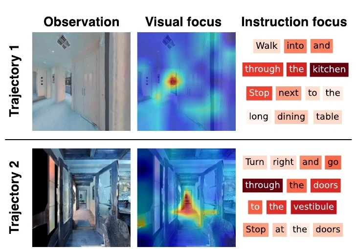
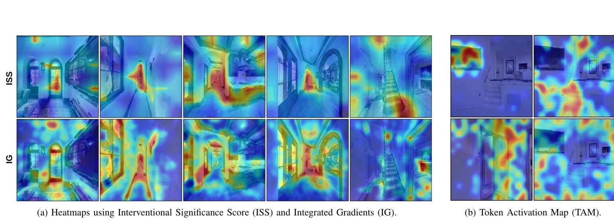
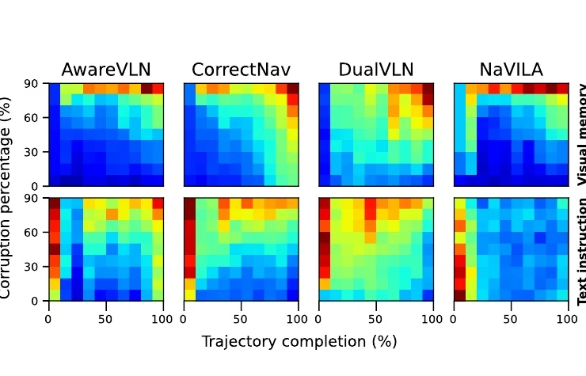
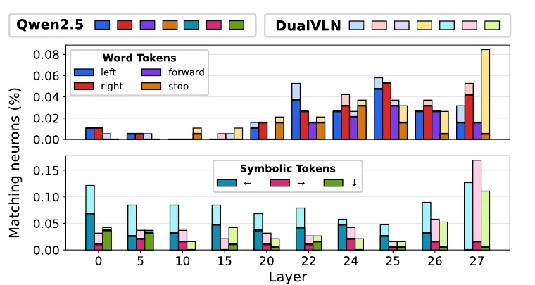
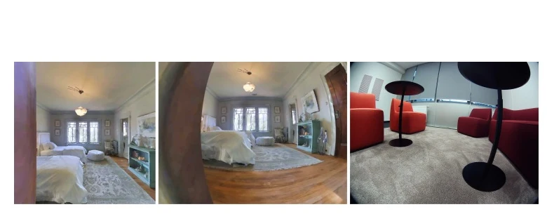

# Interpretare e orientare le policy di Vision-Language Navigation

Il paper [*What do VLM-Based Vision-Language Navigation Models Rely on: Interpreting and Steering Policy Behavior*](https://arxiv.org/abs/2609.24576), di Makowski e colleghi (2026), studia **come quattro policy di navigazione usano visione, linguaggio e memoria** e se le loro rappresentazioni interne possano essere modificate **durante l'inferenza**. 

Il punto di partenza è un limite della valutazione tradizionale: raggiungere la destinazione non dimostra che la policy abbia riconosciuto i landmark pertinenti o seguito correttamente la progressione dell'istruzione.

Il lavoro combina **attribuzione tramite perturbazioni**, analisi delle attivazioni e prove di navigazione closed loop. Ne emerge una distinzione essenziale: la sensibilità della prossima azione a un input, misurata in uno stato fissato, non equivale alla necessità di quell'input per completare l'intera traiettoria. Una policy può cambiare azione e recuperare più tardi; un'altra può mantenere quasi invariata l'azione locale, ma fallire quando la memoria degradata si accumula.

## Policy e protocollo

Gli autori confrontano **CorrectNav, DualVLN, AwareVLN e NaVILA**, quattro sistemi che ricevono un'istruzione e immagini RGB egocentriche, ma differiscono per backbone, formato del prompt, campionamento della storia, ragionamento e produzione delle azioni. CorrectNav produce azioni dal VLM e include riferimenti temporali ai frame storici. DualVLN usa una struttura gerarchica con un action expert a diffusione. AwareVLN può produrre ragionamento esplicito prima di agire. NaVILA è una policy di navigazione progettata anche per robot con gambe. Queste differenze servono a interpretare i risultati, ma impediscono di attribuire ogni scarto osservato a un solo componente architetturale.

Gli esperimenti principali si svolgono su un **sottoinsieme di R2R VLN-CE validation unseen**, quindi su percorsi in ambienti interni simulati con istruzioni linguistiche. Ogni baseline mantiene la propria configurazione nominale di camera e ampiezza degli step; di conseguenza, i valori grezzi di una misura di divergenza tra traiettorie non sono sempre direttamente confrontabili tra policy. Il paper usa pertanto anche sensibilità normalizzate all'interno di ciascun modello.

La policy riceve, al tempo $t$, l'istruzione $l$, l'osservazione corrente $o_t$ e una memoria $M_t$ composta da immagini selezionate tra $o_0,\ldots,o_t$. Se $S_t\subseteq\{0,\ldots,t\}$ indica gli istanti campionati, la memoria è:

$$
M_t = \{o_\tau\mid \tau\in S_t\}
$$

Il prompt multimodale $c_t$ raccoglie i token di $l$ e quelli delle immagini in $M_t$, secondo il formato specifico della policy. La distribuzione delle azioni può essere descritta, in forma astratta, da $\pi_\theta(a_{t:t+h-1}\mid c_t)$, dove $\theta$ sono i parametri e $h$ è l'orizzonte delle azioni generate. Il paper confronta sequenze riconducibili alle primitive discrete **forward, left, right e stop**; la realizzazione concreta delle azioni varia tra i sistemi.

## Attribuzione: quali input cambiano l'azione?

### Interventional Significance Score

L'**Interventional Significance Score (ISS)** assegna importanza a una parte dell'input alterandola e misurando quanto si sposta la traiettoria prevista. Per l'immagine si applica un blur a regioni selezionate; per il testo si eliminano parole o si sostituiscono termini con contrari, secondo l'esperimento. Sia $\tilde c_t^{(k)}$ il contesto ottenuto con l'intervento $k$, e siano $a_{t:t+h-1}$ e $\tilde a_{t:t+h-1}^{(k)}$ le sequenze generate prima e dopo tale intervento. Lo score dell'intervento confronta la distanza tra le posizioni previste e la differenza di orientamento lungo l'orizzonte:

$$
\delta_k = \frac{1}{h}\sum_{j=0}^{h-1}\left[\operatorname{MSE}\!\left(p_{t+j},\tilde p_{t+j}^{(k)}\right)+\lambda\,d_{\mathrm{ang}}\!\left(\phi_{t+j},\tilde\phi_{t+j}^{(k)}\right)\right]
$$

Qui $p_{t+j}$ e $\tilde p_{t+j}^{(k)}$ sono le posizioni ottenute integrando le azioni originali e perturbate, $\phi$ è l'orientamento, $d_{\mathrm{ang}}$ ne misura la differenza angolare con wrapping e $\lambda$ bilancia il contributo di traslazione e rotazione. L'importanza di un token o di una regione è la media di $\delta_k$ sugli interventi che lo coinvolgono. **ISS misura un effetto della perturbazione sulla decisione**, non la correttezza della decisione stessa; inoltre il valore dipende dal modo in cui l'input viene alterato.

*Le regioni rosse e le parole più evidenziate sono quelle la cui perturbazione modifica maggiormente l'azione di CorrectNav; emergono passaggi, porte e sottotask attivi. Fonte: Makowski et al., [paper](https://arxiv.org/abs/2609.24576), figura 1.*

### Gradienti e attivazioni dei token

Gli autori confrontano ISS con **Integrated Gradients (IG)**. IG interpola tra embedding di input corrotti e originali, integra i gradienti della log-probabilità della sequenza di azioni prodotta e attribuisce il cambiamento ai token in ingresso. La sequenza di output viene mantenuta fissa durante il calcolo: la mappa indica quindi quanto l'input supporti quella sequenza, non quali azioni alternative sarebbero generate dopo una perturbazione completa.

La **Token Activation Map (TAM)** proietta invece gli stati nascosti dei token di input verso la testa linguistica e associa l'attivazione ai token di output. È utile per visualizzare concetti con un referente concreto, come una porta o una scala. Risulta meno interpretabile per comandi astratti come *move forward*, che non corrispondono a un singolo oggetto nell'immagine. Per questa ragione gli autori usano TAM soprattutto come analisi qualitativa, non come prova che una regione causi l'azione.

*ISS concentra più spesso la risposta su strutture utili alla navigazione, mentre IG è più diffuso; TAM rende visibili concetti concreti ma è rumoroso per le azioni astratte. Fonte: Makowski et al., [paper](https://arxiv.org/abs/2609.24576), figura 2.*

## Risultati sulle evidenze visive e linguistiche

Per confrontare le mappe visuali, gli autori annotano manualmente le regioni rilevanti in **200 decisioni open loop** e calcolano la precisione tra i pixel con attribuzione più alta. A **P@1**, ISS raggiunge **0.66** per CorrectNav, **0.60** per AwareVLN, **0.55** per DualVLN e **0.48** per NaVILA; IG ottiene rispettivamente **0.52, 0.46, 0.42 e 0.47**. Questo sostiene la migliore localizzazione dei picchi da parte di ISS nel protocollo adottato, ma non implica che tutto il resto dell'immagine sia irrilevante o che una mappa più concentrata produca maggiore successo.

Per l'istruzione, il paper considera **100 decisioni open loop**, elimina gruppi di 1, 3 o 5 parole e confronta i punteggi con annotazioni manuali dei sottotask pertinenti. CorrectNav ottiene la precisione più alta, mentre NaVILA mostra una sensibilità più diffusa. Le annotazioni sono però un riferimento umano: landmark ripetuti o informazioni distribuite in più frasi possono influenzare legittimamente una decisione anche fuori dallo span marcato.

Un'ulteriore prova altera **progressivamente la memoria** lungo traiettorie di riferimento. Le immagini più vecchie vengono sfocate; nel caso del testo, parti crescenti dell'istruzione sono sostituite con contrari, procedendo dall'inizio. CorrectNav e DualVLN mostrano una dipendenza più evidente dalla storia visiva man mano che la traiettoria avanza; AwareVLN e NaVILA presentano profili diversi e in generale meno cumulativi. Il pattern linguistico non è uniforme tra i quattro sistemi: il contesto interno e gli indizi visivi possono compensare istruzioni degradate in modi differenti.

*Ogni colonna segue la progressione del percorso; ogni riga aumenta la quota di memoria visiva o istruzione alterata. Il colore esprime la divergenza normalizzata delle azioni rispetto al contesto intatto, non il successo dell'episodio. Fonte: Makowski et al., [paper](https://arxiv.org/abs/2609.24576), figura 3.*

Per controllare l'effetto sulla navigazione effettiva, gli autori eseguono anche episodi **closed loop** con memoria visiva degradata. Sul sottoinsieme valutato, CorrectNav passa dal **55.97%** di successo senza corruzione al **35.82%** con il 90% della memoria sfocata; AwareVLN passa dal **58.21%** al **15.67%**. Il calo di AwareVLN è maggiore anche se la sua sensibilità locale alla memoria appariva più debole. **La divergenza di una singola azione e la robustezza dell'episodio misurano quindi proprietà differenti**. Inoltre, i valori di successo di questo sottoinsieme non vanno confusi con quelli pubblicati per l'intero benchmark.

## Steering delle rappresentazioni interne

### Concetti semantici conservati dopo il fine-tuning

Il paper esamina i **value vector** dello strato feed-forward del VLM: le colonne della proiezione finale possono essere associate, tramite la testa linguistica, ai token del vocabolario che attivano maggiormente. Confrontando il backbone Qwen2.5-VL con DualVLN, gli autori osservano che token direzionali come *forward*, *left* e *right* restano rappresentati anche dopo il fine-tuning, mentre emergono associazioni con simboli usati per le azioni.

*Il confronto tra Qwen2.5-VL e DualVLN indica la persistenza di concetti direzionali testuali e la comparsa di associazioni con token simbolici negli strati finali. Fonte: Makowski et al., [paper](https://arxiv.org/abs/2609.24576), figura 4.*

Gli autori rendono causale questa osservazione modificando le attivazioni dei neuroni associati a coppie di concetti opposti. Nelle **5 traiettorie** usate per questa prova, favorire *forward* e sfavorire *turn* aumenta i token di moto *forward* del **3.2%** e riduce quelli *left* del **19.3%**; favorire *left* rispetto a *right* aumenta i token *left* del **7.8%**. I risultati mostrano che un concetto linguistico interno può influenzare le azioni anche quando DualVLN usa simboli e un action expert a diffusione. L'esperimento è però piccolo e misura variazioni nella frequenza dei token, non un miglioramento del successo.

### Vettori di attivazione per il ragionamento

Una seconda tecnica costruisce una direzione a partire da stati nascosti associati a due comportamenti. Se $\mathcal{D}^{+}$ contiene esempi di **ragionamento esplicito** e $\mathcal{D}^{-}$ esempi di **azione diretta**, la differenza tra le attivazioni medie nello strato $r$ è:

$$
d_r = \frac{1}{|\mathcal{D}^{+}|}\sum_{i\in\mathcal{D}^{+}}h_r^{(i)}-\frac{1}{|\mathcal{D}^{-}|}\sum_{i\in\mathcal{D}^{-}}h_r^{(i)}
$$

In questa formula $h_r^{(i)}$ è lo stato nascosto dell'esempio $i$ nel punto scelto per la predizione; $r$ è un indice di layer, distinto dall'istruzione $l$. Durante l'inferenza si applica $\tilde h_r=h_r+\alpha d_r$, dove $\alpha$ controlla l'intensità dell'intervento. **I pesi della rete restano invariati**: cambia soltanto l'attivazione prodotta in quel passaggio.

Con AwareVLN, una camera fisheye posta più in basso crea uno **spostamento della distribuzione visiva** rispetto alla camera nominale. In simulazione, la frequenza del ragionamento esplicito scende da **12 ± 2%** a **3 ± 1%**. Su **306 contesti decisionali** con questa alterazione, il vettore medio la porta al **20%, 55%, 90% e 100%** per intensità $\alpha$ rispettivamente di **0.5, 1, 2 e 4**. Un vettore casuale di controllo non produce lo stesso effetto. La frequenza del ragionamento dimostra che l'intervento modifica il comportamento generativo, ma da sola non stabilisce se ogni ragionamento aggiuntivo sia utile alla navigazione.

*Il cambio di camera in simulazione riproduce parte dello spostamento visivo incontrato dal robot reale. Fonte: Makowski et al., [paper](https://arxiv.org/abs/2609.24576), figura 5.*

Il vettore viene poi trasferito **dalla simulazione al robot reale** senza raccogliere ulteriori dati nella nuova modalità visiva. Il protocollo comprende **40 prove, 8 scene e 12 istruzioni**. La policy originale viene eseguita per prima; quando un operatore riconosce una scelta sbagliata senza correzione o un loop, applica il vettore con $\alpha=3$ sul primo token generato. Il paper riporta un successo del **37.2%** per la variante non modificata e del **74.4%** dopo steering, insieme al **59.3%** di recupero dagli stati di fallimento. Il risultato documenta la possibilità di recuperare con un intervento interno, ma **il riconoscimento del fallimento e l'attivazione non sono automatici**.

## Portata dei risultati

Il contributo metodologico più utile è l'uso congiunto di **interventi sugli input, misure closed loop e interventi sulle attivazioni**. Le prime due analisi chiariscono quali informazioni cambiano l'azione e quanto la policy tolleri la loro perdita nel tempo; lo steering verifica se rappresentazioni interne individuate durante l'analisi possano alterare il comportamento senza fine-tuning.

La portata empirica rimane circoscritta ai quattro modelli e ai campioni di R2R VLN-CE considerati, più una valutazione reale con intervento umano. Le mappe di attribuzione dipendono dalle perturbazioni scelte e dalle annotazioni di riferimento. Le prove su value vector hanno pochi episodi, mentre la prova reale non isola un sistema autonomo di rilevazione degli errori. Il paper suggerisce quindi una strada concreta per diagnosticare e correggere alcune policy VLN, lasciando aperta la validazione di **trigger automatici**, la scelta online dell'intensità $\alpha$ e il trasferimento ad altri embodiment e ambienti.
