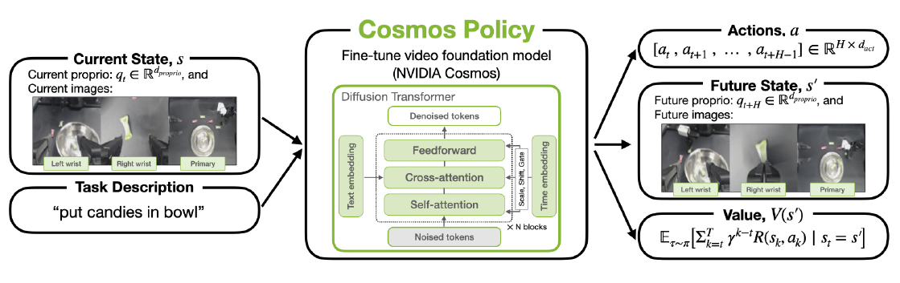
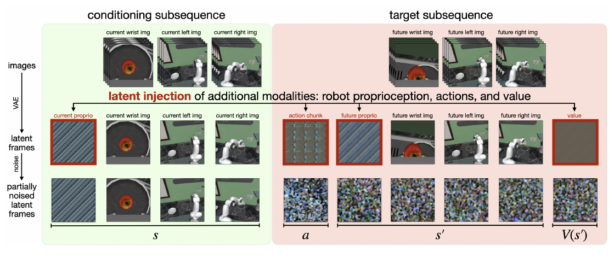
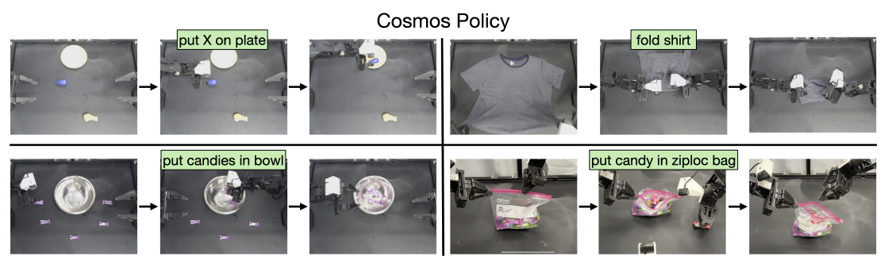
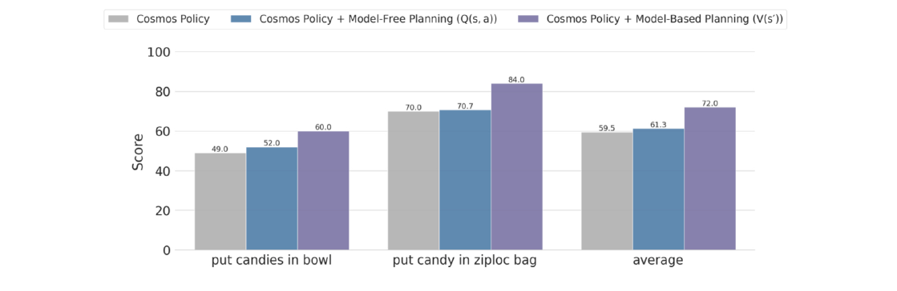

# Cosmos Policy (2026)

Il paper [*Cosmos Policy: Fine-Tuning Video Models for Visuomotor Control and Planning*](https://arxiv.org/pdf/2601.16163v1), di Moo Jin Kim e coautori, adatta un video foundation model al controllo robotico e al **planning mediante futuro e value predetti**. Questo capitolo segue il preprint arXiv v1 del gennaio 2026; gli autori pubblicano [progetto, modelli e dati](https://research.nvidia.com/labs/dir/cosmos-policy/) e [codice](https://github.com/NVlabs/cosmos-policy).

Il backbone è **Cosmos-Predict2-2B**, pre-addestrato per generare video condizionati da immagini e testo. Cosmos Policy non aggiunge un action expert separato: rappresenta direttamente propriocezione, azioni e value nel formato latente già gestito dal modello video.

*Fonte: Kim et al., Cosmos Policy: Fine-Tuning Video Models for Visuomotor Control and Planning, Figura 1. Il video backbone riceve osservazioni correnti e descrizione del task e predice chunk di azioni, osservazioni future e value.*

## Stato osservabile, azioni e return

Indichiamo con $o_t$ l'insieme delle immagini correnti, con $q_t$ lo stato propriocettivo del robot e con $l$ l'istruzione linguistica. Usiamo $s_t=(o_t,q_t)$ per il **surrogato osservabile dello stato**, non per lo stato fisico completo dell'ambiente. Il paper chiama state questa stessa approssimazione.

Un chunk di $K$ comandi è $\mathbf{a}_t=(a_t,\ldots,a_{t+K-1})$ e lo stato futuro predetto è $s_{t+K}$. Il modello genera anche un value, cioè una stima del return atteso dopo il chunk.

Per costruire i target, gli autori usano **Monte Carlo return** osservati nei rollout. Con $T$ istante terminale, $\gamma$ fattore di sconto e $R_T$ reward finale, il target nella formulazione a reward terminale è:

$$
G_t = \gamma^{T-t}R_T
$$

Il target è il risultato effettivamente osservato nella traiettoria, mentre la rete deve apprenderne una predizione condizionata. Per task con completamento parziale $R_T$ può essere frazionario; per task binari indica successo o fallimento.

Chiamare il target $V(s')$ non garantisce che la rete legga soltanto lo stato futuro $s'$. Nel training iniziale il value può essere condizionato sull'intero prefisso, comprendente stato corrente e azione. La distinzione fra **state value** e **state-action value** viene resa esplicita nel successivo training per il planning.

## Latent frame injection

Il video backbone lavora su una sequenza di volumi latenti ottenuti da un VAE. **Latent frame injection** sfrutta questi volumi anche per variabili che non sono immagini, riempiendoli con copie normalizzate di vettori o scalari.

Il chunk viene appiattito in un vettore, normalizzato nell'intervallo $[-1,+1]$, duplicato e rimodellato nelle dimensioni di un frame latente. Lo stesso procedimento viene usato per propriocezione e value. Per estrarre i comandi generati si mediano le copie e si inverte la normalizzazione; queste modalità non richiedono un decoder visuale.

Le immagini delle diverse camere vengono invece codificate tramite il VAE. La sequenza contiene quindi **frame visuali e frame non visuali**, tutti compatibili con il Diffusion Transformer. Il parametro temporale del modello video diventa anche un modo per ordinare modalità diverse, non soltanto fotogrammi consecutivi.

*Fonte: Kim et al., Cosmos Policy: Fine-Tuning Video Models for Visuomotor Control and Planning, Figura 2. Propriocezione, chunk di azioni e value vengono inseriti accanto ai latent delle camere. Il prefisso pulito condiziona il denoising dei target.*

Nel setup illustrativo con tre camere, la sequenza comprende un placeholder iniziale, propriocezione corrente, tre immagini correnti, chunk di azioni, propriocezione futura, tre immagini future e value. Il placeholder e la ripetizione delle immagini gestiscono il particolare schema di compressione temporale del VAE; non rappresentano nuove osservazioni dell'ambiente.

Il modello usa **solo la situazione corrente e un futuro all'estremità del chunk**. Non riceve una lunga storia e non predice necessariamente tutte le immagini intermedie. La lunghezza della sequenza latente non deve quindi essere scambiata per un equivalente orizzonte temporale visuale.

## Policy, World Model e value con lo stesso denoising

Il training cambia quali volumi latenti rimangono puliti come condizioni e quali vengono corrotti e ricostruiti. Questo permette di ottimizzare tre ruoli senza reti separate:

| Ruolo | Variabili condizionanti | Target generati |
| --- | --- | --- |
| Policy | $s_t,l$ | $\mathbf{a}_t,s_{t+K},G_{t+K}$ |
| World Model | $s_t,\mathbf{a}_t,l$ | $s_{t+K},G_{t+K}$ |
| Value nel training iniziale | $s_t,\mathbf{a}_t,s_{t+K},l$ | $G_{t+K}$ |

Le modalità vengono addestrate con **batch bilanciati 50/25/25**. Il 50% degli esempi riguarda la policy, il 25% la dinamica e il 25% il value. La policy usa dimostrazioni riuscite; dinamica e value possono usare anche dimostrazioni che falliscono quando vengono rieseguite.

Nella formulazione diffusion, i target latenti vengono corrotti con rumore gaussiano e il backbone impara a denoisarli dato il prefisso pulito. L'azione non viene ricavata da un video tramite inverse dynamics: è una delle modalità generate direttamente.

La supervisione ausiliaria è rilevante. Nelle ablation RoboCasa, una policy che apprende soltanto le azioni scende al **44.4%**, rispetto al 67.1% della configurazione completa. La differenza mostra il valore degli obiettivi aggiuntivi nel protocollo, senza dimostrare che il futuro sia causalmente corretto in ogni situazione.

Il backbone rimane architetturalmente invariato, ma il training non è identico a quello video originario. Gli autori modificano la distribuzione dei livelli di rumore: con probabilità 0.7 campionano dalla distribuzione log-normal di base e con probabilità 0.3 da una uniforme nell'intervallo $[1,85]$, aumentando il peso dei livelli di rumore elevati utili alla generazione delle azioni.

## Uso come policy diretta

La modalità diretta genera azioni, futuro e value **in parallelo**. Per controllare il robot servono soltanto i comandi; gli altri output possono essere scartati. Non viene effettuata una ricerca tra candidati e non si usa il value per scegliere il chunk.

Questo è il protocollo che produce i risultati principali su LIBERO, RoboCasa e ALOHA. La possibilità di predire il futuro non significa quindi che tutte le prestazioni riportate derivino dal planning: in questi esperimenti il beneficio del World Model passa soprattutto dal training congiunto.

## Apprendere dai rollout per rendere utile il planning

Le dimostrazioni riuscite coprono una distribuzione ristretta. Un modello addestrato soprattutto su successi può prevedere che anche azioni imperfette riusciranno, mentre un value poco esposto ai fallimenti può assegnare punteggi simili a tutti i candidati.

Per il planning, gli autori raccolgono **648 rollout**: 505 provengono dalle valutazioni delle varie policy e 143 sono ulteriori episodi di Cosmos Policy sul task della busta ziploc. Il dataset include esiti di successo, fallimento e completamento parziale.

Il checkpoint viene ulteriormente adattato usando il 90% del batch per World Model e value, diviso equamente, e il 10% per la policy. In deployment si mantengono **due checkpoint**: quello originario propone le azioni e quello adattato sui rollout ne valuta gli esiti. Il post-training iniziale a singolo stadio su dimostrazioni e l'adattamento aggiuntivo per il planning sono quindi passaggi distinti.

Per apprendere $V(s_{t+K})$ si mascherano stato corrente e azione durante la predizione del value. Per apprendere $Q(s_t,\mathbf{a}_t)$ si maschera invece il futuro. La seconda variante può valutare candidati senza generare prima uno stato futuro.

## Planning online best-of-N

Il planner campiona $N$ chunk dalla policy, predice le loro conseguenze con il World Model e seleziona il candidato con value più elevato. In una formulazione semplificata:

$$
\begin{aligned}
\mathbf{a}_t^{(i)} &\sim \pi(\mathbf{a}_t\mid s_t,l)\\
\widehat{s}_{t+K}^{(i)} &\sim p_{\mathrm{WM}}(s_{t+K}\mid s_t,\mathbf{a}_t^{(i)},l)\\
i^* &= \operatorname*{arg\,max}_{i\in\{1,\ldots,N\}}\widehat{V}(\widehat{s}_{t+K}^{(i)},l)
\end{aligned}
$$

$i$ identifica un candidato e $i^*$ quello scelto. $\pi$ è il checkpoint policy, $p_{\mathrm{WM}}$ la distribuzione del checkpoint adattato e $\widehat{V}$ la stima del value. La formula evidenzia il principio, mentre l'implementazione usa più campioni per stabilizzare lo scoring.

Per ogni proposta vengono generati **tre futuri** e, per ogni futuro, **cinque value**, per un totale di 15 stime. Il criterio *majority mean* separa le stime in predizioni di successo e fallimento mediante una soglia, prende il gruppo maggioritario e ne calcola la media. Non è un ensemble di 15 reti indipendenti: sono campioni ripetuti dal modello generativo.

Gli esperimenti usano **$N=8$**, parallelizzando le otto proposte su otto H100. Il robot esegue il chunk completo e ripete il processo dopo una nuova osservazione. È planning online, ma con **un solo livello di ricerca**, non un albero profondo o un MPC che ottimizzi molti chunk e ne esegua soltanto una piccola frazione.

## Dataset e protocolli simulati

**LIBERO** usa un Franka Emika Panda e quattro suite di dieci task: Spatial, Object, Goal e Long. Ogni suite fornisce 500 dimostrazioni, per 2,000 complessive. Le valutazioni comprendono 50 episodi per task e tre seed, pari a 6,000 trial totali. Il successo medio della policy diretta è **98.5%**.

**RoboCasa** comprende 24 task di manipolazione in cucina con Franka Panda. Cosmos Policy usa soltanto 50 dimostrazioni teleoperate per task, pari a **1,200 traiettorie**, senza aggiungere le dimostrazioni MimicGen disponibili nel benchmark.

La valutazione RoboCasa usa oggetti non visti e cinque scene per task, due delle quali presentano stili non incontrati nel training. Cinquanta trial per task e tre seed producono 3,600 trial totali. Il successo medio è **67.1%**; diversi baseline riportati usano più dati, quindi il confronto non mantiene costante per tutti la quantità di supervisione robotica.

## Robot ALOHA e metriche fisiche

ALOHA comprende **due bracci ViperX 300 S**, una camera dall'alto e due camere sui polsi. L'input propriocettivo contiene 14 angoli articolari. I comandi vengono eseguiti a 25 Hz e ogni chunk comprende 50 passi, cioè 2 secondi di movimento.

*Fonte: Kim et al., Cosmos Policy: Fine-Tuning Video Models for Visuomotor Control and Planning, Figura 3. Il setup fisico comprende selezione linguistica di oggetti, piegatura di una maglietta, raccolta di caramelle e inserimento di una caramella in una busta ziploc.*

Le dimostrazioni sono 80 per “put X on plate”, 15 per “fold shirt”, 45 per “put candies in bowl” e 45 per “put candy in ziploc bag”, per un totale di **185**. Gli esperimenti valutano condizioni in-distribution e OOD con 101 trial complessivi per metodo e gli stessi stati iniziali per i confronti.

Lo **score** misura il completamento medio del task, includendo risultati parziali. Cosmos Policy ottiene il 93.6% medio complessivo, contro l'88.6% di $\pi_{0.5}$ nel confronto. La variante OOD isolata raggiunge però l'89.3%, contro il 92.5% di $\pi_{0.5}$: il vantaggio complessivo non si estende a ogni sottoprotocollo.

## Risultati del planning e costo dell'inferenza

*Fonte: Kim et al., Cosmos Policy: Fine-Tuning Video Models for Visuomotor Control and Planning, Figura 7. Il confronto riguarda condizioni iniziali più difficili di due task ALOHA. Il planning model-based usa $V(s')$, mentre la variante model-free valuta direttamente $Q(s,a)$.*

Su questo protocollo lo score medio passa da **59.5 a 72.0**, cioè **12.5 punti**, con il planning model-based. La selezione mediante $Q$ raggiunge 61.3. Questi numeri non vanno confrontati direttamente con il 93.6% della valutazione generale, perché cambiano task e difficoltà delle condizioni iniziali.

La policy diretta produce un chunk in circa **0.61 secondi** con cinque step di denoising su una H100 per LIBERO e RoboCasa. Su ALOHA, con dieci step, richiede circa **0.95 secondi**. Il robot si ferma durante la generazione e poi esegue 2 secondi di azioni; il controllo a 25 Hz all'interno del chunk non equivale a decisioni closed loop a 25 Hz.

Il best-of-8 completo richiede circa **4.9 secondi su otto H100**, prima dell'esecuzione del chunk. Questa latenza limita l'applicabilità a situazioni dinamiche, anche se non impedisce il successo nei task tabletop studiati.

## Novelty

- **Latent frame injection:** adatta un video foundation model a modalità robotiche senza introdurre moduli di azione separati.
- **Obiettivi congiunti mediante condizionamento:** lo stesso denoising apprende policy, dinamica e return.
- **Policy diretta e planning nello stesso framework:** distingue generazione parallela dei comandi da selezione best-of-N con scoring dei futuri.
- **Adattamento sui rollout:** usa errori ed esiti della policy per rendere dinamica e value più informativi fuori dalla distribuzione delle dimostrazioni.
- **Valutazione simulata e fisica:** verifica controllo single-arm e bimanuale, oltre al contributo del planning su task reali.

## Limiti

L'uso di un video prior non garantisce causalità, accuratezza del contatto o affidabilità sotto occlusione. Per il planning è necessario raccogliere rollout aggiuntivi e il paper mostra che il checkpoint iniziale può prevedere erroneamente un grasp riuscito. Non vengono fornite garanzie di calibrazione del value o sicurezza delle azioni selezionate.

L'osservazione è corrente e il futuro è quello al termine di un singolo chunk. Memoria lunga e ricerca a più livelli non sono valutate. L'esecuzione completa del chunk riduce la possibilità di correggere un errore durante il movimento.

Il costo di inferenza cresce molto con la ricerca; anche l'uso come policy diretta prevede pause misurabili. I test fisici comprendono quattro task in un unico setup ALOHA e non dimostrano trasferimento zero-shot fra embodiment.

Rispetto a [Unified World Models](../unified_world_models/README.md), Cosmos Policy dà un ruolo centrale al backbone video pre-addestrato e alla predizione del value. Rispetto a [WorldVLA](../worldvla/README.md), valuta esplicitamente se usare le conseguenze predette per scegliere fra azioni migliori aumenti il completamento dei task.
