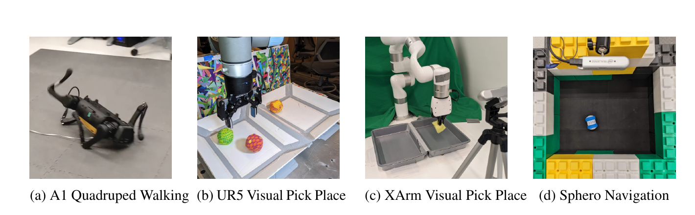
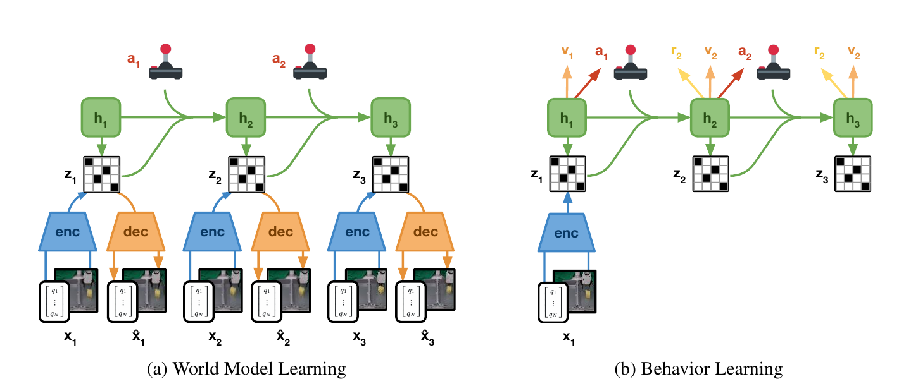
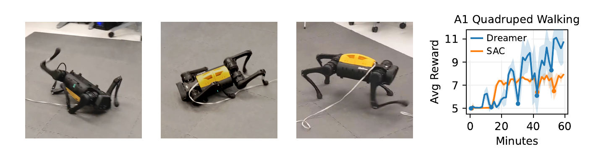
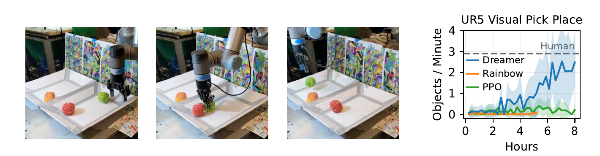
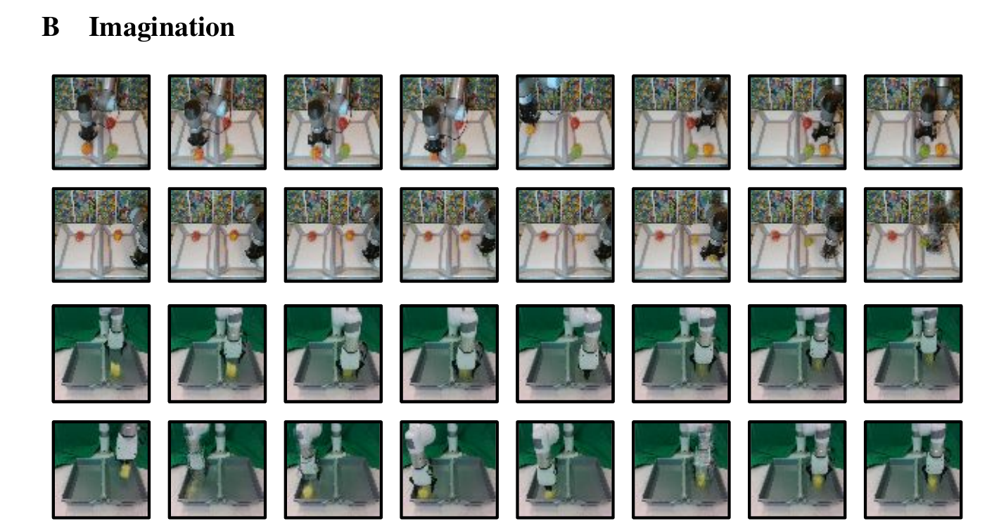

# DayDreamer (2023)

Il paper [*DayDreamer: World Models for Physical Robot Learning*](https://proceedings.mlr.press/v205/wu23c.html), di Philipp Wu e coautori, applica DreamerV2 al reinforcement learning online su robot fisici. Il lavoro è stato presentato a CoRL 2022 e pubblicato nei relativi proceedings nel 2023.

Il nome **DayDreamer** identifica soprattutto un risultato sistemico ed empirico. Gli autori dichiarano esplicitamente di non introdurre un nuovo algoritmo: mostrano invece che un World Model moderno può apprendere da zero direttamente nel mondo reale, senza simulatore e senza dimostrazioni, abbastanza rapidamente da rendere praticabili esperimenti su un solo robot.

*Fonte: Wu et al., DayDreamer: World Models for Physical Robot Learning, Figura 1. Da sinistra sono mostrati il quadrupede Unitree A1, il manipolatore UR5, il manipolatore XArm e lo Sphero Ollie, impiegati rispettivamente per locomozione, due task di pick-and-place e navigazione visuale.*

## Problema e ciclo di apprendimento

DayDreamer affronta un setting di **online reinforcement learning**. All'inizio il replay buffer non contiene dimostrazioni esperte né traiettorie generate in simulazione. Il robot osserva $o_t$, seleziona un'azione $a_t$, riceve il reward $r_t$ e la nuova osservazione $o_{t+1}$, quindi salva la transizione nel replay buffer.

Le sequenze reali hanno due ruoli. Addestrano un modello latente della dinamica e forniscono gli stati iniziali dai quali vengono generati molti rollout immaginati. Actor e critic imparano su queste traiettorie sintetiche; l'actor aggiornato torna poi a raccogliere esperienza fisica, modificando progressivamente la distribuzione dei dati.

Il sistema usa due thread paralleli. L'**actor thread** calcola le azioni e mantiene la frequenza di controllo richiesta dall'hardware. Il **learner thread** campiona continuamente dal replay buffer e aggiorna World Model, actor e critic, senza attendere il successivo passo del robot. Questa separazione evita che il costo del training aumenti la latenza di controllo e, al contrario di un ciclo sincrono, non richiede un iperparametro che stabilisca quanti aggiornamenti eseguire per ogni transizione reale.

Il parallelismo non crea nuove esperienze fisiche: tutte le transizioni nel replay provengono comunque dal singolo robot. Il vantaggio è che ogni sequenza reale può generare un grande batch di futuri latenti, fino a circa 16,000 stati immaginati su una singola GPU nella configurazione descritta dal paper.

Il replay buffer FIFO può contenere fino a 1 milione di transizioni e gli aggiornamenti iniziano dopo i primi 10,000 step. Ogni update usa batch di 32 sequenze lunghe 32 step. Questi valori, come il learning rate di $10^{-4}$, rimangono invariati nei quattro esperimenti.

## World Model basato su RSSM

DayDreamer adotta il **Recurrent State-Space Model (RSSM) discreto** di DreamerV2. Per mantenere distinta la memoria deterministica dalla componente stocastica, indichiamo con $h_t$ lo stato ricorrente, con $z_t$ il codice discreto e con $s_t=(h_t,z_t)$ lo stato latente completo usato per il controllo.

Una formulazione compatta delle componenti è:

$$
\begin{aligned}
h_t &= f_\theta(h_{t-1},z_{t-1},a_{t-1})\\
z_t &\sim q_\theta(z_t\mid h_t,o_t)\\
\hat z_t &\sim p_\theta(z_t\mid h_t)\\
\hat o_t &\sim p_\theta(o_t\mid h_t,z_t)\\
\hat r_t &\sim p_\theta(r_t\mid h_t,z_t)
\end{aligned}
$$

La funzione $f_\theta$ aggiorna la memoria ricorrente usando stato e azione precedenti. Il posterior $q_\theta$ incorpora l'osservazione reale $o_t$ e viene usato durante l'inferenza sul replay; il prior $p_\theta(z_t\mid h_t)$ predice invece il codice senza vedere $o_t$ e consente di proseguire un rollout in imagination. Le altre due distribuzioni ricostruiscono osservazione e reward, indicati con $\hat o_t$ e $\hat r_t$ quando sono predetti.

L'encoder non tratta necessariamente l'osservazione come un singolo vettore omogeneo. Può elaborare immagini RGB o RGB-D insieme a letture propriocettive, fondendole nel medesimo posterior. Nella configurazione condivisa fra gli esperimenti, l'RSSM usa una memoria di dimensione 512 e **32 variabili categoriali con 32 classi ciascuna**.

*Fonte: Wu et al., DayDreamer: World Models for Physical Robot Learning, Figura 3. A sinistra encoder, dinamica ricorrente e decoder vengono addestrati su sequenze reali; a destra actor, reward model e critic valutano rollout prodotti dal prior latente senza decodificare le osservazioni.*

Il decoder fornisce un obiettivo denso anche quando i reward sono rari: per rappresentare correttamente la sequenza, il latent deve conservare informazione sui sensori e sulla scena. Una loss variazionale allinea inoltre posterior e prior mediante divergenza di Kullback–Leibler. In forma schematica, l'obiettivo del modello contiene:

$$
\mathcal{L}_{\mathrm{model}} =
\sum_t
\left[
-\log p_\theta(o_t\mid s_t)
-\log p_\theta(r_t\mid s_t)
+\beta D_{\mathrm{KL}}
\left(
q_\theta(z_t\mid h_t,o_t)
\,\|\,
p_\theta(z_t\mid h_t)
\right)
\right]
$$

Il coefficiente $\beta$ rappresenta il bilanciamento del termine KL; l'implementazione usa il *KL balancing* di DreamerV2. Questa espressione chiarisce il ruolo dei termini, mentre il training effettivo usa le variabili categoriali e gli stimatori di gradiente dell'implementazione DreamerV2.

Ricostruire i sensori serve per apprendere e ispezionare il modello, non per scegliere ogni azione. Durante il behavior learning, transizione, reward, actor e critic operano direttamente su $s_t$. Si evita così il costo di generare immagini in ogni rollout e la policy non dipende dalla qualità fotorealistica del decoder.

## Actor–critic in imagination

DayDreamer non esegue una ricerca online come PlaNet o TD-MPC. Apprende invece un actor $\pi_\phi(a_t\mid s_t)$ che produce una distribuzione sulle azioni e un critic $v_\psi(s_t)$ che stima il return futuro. Partendo da stati inferiti da sequenze reali, l'actor propone azioni e il prior dell'RSSM genera gli stati successivi; il reward model assegna i reward immaginati.

Il critic viene addestrato mediante **$\lambda$-return**, che combina bootstrap a profondità differenti. Se $H$ è l'orizzonte immaginato, $\gamma$ il discount factor e $\lambda$ il parametro di interpolazione, il target ricorsivo è:

$$
V_t^\lambda =
\hat r_t+
\gamma\left[
(1-\lambda)v_\psi(s_{t+1})+
\lambda V_{t+1}^\lambda
\right]
$$

La ricorsione termina con:

$$
V_H^\lambda = v_\psi(s_H)
$$

Il bootstrap del critic permette di considerare conseguenze oltre il breve rollout esplicito. La tabella degli iperparametri riporta $H=15$, $\gamma=0.95$ e $\lambda=0.95$; il testo del paper descrive la traiettoria risultante come composta da 16 stati, includendo lo stato iniziale.

L'actor massimizza i $\lambda$-return e mantiene un bonus di entropia per sostenere l'esplorazione. Nei task continui il gradiente viene propagato attraverso le azioni riparametrizzate e la dinamica differenziabile. Nei task discreti viene usato uno stimatore REINFORCE. I gradienti di actor e critic non aggiornano il World Model: questo *stop gradient* impedisce alla policy di migliorare apparentemente il return deformando le predizioni del modello in senso ottimistico.

In fase di esecuzione non occorre generare l'intero rollout. L'osservazione aggiorna il posterior, poi una singola valutazione dell'actor produce l'azione. **L'imagination riduce quindi il costo della raccolta dati durante il training senza imporre il costo di un planner iterativo durante il controllo**.

## Embodiment e protocolli sperimentali

I quattro esperimenti condividono algoritmo e iperparametri, ma non uno stesso agente: per ciascun task World Model, actor e critic vengono addestrati separatamente. Le configurazioni coprono azioni continue e discrete, reward densi e sparsi e combinazioni diverse di sensori.

| Sistema | Osservazioni | Azioni e frequenza | Reward | Tempo e risultato riportato |
| --- | --- | --- | --- | --- |
| Unitree A1 | Angoli dei motori, orientamento e velocità angolari | Target articolari continui, 20 Hz | Denso e sagomato | Cammina in circa 1 ora; si adatta alle spinte in altri 10 minuti |
| UR5 | RGB in terza persona e propriocezione | Incrementi cartesiani e gripper discreti, 2 Hz | Sparso | 2.5 oggetti al minuto dopo 8 ore |
| XArm 7-DoF | RGB, profondità e propriocezione | Azioni discrete, circa 0.5 Hz | Sparso | 3.1 oggetti al minuto dopo 10 ore |
| Sphero Ollie | RGB dall'alto, senza propriocezione | Comandi di coppia continui, 2 Hz | Denso | Distanza media dal goal 0.15 entro 2 ore |

### Locomozione con Unitree A1

L'A1 possiede 12 motori direct-drive. L'actor invia target angolari continui, realizzati sull'hardware da un controller PD a 20 Hz. Le osservazioni sono interamente propriocettive; non vengono usate immagini. Il reward sagomato combina assetto verticale, vicinanza a una posa eretta e velocità in avanti, attivando progressivamente i termini quando i requisiti precedenti sono soddisfatti.

Il robot comincia ogni training sdraiato sulla schiena con le zampe in aria. Impara a girarsi nei primi 5 minuti, a stare in piedi circa 20 minuti più tardi e, entro un'ora, ad avanzare con un'andatura *pronking*. SAC impara a girarsi ma non raggiunge stabilmente stazione eretta e cammino nello stesso budget di dati.

*Fonte: Wu et al., DayDreamer: World Models for Physical Robot Learning, Figura 4. La sequenza mostra recovery, stazione eretta e cammino; la curva confronta il reward di Dreamer con SAC durante una singola run di un'ora.*

Il claim *without resets* significa che non viene addestrata una reset policy e che le cadute fanno parte dell'esperienza: il robot deve imparare autonomamente a rialzarsi. Non significa però autonomia fisica completa. Un filtro Butterworth attenua i comandi ad alta frequenza per proteggere i motori e un operatore riporta il robot nell'area disponibile quando ne raggiunge il bordo, senza cambiarne posa o configurazione articolare.

Dopo l'ora iniziale, gli sperimentatori spingono ripetutamente il quadrupede con un palo. In circa 10 minuti di ulteriore apprendimento online, l'agente impara a resistere alle spinte leggere e a girarsi e rialzarsi dopo quelle più forti. È adattamento mediante nuovi aggiornamenti, non robustezza zero-shot.

### Pick-and-place multi-oggetto con UR5

L'UR5 deve spostare tre palline fra due contenitori. L'osservazione combina un'immagine RGB in terza persona con angoli articolari, apertura del gripper e posizione cartesiana dell'end-effector. A 2 Hz, l'actor sceglie azioni discrete che incrementano la posizione lungo gli assi $X$, $Y$ e $Z$ oppure commutano lo stato del gripper.

Il reward vale $+1$ quando il robot afferra un oggetto, $-1$ se lo rilascia nello stesso contenitore e $+10$ se lo deposita in quello opposto. La struttura è sparsa rispetto alla durata della manipolazione e crea un optimum locale: afferrare e rilasciare subito produce reward senza completare il trasporto.

*Fonte: Wu et al., DayDreamer: World Models for Physical Robot Learning, Figura 5. Le immagini mostrano un ciclo di presa e trasferimento; la curva confronta Dreamer, Rainbow e PPO con una baseline umana.*

Dopo circa 2 ore la prestazione inizia a crescere; entro 8 ore Dreamer raggiunge 2.5 oggetti al minuto, vicino ai tre operatori umani valutati con joystick. Rainbow e PPO rimangono prevalentemente nell'optimum locale di presa e rilascio nello stesso contenitore. Il task è però semplificato da regole specifiche: il movimento verticale è abilitato soltanto quando il gripper contiene un oggetto e questo si apre automaticamente sopra il contenitore corretto.

### Pick-and-place RGB-D con XArm

L'XArm è un manipolatore economico a 7 gradi di libertà controllato a circa 0.5 Hz. Il setup aggiunge profondità RGB-D alla propriocezione e mantiene action space discreto e reward sparso analoghi a quelli dell'UR5. Un solo oggetto morbido deve essere trasferito avanti e indietro fra due contenitori.

Poiché i contenitori non sono inclinati, l'oggetto è collegato al gripper con un filo: la modifica riduce il rischio che rimanga bloccato negli angoli, ma introduce una dinamica deformabile difficile da simulare. Dreamer raggiunge 3.1 trasferimenti al minuto in 10 ore, un valore comparabile alla baseline umana, mentre Rainbow non risolve il task. In alcuni episodi l'actor sfrutta il filo per trascinare l'oggetto fuori da un angolo prima di afferrarlo.

Il setup si trova vicino a grandi finestre e viene inizialmente addestrato di notte. All'alba, ombre e riflessi causano un crollo della prestazione; continuando il training online, il robot recupera e supera il livello precedente in circa 5 ore. Il risultato mostra capacità di riadattamento, ma anche la sensibilità iniziale a un cambiamento visuale comune.

### Navigazione visuale con Sphero Ollie

Lo Sphero riceve soltanto immagini RGB dall'alto. La forma cilindrica rende ambiguo l'orientamento in un singolo frame, perciò la memoria ricorrente deve inferire la direzione del moto dalla storia. L'actor produce due comandi continui di coppia a 2 Hz per un sistema sottoattuato che deve accumulare momento.

Il reward è l'opposto della distanza euclidea dal goal fisso. Ogni episodio termina dopo 100 step; una sequenza di comandi casuali ad alta potenza cambia quindi la posizione iniziale del robot. Entro 2 ore Dreamer raggiunge una distanza media dal goal pari a 0.15 rispetto alla dimensione dell'area e rimane vicino al bersaglio. DrQ-v2 ottiene però un risultato simile, perciò questo esperimento dimostra applicabilità del World Model, non un vantaggio netto sul miglior baseline model-free scelto dagli autori.

## Cosa viene immaginato

Sebbene la policy non richieda immagini decodificate, il decoder consente di visualizzare un rollout latente. Le sequenze permettono di controllare qualitativamente se l'actor stia immaginando il gripper in avvicinamento e l'oggetto in movimento, rendendo il modello più ispezionabile di una dinamica completamente decoder-free.

*Fonte: Wu et al., DayDreamer: World Models for Physical Robot Learning, Figura B.1. Le prime due righe visualizzano rollout dell'UR5 e le ultime due rollout dell'XArm; ogni riga è una traiettoria immaginata della quale viene mostrato un frame ogni due step.*

Le ricostruzioni non sono perfettamente coerenti. Nel secondo rollout dell'UR5 una pallina arancione immobile diventa verde, segnalando che la dinamica non conserva sempre identità e aspetto degli oggetti. Il successo della policy indica che un errore di pixel non è necessariamente dannoso quando il latent mantiene le informazioni sufficienti al reward; lo stesso esempio mostra però perché queste predizioni non debbano essere interpretate come simulazioni fisiche fedeli.

## Relazione con PlaNet e TD-MPC

PlaNet, DayDreamer e TD-MPC apprendono tutti dinamiche latenti, ma usano il modello in momenti diversi. **PlaNet pianifica online** con CEM e non possiede actor o critic. **DayDreamer addestra actor e critic in imagination** e durante l'esecuzione usa direttamente la policy. **TD-MPC pianifica online** con MPPI, ma accelera la ricerca mediante una policy prior e completa i reward a breve termine con un $Q$-value terminale.

Anche la rappresentazione differisce. PlaNet e DayDreamer usano un RSSM stocastico e un decoder di osservazioni; DayDreamer eredita da DreamerV2 latent discreti e behavior learning. TD-MPC apprende invece una dinamica deterministica decoder-free orientata a reward e value. DayDreamer rende quindi più facile ispezionare ciò che il modello genera, ma dedica capacità anche a dettagli sensoriali che potrebbero essere irrilevanti per il controllo.

## Novelty

- **Dreamer su hardware reale:** dimostra reinforcement learning online da zero su quattro robot, senza simulatore o dimostrazioni e senza modificare l'algoritmo di base tra i task.
- **Actor e learner asincroni:** separa la latenza del controllo dalla velocità degli aggiornamenti e sfrutta continuamente il tempo fisico fra due osservazioni.
- **Ampiezza sperimentale:** lo stesso insieme di iperparametri copre locomozione, manipolazione e navigazione, azioni continue e discrete, reward densi e sparsi e input propriocettivi, RGB e depth.
- **Apprendimento fisico rapido:** ottiene recovery, stazione eretta e cammino dell'A1 in circa un'ora e pick-and-place visuale in 8–10 ore su un singolo manipolatore.
- **Adattamento continuato:** mostra che nuovi dati reali possono aggiornare comportamento e modello dopo spinte sull'A1 o un forte cambiamento di illuminazione sull'XArm.
- **Infrastruttura pubblica:** rilascia il sistema software multi-modale e multi-action-space usato negli esperimenti, offrendo una base riproducibile per successivi World Model robotici.

## Limiti

Il vincolo principale rimane l'interazione fisica. Ore di esplorazione provocano usura, possono richiedere riparazioni e mantengono necessario il monitoraggio umano. Gli autori indicano esplicitamente questo problema e non valutano training molto più lunghi, task più complessi o uso continuativo su larga scala.

Il sistema non include vincoli formali di sicurezza né stima epistemica dell'incertezza. Filtrare i comandi dell'A1 riduce alcuni rischi, ma non impedisce al modello o all'actor di scegliere azioni fuori distribuzione. Lo stop gradient evita una forma diretta di manipolazione ottimistica del modello, senza eliminare errori accumulati nei rollout o policy che ne sfruttano le imperfezioni.

I task sono fortemente strutturati. Il reward dell'A1 incorpora conoscenza sulla posa e sulla velocità desiderate; l'UR5 limita il movimento verticale e apre automaticamente il gripper; l'oggetto dello XArm è assicurato con un filo; lo Sphero ha goal e camera fissi e viene riposizionato attraverso una procedura dedicata. Queste scelte sono legittime per isolare l'apprendimento, ma riducono la distanza fra il risultato e una manipolazione o navigazione aperta e autonoma.

Le evidenze statistiche sono limitate dal costo dell'hardware. La curva principale dell'A1 deriva da una singola run e le baseline non ricevono necessariamente budget sufficienti per raggiungere la propria prestazione asintotica. Sullo Sphero, DrQ-v2 e Dreamer sono sostanzialmente comparabili. Il lavoro supporta quindi il claim di fattibilità e data efficiency, non una superiorità universale rispetto al model-free reinforcement learning.

Infine, non esiste un World Model condiviso fra i quattro robot: ciascun agente viene addestrato per un task e un embodiment specifici. Non vengono studiati trasferimento, riuso della conoscenza, istruzioni linguistiche, nuovi goal senza fine-tuning o generalizzazione a scene non controllate. Il decoder rende visibili alcuni errori, ma la trasformazione di colore osservata nei rollout dell'UR5 mostra che identità e dinamica multi-oggetto possono ancora essere modellate in modo incoerente.
