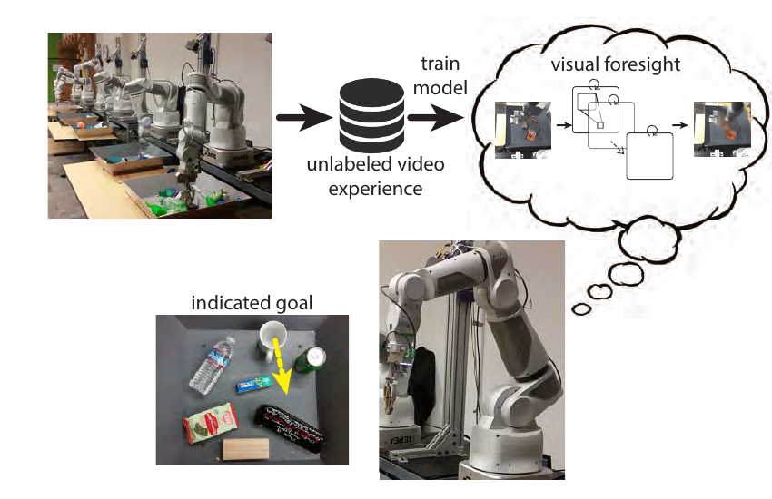

# Deep Visual Foresight (2017)

Il paper [*Deep Visual Foresight for Planning Robot Motion*](https://arxiv.org/abs/1610.00696), di Chelsea Finn e Sergey Levine, presenta un primo esempio di **visual Model Predictive Control** su robot reale. L'obiettivo non è imparare una policy per un singolo task, ma un modello predittivo riutilizzabile che anticipi gli effetti visuali delle azioni.

## Idea centrale

Il sistema viene addestrato su 50,000 episodi di pushing raccolti autonomamente con dieci bracci a 7 gradi di libertà. Durante la raccolta, ogni robot muove casualmente il proprio end-effector in un contenitore con 10–20 oggetti. Registra immagini RGB, posa del gripper e comandi; il dataset non contiene segmentazioni, pose degli oggetti, flow annotato o reward.

*Fonte: Finn e Levine, Deep Visual Foresight for Planning Robot Motion, Figura 1. L'esperienza visuale non etichettata addestra un modello action-conditioned; al test, un goal indicato nell'immagine viene realizzato pianificando attraverso i futuri visuali previsti.*

Una convolutional LSTM riceve due frame, le pose recenti dell'end-effector e una sequenza candidata di azioni. Invece di generare ogni immagine da zero, predice **trasformazioni locali dei pixel**: più kernel di moto vengono combinati mediante maschere apprese. Flow e maschere emergono dalla sola loss di ricostruzione video e permettono di propagare nel futuro una distribuzione sulla posizione del pixel selezionato.

## Dal goal visuale all'azione

L'utente specifica un pixel sorgente $d_t$ nell'osservazione $o_t$ e una posizione target $g$. Per una sequenza candidata $a_{t:t+H-1}$, il modello stima la probabilità che il pixel raggiunga $g$ dopo $H$ step. Indicando con $u_{t+H}$ la posizione futura del pixel, il planner sceglie quindi:

$$
a_{t:t+H-1}^* =
\arg\max_{a_{t:t+H-1}}
p(u_{t+H}=g\mid o_{t-1:t},a_{t:t+H-1},d_t)
$$

Il **Cross-Entropy Method** campiona sequenze, conserva quelle con probabilità maggiore e aggiorna la distribuzione delle azioni. L'orizzonte è $H=3$, circa 800 ms. Viene eseguita soltanto la prima azione, il pixel viene rintracciato nella nuova immagine mediante optical flow e il piano viene ricalcolato circa ogni 200 ms.

Il protocollo usa immagini $64\times64$ e oggetti non presenti nei dati di training. Su dieci task di pushing, la distanza finale media dal target è $2.52\pm1.06$ pixel, contro $3.19\pm1.68$ del migliore baseline basato su visual servoing e replanning. Gli esperimenti qualitativi mostrano anche rotazioni ottenute assegnando target opposti a due estremità dello stesso oggetto.

## Novelty

- Collega un **video predictor action-conditioned** a MPC per controllare un manipolatore reale da immagini.
- Sostituisce pose e modelli fisici con goal definiti come movimento di uno o più pixel.
- Apprende implicitamente flow e maschere degli oggetti da dati autonomi privi di annotazioni.
- Usa replanning closed loop per correggere continuamente gli errori della predizione open loop.

## Limiti

La dimostrazione è circoscritta a pushing rapido e non prensile. L'orizzonte molto breve evita gran parte dell'accumulo dell'errore, ma impedisce piani articolati; mantenere costante il comando nei tre step riduce ulteriormente lo spazio di ricerca.

Il goal richiede click manuali e l'esecuzione dipende da un optical-flow solver esterno. Quando il braccio occlude l'oggetto, il tracker può spostare il pixel sull'end-effector e il planner finisce per muovere il robot, non l'oggetto, verso il target. Errori del video model possono inoltre confondere rotazione e traslazione. Il lavoro va quindi letto come prova di fattibilità storica del **predict-then-act visuale**, non come soluzione generale per la manipolazione.
