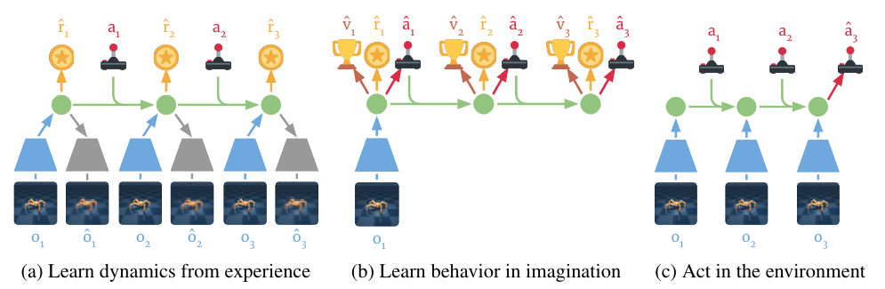
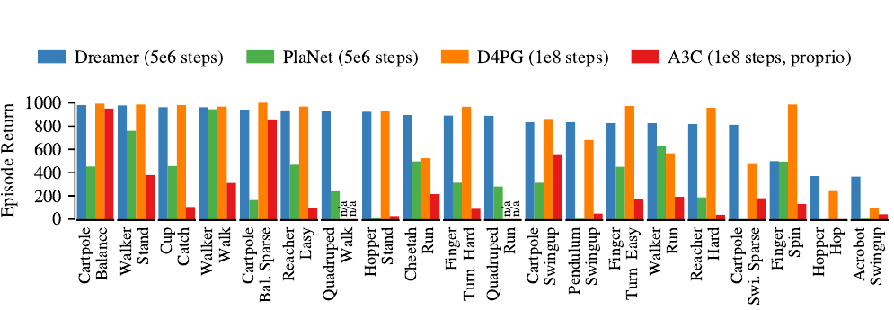

# Dreamer (2020)

Il paper [*Dream to Control: Learning Behaviors by Latent Imagination*](https://arxiv.org/pdf/1912.01603), di Danijar Hafner e coautori, introduce **Dreamer**, pubblicato a ICLR 2020 dopo il preprint del 2019. Il problema centrale è apprendere comportamenti con conseguenze lontane nel tempo usando un modello che può essere simulato affidabilmente soltanto per un orizzonte limitato.

Il punto di partenza è [PlaNet](../planet/README.md): un Recurrent State-Space Model comprime la storia di immagini e azioni in uno stato latente e permette di prevedere reward senza generare immagini. Dreamer modifica soprattutto **come il modello viene usato per apprendere il comportamento**. Invece di cercare online sequenze di azioni, addestra una policy e una funzione di valore su traiettorie immaginate.

## Dal planning online al behavior learning

Un planner a orizzonte finito valuta le conseguenze delle azioni soltanto entro la finestra simulata. Aumentare tale finestra richiede più calcolo e amplifica gli errori del modello. Un comportamento che prepara un successo lontano può quindi essere scartato perché non produce reward immediato.

Dreamer aggiunge un **critic**, una rete che stima il reward cumulativo futuro, e un **actor**, la policy che sceglie azioni. Il critic fornisce una stima oltre la finestra immaginata; l'actor incorpora nelle proprie reti il risultato dell'ottimizzazione. Il costo della ricerca viene così spostato dal momento della decisione al training.

*Fonte: Hafner et al., Dream to Control: Learning Behaviors by Latent Imagination, Figura 3. Il modello apprende da osservazioni reali; actor e critic apprendono su traiettorie latenti; durante l'interazione l'actor usa il latent aggiornato con la nuova osservazione.*

Le traiettorie immaginate partono da stati inferiti su sequenze reali del replay buffer. Il modello viene poi eseguito senza immagini intermedie, seguendo le azioni dell'actor. Questo permette di simulare molti futuri in parallelo mantenendo un costo molto inferiore a quello della generazione video.

## Osservazioni, dati ed embodiment

La valutazione principale comprende **20 task della DeepMind Control Suite**, con controllo continuo e osservazioni RGB da $64\times64$ pixel. Gli ambienti includono pendoli e cartpole, locomozione di walker, cheetah, hopper e quadrupedi, nonché task come Reacher e Cup Catch. Si tratta di embodiment simulati; lo stato interno del simulatore non viene fornito alla policy visuale.

I dati non costituiscono un dataset statico di dimostrazioni. Il replay buffer, indicato con $\mathcal{D}$, viene inizializzato con **cinque episodi di azioni casuali** e ampliato attraverso l'interazione dell'agente. Il protocollo alterna 100 aggiornamenti delle reti alla raccolta di un episodio, usando rumore esplorativo sulle azioni.

L'action repeat, cioè il numero di frame per cui viene mantenuta la stessa azione, è fissato a 2 nel confronto principale di controllo continuo. Per interpretare la sample efficiency occorre distinguere i frame dell'ambiente dalle decisioni della policy e tenere conto di questo fattore.

L'appendice include anche task con azioni discrete ed early termination, fra cui Atari e DeepMind Lab. Questi esperimenti mostrano l'estendibilità del metodo, ma **non corrispondono al protocollo Atari completo di DreamerV2**.

## Stato latente e RSSM gaussiano

Indichiamo con $o_t$ l'osservazione al tempo $t$, con $a_t$ l'azione eseguita e con $r_t$ il reward associato alla decisione. Per mantenere la notazione del capitolo su PlaNet, $s_t$ indica la **componente stocastica dello stato latente**, mentre $h_t$ è la memoria deterministica. Definiamo $u_t=(h_t,s_t)$ come lo stato completo usato da actor e critic.

Le componenti principali del modello sono:

$$
\begin{aligned}
h_t &= f_\theta(h_{t-1},s_{t-1},a_{t-1})\\
s_t &\sim q_\theta(s_t\mid h_t,o_t)\\
\widehat{s}_t &\sim p_\theta(s_t\mid h_t)\\
\widehat{o}_t &\sim p_\theta(o_t\mid h_t,s_t)\\
\widehat{r}_t &\sim p_\theta(r_t\mid h_t,s_t)
\end{aligned}
$$

Qui $\theta$ raccoglie i parametri del World Model e $f_\theta$ è la funzione ricorrente implementata con una GRU. Il posterior $q_\theta$ incorpora l'immagine corrente; il prior $p_\theta$ predice invece la componente stocastica senza consultare quell'immagine. Il simbolo $q(\cdot)$ indica dunque una **distribuzione variazionale**, non lo stato di un robot.

Prior e posterior sono gaussiane diagonali su un vettore di dimensione 30. La memoria $h_t$ conserva il contesto, mentre $s_t$ permette di campionare esiti diversi. Nei task con terminazione anticipata si aggiunge una predizione del discount, per ridurre il peso dei passi che potrebbero non essere raggiunti.

Durante l'esecuzione, l'agente usa il posterior per aggiornare $u_t$ dopo ogni osservazione. Durante l'imagination usa soltanto il prior e le azioni dell'actor. Il decoder delle immagini serve come **segnale di apprendimento**, ma non viene eseguito per ottimizzare o applicare la policy.

## Apprendimento del World Model

La configurazione principale apprende il latent tramite ricostruzione delle immagini, predizione del reward e regolarizzazione variazionale. Una forma della loss, omettendo l'eventuale predizione del discount, è:

$$
\mathcal{L}_{\mathrm{model}} =
\mathbb{E}_{\mathcal{D},q_\theta}\left[
\sum_t\left(
-\log p_\theta(o_t\mid u_t)
-\log p_\theta(r_t\mid u_t)
+\beta\max\left\{\kappa,D_{\mathrm{KL}}\left(q_\theta(s_t\mid h_t,o_t)\,\|\,p_\theta(s_t\mid h_t)\right)\right\}
\right)\right]
$$

L'aspettativa è calcolata sulle sequenze campionate da $\mathcal{D}$ e sui campioni del posterior. $D_{\mathrm{KL}}$ è la divergenza di Kullback–Leibler; $\beta$ ne pesa il contributo e $\kappa$ è la soglia di **free nats**. Nel controllo continuo vengono usati $\beta=1$ e $\kappa=3$.

La KL insegna al prior a prevedere gli stati informati dalle osservazioni e limita quanto il posterior possa incorporare informazione nuova. Sotto la soglia, il termine resta costante: il modello non viene spinto a eliminare ulteriore informazione dal latent soltanto per ridurre una KL già piccola.

Gli aggiornamenti impiegano batch di 50 sequenze lunghe 50 passi. Il paper confronta anche rappresentazioni apprese attraverso sola predizione del reward o obiettivi contrastivi. **La ricostruzione dei pixel risulta il segnale più efficace nel protocollo studiato**: fornisce informazione anche quando il reward è raro e non identifica ancora le proprietà utili al task.

Questa scelta non equivale a supervisionare il modello con lo stato fisico. Un latent può ricostruire bene una scena e rappresentare male una proprietà dinamica, come una velocità o un contatto, necessaria per il controllo.

## Actor, critic e return oltre l'orizzonte

L'actor $\pi_\phi(a_t\mid u_t)$, con parametri $\phi$, produce una distribuzione sulle azioni. Il critic $v_\psi(u_t)$, con parametri $\psi$, approssima il return scontato ottenibile seguendo quell'actor. $\gamma\in[0,1]$ è il fattore di sconto.

Per esplicitare il bootstrap, consideriamo un rollout immaginato lungo $H$ transizioni, numerato da $k=0$ a $k=H$. $\widehat{r}_k$ è il reward predetto dopo l'azione $a_k$, e $u_k$ lo stato latente immaginato. Una forma ricorsiva del **$\lambda$-return** è:

$$
\begin{aligned}
G_H^\lambda &= v_\psi(u_H)\\
G_k^\lambda &= \widehat{r}_k+\gamma\left[(1-\lambda)v_\psi(u_{k+1})+\lambda G_{k+1}^\lambda\right],\qquad 0\leq k<H
\end{aligned}
$$

Il parametro $\lambda\in[0,1]$ bilancia bootstrap a breve distanza e accumulo dei reward lungo il rollout. Nel protocollo principale $H=15$, $\gamma=0.99$ e $\lambda=0.95$. Anche con un rollout corto, il termine terminale $v_\psi(u_H)$ fornisce una stima delle conseguenze successive.

Il critic minimizza l'errore quadratico rispetto a questi target, trattandoli come costanti durante il proprio aggiornamento. L'actor massimizza invece i $\lambda$-return dei passi immaginati. Nei task con terminazione, discount predetti e pesi di sopravvivenza sostituiscono il semplice sconto costante.

## Gradienti attraverso l'imagination

Il contributo caratteristico di Dreamer è usare la **differenziabilità del World Model** per aggiornare l'actor. Nel controllo continuo, un'azione può essere campionata mediante riparametrizzazione:

$$
a_k = \tanh\left(\mu_\phi(u_k)+\sigma_\phi(u_k)\odot\epsilon_k\right),\qquad
\epsilon_k\sim\mathcal{N}(0,I)
$$

$\mu_\phi$ e $\sigma_\phi$ sono media e deviazione standard prodotte dall'actor, $\epsilon_k$ è rumore gaussiano standard, $I$ è la matrice identità e $\odot$ indica il prodotto elemento per elemento. La trasformazione $\tanh$ mantiene l'azione entro l'intervallo ammesso.

Una volta campionato il rumore, l'azione è una funzione differenziabile dei parametri della policy. Anche i latent gaussiani vengono riparametrizzati. Il gradiente del return può quindi attraversare **azione, transizione, reward e value**, assegnando credito alle decisioni iniziali che modificano risultati successivi.

Durante questo aggiornamento i parametri del World Model sono congelati. Ciò non interrompe il gradiente rispetto ai suoi input: la rete continua a trasmettere all'actor come una variazione dell'azione cambierebbe il futuro predetto. Il modello viene aggiornato separatamente usando dati reali, così l'ottimizzazione della policy non può semplicemente alterarlo per far apparire migliori le proprie azioni.

## Risultati e significato del confronto

*Fonte: Hafner et al., Dream to Control: Learning Behaviors by Latent Imagination, Figura 6. Return sui 20 task di controllo visuale: Dreamer e PlaNet usano 5 milioni di step, mentre D4PG e A3C sono riportati dopo 100 milioni. A3C riceve input propriocettivi.*

Il return medio di Dreamer è **823.39**, contro **332.97** di PlaNet e **786.32** di D4PG. Il confronto dimostra che imparare una policy con bootstrap può superare il planning latente a orizzonte finito, conservando un vantaggio nell'interazione richiesta rispetto al baseline model-free.

Le ablation sull'orizzonte mostrano che actor senza value e planning PlaNet diventano più miopi quando la finestra si riduce. La presenza del critic aiuta soprattutto nei task che richiedono preparazione e assegnazione del credito nel tempo, come Acrobot Swingup e Hopper Hop.

Il rapporto tra budget di interazione non deve però essere interpretato come rapporto tra costi totali. Dreamer impiega anche aggiornamenti del modello e rollout sintetici. Inoltre la media sui task non descrive uniformemente ogni ambiente, e i baseline non condividono tutti lo stesso tipo di osservazione.

## Novelty

- **Behavior learning in imagination:** actor e critic vengono appresi da traiettorie latenti, senza ricerca online delle azioni.
- **Gradienti del return attraverso il modello:** la policy sfrutta transizioni differenziabili multi-step, oltre alle predizioni immediate del critic.
- **Value bootstrap oltre il rollout:** i $\lambda$-return permettono di ottimizzare conseguenze oltre l'orizzonte simulato.
- **Controllo visuale efficiente:** il decoder fornisce supervisione al training senza essere necessario nel ciclo decisionale.

## Limiti

L'actor viene ottimizzato rispetto al **modello appreso**, non rispetto alla dinamica vera. Predizioni inesatte di transizione, reward o value possono quindi generare gradienti fuorvianti. L'interazione successiva può correggere gli errori, ma non esiste una garanzia che la policy eviti regioni poco coperte dai dati.

La stocasticità del latent non costituisce una misura esplicita dell'**incertezza epistemica**. Rappresentare futuri diversi non dice automaticamente quanto il modello sia affidabile in una regione inesplorata. La ricostruzione visuale può inoltre spendere capacità su dettagli che non aiutano il task.

Gli esperimenti principali usano simulatori e training separato per ogni task. Il lavoro non dimostra un controller generalista, trasferimento zero-shot, uso del linguaggio o robustezza su robot fisici. Queste proprietà richiedono protocolli dedicati.

Il passaggio a [DreamerV2](../dreamerv2/README.md) affronta soprattutto rappresentazioni e ottimizzazione su ambienti visuali discreti più complessi; [DayDreamer](../daydreamer/README.md) studia invece il trasferimento della famiglia al reinforcement learning online sui robot reali.
