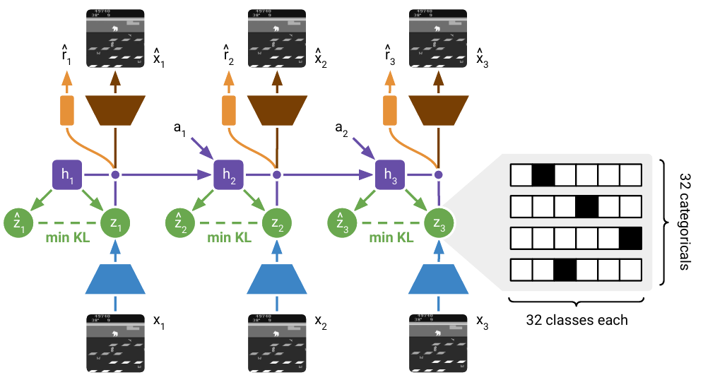
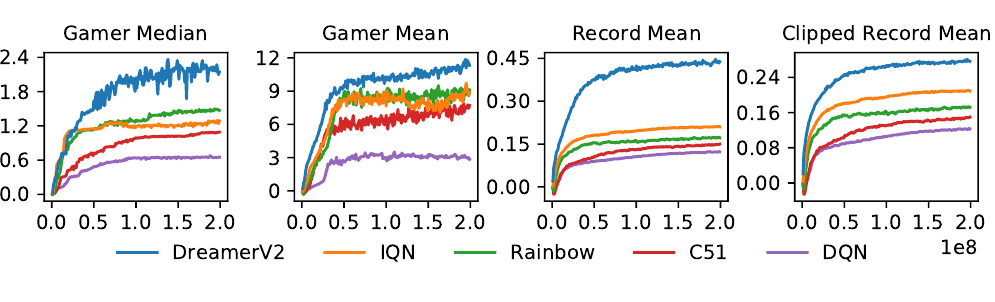

# DreamerV2 (2021)

Il paper [*Mastering Atari with Discrete World Models*](https://arxiv.org/pdf/2010.02193), di Danijar Hafner, Timothy Lillicrap, Mohammad Norouzi e Jimmy Ba, presenta **DreamerV2**, pubblicato a ICLR 2021. L'approfondimento segue la versione arXiv v4, aggiornata nel 2022.

Il lavoro conserva il principio di [Dreamer](../dreamer/README.md): apprendere un World Model dalle interazioni e addestrare actor e critic sulle sue predizioni latenti. Il nuovo obiettivo è rendere il modello sufficientemente efficace nei giochi Atari, caratterizzati da eventi discreti, osservazioni visuali e azioni categoriche.

## Perché cambiare la rappresentazione

Il latent gaussiano di Dreamer è adatto a descrivere variazioni continue, ma Atari comprende anche cambiamenti improvvisi: comparsa di oggetti, collisioni, passaggi di schermata e perdita di vite. DreamerV2 sostituisce le variabili gaussiane con una **rappresentazione composta da variabili categoriche**.

Questa scelta non impone uno stato simbolico interpretabile. Le categorie vengono apprese senza annotazioni semantiche e non corrispondono necessariamente a oggetti o eventi. Forniscono però un diverso spazio di rappresentazione, che nelle ablation del paper migliora il controllo.

La seconda modifica fondamentale riguarda la regolarizzazione variazionale. Il prior deve imparare a prevedere il posterior, ma il posterior non dovrebbe essere costretto troppo presto a imitare un prior ancora inaccurato. Il **KL balancing** consente di pesare diversamente questi due effetti.

## RSSM con stati discreti

Usiamo $o_t$ per l'osservazione, $a_t$ per l'azione, $r_t$ per il reward, $h_t$ per la memoria deterministica e $s_t$ per la componente stocastica dello stato latente. Come nel capitolo precedente, $u_t=(h_t,s_t)$ indica lo stato completo. Nel paper originale immagini e latent sono indicati rispettivamente con $x_t$ e $z_t$.

Le transizioni e il filtering posterior restano:

$$
\begin{aligned}
h_t &= f_\theta(h_{t-1},s_{t-1},a_{t-1})\\
s_t &\sim q_\theta(s_t\mid h_t,o_t)\\
\widehat{s}_t &\sim p_\theta(s_t\mid h_t)
\end{aligned}
$$

$\theta$ raccoglie i parametri del World Model; $f_\theta$ è una GRU. $q_\theta$ è il posterior variazionale informato dall'immagine, mentre $p_\theta$ è il prior disponibile durante l'imagination. Le due distribuzioni sono prodotti di **32 distribuzioni categoriche, ciascuna con 32 classi**.

Ogni campione viene codificato one-hot e le 32 codifiche vengono concatenate: il risultato è un vettore sparso di dimensione 1,024. La combinazione contiene $32^{32}$ possibili codici, ma il modello non mantiene una tabella per ciascuno di essi; apprende distribuzioni fattorizzate e una dinamica neurale.

*Fonte: Hafner et al., Mastering Atari with Discrete World Models, Figura 2. Il posterior incorpora l'immagine, mentre il prior tenta di anticiparlo. Il riquadro a destra mostra la struttura delle 32 variabili categoriche con 32 classi. Nella figura $x_t$ corrisponde a $o_t$ e $z_t$ a $s_t$ nel testo.*

Dal latent completo vengono ricostruita l'osservazione e predetti reward e discount. Il discount predictor rappresenta la possibilità di terminazione dell'episodio, permettendo di pesare meno i passi immaginati che avrebbero probabilmente luogo dopo la fine del task.

## Straight-through gradients

Campionare una categoria produce un'operazione non differenziabile. DreamerV2 usa uno **straight-through estimator**: nel forward mantiene il campione discreto, mentre nel backward usa il gradiente delle probabilità.

Indicando con $y$ il campione one-hot, con $p$ il vettore delle probabilità categoriche e con $\operatorname{sg}$ lo stop-gradient, la costruzione è:

$$
y_{\mathrm{ST}} = y+p-\operatorname{sg}(p)
$$

Nel forward $p-\operatorname{sg}(p)$ vale zero e quindi $y_{\mathrm{ST}}=y$. Nel backward il campione $y$ non fornisce gradiente, mentre il termine $p$ permette di aggiornare i logits della distribuzione. La stessa operazione si applica alle variabili categoriche che compongono il latent.

Il gradiente è **biased**, cioè non coincide in generale con il gradiente esatto dell'aspettativa rispetto al campionamento discreto. Il suo vantaggio pratico è la bassa varianza e la semplicità con cui può essere propagato nelle reti che ricevono i campioni.

## Loss del modello e KL balancing

La loss del World Model combina negative log-likelihood di immagini, reward e discount con una divergenza tra posterior e prior. Nel protocollo Atari il peso globale della KL è $\beta=0.1$, mentre nel controllo continuo è $\beta=1$.

Definiamo $Q_t=q_\theta(s_t\mid h_t,o_t)$ e $P_t=p_\theta(s_t\mid h_t)$. Il termine bilanciato è:

$$
\mathcal{L}_{\mathrm{KL},t} =
\alpha D_{\mathrm{KL}}\left(\operatorname{sg}(Q_t)\,\|\,P_t\right)
+(1-\alpha)D_{\mathrm{KL}}\left(Q_t\,\|\,\operatorname{sg}(P_t)\right)
$$

Il parametro $\alpha=0.8$ assegna più peso all'aggiornamento del prior. Il primo termine tratta il posterior come target; il secondo permette di rendere il posterior più predicibile, tenendo fermo il prior nel calcolo del gradiente.

**Il bilanciamento modifica i gradienti, non il valore numerico della KL**: senza considerare lo stop-gradient, i due termini coincidono e i pesi sommano a uno. Il peso $\beta$ e il bilanciamento $\alpha$ svolgono quindi ruoli differenti. Il primo controlla il rapporto tra KL e predizione; il secondo ripartisce la pressione fra le distribuzioni.

Un encoder e un decoder convoluzionali gestiscono le immagini; MLP predicono prior, reward e discount. Il modello comprende circa 20 milioni di parametri, mentre actor e critic ne hanno circa 1 milione ciascuno. I batch contengono 50 sequenze di 50 passi estratte dal replay buffer. Nel protocollo Atari i reward vengono trasformati con $\tanh$ prima del training: i punteggi di valutazione restano invece riferiti ai reward del gioco.

## Apprendimento del comportamento

Actor e critic vengono aggiornati usando rollout di **15 passi** che iniziano nei posterior states inferiti dai dati reali. Il modello resta congelato durante questa fase e non decodifica immagini. Il paper descrive il calcolo parallelo di 2,500 traiettorie latenti su una GPU.

L'actor $\pi_\phi(a_k\mid u_k)$ sceglie le azioni, il critic $v_\psi(u_k)$ stima il return, e il modello produce reward $\widehat{r}_k$ e discount $\widehat{\gamma}_k$. Gli indici $k$ si riferiscono al rollout immaginato; $\phi$ e $\psi$ sono rispettivamente i parametri di actor e critic.

I target del critic sono **$\lambda$-return**, con $\lambda=0.95$, che combinano reward immaginati e bootstrap dal value dei passi successivi. Il critic minimizza l'errore quadratico rispetto ai target e viene stabilizzato mediante una target network aggiornata ogni 100 gradient step.

La possibilità di backpropagare attraverso il latent discreto non impone che l'actor venga addestrato con lo stesso estimatore. DreamerV2 confronta **REINFORCE**, gradienti attraverso la dinamica e una loro combinazione.

Una forma della loss dell'actor, omettendo i pesi cumulativi del discount, è:

$$
\mathcal{L}_{\mathrm{actor}} =
\mathbb{E}\left[\sum_k\left(
-\rho\log\pi_\phi(a_k\mid u_k)\operatorname{sg}\left(G_k^\lambda-v_\psi(u_k)\right)
-(1-\rho)G_k^\lambda
-\eta\mathcal{H}\left[\pi_\phi(\cdot\mid u_k)\right]
\right)\right]
$$

$G_k^\lambda$ è il return target immaginato; $\rho\in[0,1]$ bilancia i due estimatori, $\eta$ pesa il bonus di entropia e $\mathcal{H}$ è l'entropia della distribuzione delle azioni. L'aspettativa è presa sui rollout del modello e dell'actor.

Il termine REINFORCE aumenta la probabilità delle azioni con return superiore alla baseline $v_\psi(u_k)$. Il termine diretto sul return trasmette invece gradienti attraverso le transizioni. L'entropia favorisce esplorazione e impedisce che la policy si concentri troppo presto su poche azioni.

Per Atari gli autori usano **$\rho=1$**, quindi REINFORCE per l'actor; per il controllo continuo usano **$\rho=0$**, quindi gradienti della dinamica. REINFORCE è unbiased rispetto all'obiettivo dell'MDP immaginato, ma questo **non elimina il bias causato da un modello inaccurato rispetto all'ambiente vero**.

## Dati e protocollo Atari

La valutazione principale usa **55 giochi Atari con sticky actions**. In questa impostazione il simulatore può ripetere l'azione precedente invece di applicare quella nuova, introducendo stocasticità nel controllo. Il numero di giochi va mantenuto distinto dai 57 del protocollo Atari di DreamerV3.

I frame in scala di grigi vengono ridimensionati a $64\times64$ pixel. La memoria ricorrente integra la storia, senza frame stacking. I dati derivano dall'interazione online, senza dimostrazioni expert né dataset esterni. Ogni agente ha un replay buffer e viene addestrato separatamente per il proprio gioco.

Il budget è di **200 milioni di frame per gioco**. Con action repeat 4 l'agente riceve circa 50 milioni di input e decisioni, per cui frame e transizioni nel replay non sono quantità intercambiabili. L'implementazione riportata completa il training in meno di dieci giorni usando una singola NVIDIA V100 e una singola istanza dell'ambiente.

Il paper stima 468 miliardi di stati latenti immaginati durante questo training. Questo numero chiarisce che l'efficienza rispetto all'interazione reale viene ottenuta anche mediante un uso molto intenso del modello.

## Risultati e aggregazione dei punteggi

*Fonte: Hafner et al., Mastering Atari with Discrete World Models, Figura 4. Confronto fino a 200 milioni di frame con IQN, Rainbow, C51 e DQN. I quattro pannelli usano normalizzazione rispetto al giocatore umano o al record umano e aggregazioni differenti.*

DreamerV2 supera il livello umano nel **punteggio mediano normalizzato rispetto al gamer** e i baseline model-free del confronto. La Tabella 1 riporta una mediana di **2.15**, equivalente al 215% del riferimento umano normalizzato, rispetto a 1.29 di IQN e 1.47 di Rainbow. La mediana non afferma che tutti i giochi siano risolti: riassume il centro della distribuzione dei risultati normalizzati.

La normalizzazione rispetto al giocatore umano può attribuire grande peso a giochi nei quali il punteggio dell'agente supera di molto quello del gamer di riferimento. Gli autori riportano anche normalizzazione rispetto ai record e una media con clipping, per ridurre il dominio di pochi outlier e rendere il confronto più informativo.

Le ablation mostrano l'utilità sia dei latent discreti sia del KL balancing. Il paper verifica inoltre **Humanoid Walk e Humanoid Stand da pixel**, mostrando che l'architettura non è limitata alle azioni discrete. L'umanoide è simulato; questi risultati non costituiscono una prova su hardware robotico.

## Novelty

- **RSSM categorico:** sostituisce il latent gaussiano con più variabili discrete e gradienti straight-through.
- **KL balancing:** privilegia l'apprendimento del prior senza regolarizzare altrettanto intensamente il posterior verso una dinamica ancora immatura.
- **Atari mediante imagination:** raggiunge prestazioni aggregate di livello umano usando una policy appresa in un modello addestrato separatamente.
- **Confronto degli estimatori dell'actor:** distingue i vantaggi di REINFORCE su Atari e dei gradienti della dinamica nel controllo continuo.

## Limiti

Il budget di 200 milioni di frame e il costo dei rollout sintetici rimangono consistenti. L'uso di una singola GPU rende il confronto praticabile, ma non implica training leggero né la stessa efficienza del protocollo Atari100k.

Gli iperparametri del controllo continuo differiscono da quelli di Atari, in particolare per peso della KL, estimatore dell'actor ed entropia. DreamerV2 non dimostra quindi la robustezza di una configurazione condivisa tra domini che sarà il tema di [DreamerV3](../dreamerv3/README.md).

Stati discreti e KL balancing non forniscono garanzie di accuratezza sui rollout lunghi, una misura epistemica dell'incertezza o una soluzione generale all'esplorazione con reward sparsi. La ricostruzione delle immagini rimane centrale e può privilegiare proprietà percettive rispetto a proprietà utili al controllo.

Il paper studia agenti separati in simulatori, senza linguaggio, trasferimento zero-shot o robot reali. L'uso dell'algoritmo nell'apprendimento fisico viene analizzato in [DayDreamer](../daydreamer/README.md), dove raccolta online, reset e condizioni operative acquistano un ruolo diverso.
