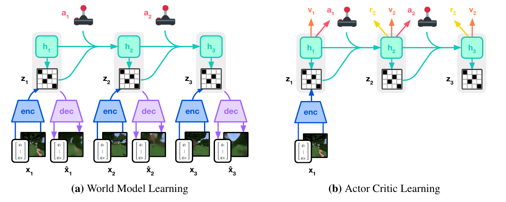
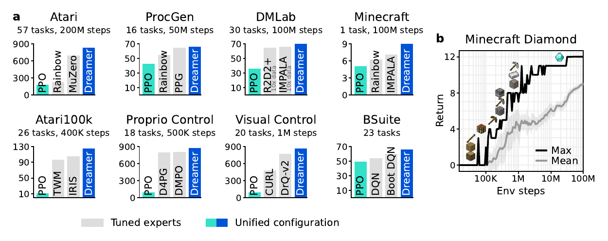
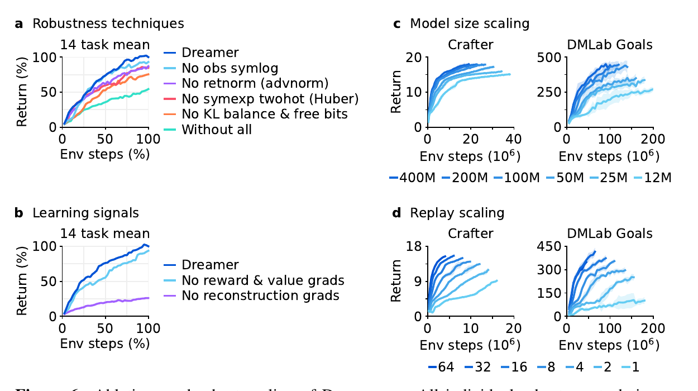

# DreamerV3 (2023)

Il paper [*Mastering Diverse Domains through World Models*](https://arxiv.org/pdf/2301.04104v2), di Danijar Hafner, Jurgis Pasukonis, Jimmy Ba e Timothy Lillicrap, presenta **DreamerV3**. Il preprint iniziale è del 2023; questo capitolo segue esplicitamente la **revisione arXiv v2 del 17 aprile 2024**, alla quale si riferiscono figure, protocolli e descrizione delle loss.

Il problema cambia rispetto a [DreamerV2](../dreamerv2/README.md). Non basta ottenere un buon risultato su un benchmark: l'algoritmo deve rimanere stabile passando fra immagini e vettori, azioni discrete e continue, reward densi e sparsi e quantità di scale differenti. La novelty riguarda soprattutto la **robustezza dell'apprendimento**, non una nuova forma di planning online.

## Che cosa significa una configurazione condivisa

Un reward moltiplicato per una costante può alterare la dimensione dei gradienti e il peso relativo dell'esplorazione. Un cambiamento nella scala delle osservazioni può modificare l'equilibrio tra ricostruzione e KL. Anche quando l'architettura è applicabile a molti ambienti, questi effetti possono rendere necessario un lungo tuning manuale.

DreamerV3 combina trasformazioni dei target, predizioni distribuzionali e normalizzazioni per riutilizzare gli **iperparametri centrali dell'algoritmo** tra domini. Il modello conserva encoder appropriati al tipo di osservazione e output appropriati all'action space; non impone lo stesso formato sensoriale a ogni ambiente.

La configurazione condivisa va distinta da una policy condivisa. Nel protocollo, **ogni task ha un agente addestrato sulle proprie interazioni**. Il paper non dimostra che una singola rete già addestrata controlli tutti i domini, né che possa affrontare un nuovo task senza apprendimento.

## Architettura e ciclo di apprendimento

Usiamo $o_t$ per l'osservazione, $a_t$ per l'azione, $r_t$ per il reward e $c_t\in\{0,1\}$ per il flag di continuazione: $c_t=0$ indica una terminazione. Come negli altri capitoli della famiglia, $h_t$ è la memoria deterministica, $s_t$ la componente stocastica del latent e $u_t=(h_t,s_t)$ lo stato completo.

Il World Model mantiene un **RSSM discreto**: una funzione ricorrente aggiorna $h_t$ da stato e azione precedenti; il posterior $q_\theta(s_t\mid h_t,o_t)$ incorpora l'osservazione; il prior $p_\theta(s_t\mid h_t)$ permette di immaginare senza osservazioni future. $\theta$ raccoglie i parametri del modello e $q(\cdot)$ indica una distribuzione variazionale.

*Fonte: Hafner et al., Mastering Diverse Domains through World Models, revisione arXiv v2, Figura 3. A sinistra ricostruzione e apprendimento della dinamica; a destra rollout latenti per actor e critic. I simboli originali $x_t$ e $z_t$ corrispondono rispettivamente a $o_t$ e $s_t$ nel testo.*

Encoder e decoder sono convoluzionali per le immagini e MLP per i vettori. Altri MLP predicono reward e continuazione. Actor e critic lavorano su $u_t$ e vengono addestrati su traiettorie prodotte dal prior; per agire nell'ambiente l'agente aggiorna il posterior e campiona un'azione dall'actor, **senza lookahead planning**.

Il replay buffer viene raccolto online. Le sequenze reali addestrano il World Model e forniscono gli stati iniziali dei rollout immaginati; i rollout insegnano alla policy quali comportamenti producono return elevati. La revisione analizzata comprende anche un contributo al training del critic da sequenze del replay, oltre a quello da imagination.

## Regolarizzazione: dynamics loss e representation loss

Il modello deve conservare informazione utile sulle osservazioni e produrre stati predicibili. Un posterior troppo compresso può ignorare dettagli decisivi; uno troppo ricco può essere difficile da anticipare mediante il prior.

Definiamo $Q_t=q_\theta(s_t\mid h_t,o_t)$ e $P_t=p_\theta(s_t\mid h_t)$. Con $\operatorname{sg}$ indichiamo lo stop-gradient e con $D_{\mathrm{KL}}$ la divergenza di Kullback–Leibler. DreamerV3 separa due termini:

$$
\begin{aligned}
\mathcal{L}_{\mathrm{dyn},t} &= \max\left\{1,D_{\mathrm{KL}}\left(\operatorname{sg}(Q_t)\,\|\,P_t\right)\right\}\\
\mathcal{L}_{\mathrm{rep},t} &= \max\left\{1,D_{\mathrm{KL}}\left(Q_t\,\|\,\operatorname{sg}(P_t)\right)\right\}
\end{aligned}
$$

Il primo termine addestra il prior verso il posterior; il secondo rende le rappresentazioni più predicibili tenendo fermo il prior. La soglia di **1 nat**, una misura di informazione basata sul logaritmo naturale, applica il principio dei free bits: sotto quel valore il termine non esercita ulteriore pressione a comprimere il latent.

Indichiamo con $\mathcal{L}_{\mathrm{pred},t}$ il termine che ricostruisce le osservazioni e predice reward e continuazione. La loss complessiva usa pesi fissi:

$$
\mathcal{L}_{\mathrm{model}} =
\mathbb{E}\left[\sum_t\left(
\mathcal{L}_{\mathrm{pred},t}
+\mathcal{L}_{\mathrm{dyn},t}
+0.1\mathcal{L}_{\mathrm{rep},t}
\right)\right]
$$

L'aspettativa è sulle sequenze del replay e sui campioni del posterior. Il peso minore della representation loss evita di sacrificare troppo presto l'informazione osservata; i free bits impediscono che anche una pressione residua riduca indefinitamente la capacità informativa.

Le distribuzioni categoriche di encoder e prior usano inoltre **uniform mixing**: il 99% della probabilità deriva dalla rete e l'1% da una distribuzione uniforme. Se $p_i$ è la probabilità neurale della classe $i$ e $K$ il numero di classi, la probabilità effettiva è:

$$
\widetilde{p}_i = 0.99p_i+\frac{0.01}{K}
$$

Nessuna classe può ricevere probabilità esattamente nulla. Questo attenua picchi di KL quando posterior e prior concentrano la probabilità su categorie differenti. Il mixing viene applicato anche alle distribuzioni categoriche dell'actor. I campioni discreti del latent continuano a usare gradienti straight-through.

## Symlog per quantità di scale differenti

La regressione quadratica su target grandi può produrre gradienti sproporzionati; un logaritmo ordinario non gestisce valori negativi. DreamerV3 usa una trasformazione simmetrica rispetto allo zero:

$$
\begin{aligned}
\operatorname{symlog}(x) &= \operatorname{sign}(x)\log(1+|x|)\\
\operatorname{symexp}(x) &= \operatorname{sign}(x)\left(\exp(|x|)-1\right)
\end{aligned}
$$

$x$ è uno scalare reale e $\operatorname{sign}$ ne restituisce il segno; le funzioni vengono applicate elemento per elemento ai vettori. $\operatorname{symexp}$ è l'inversa di $\operatorname{symlog}$. Vicino allo zero symlog è simile all'identità; per valori di grande modulo comprime la scala mantenendo il segno.

Le **osservazioni vettoriali** vengono trasformate prima dell'encoder e nella costruzione dei target del decoder. Questo riduce la dipendenza dei gradienti dall'unità di misura delle componenti. Non implica applicare la stessa trasformazione ai pixel: immagini e vettori conservano likelihood e trattamento appropriati alle rispettive modalità.

## Reward e value come distribuzioni

Reward e return possono essere stocastici e multimodali. Nella revisione qui analizzata, reward predictor e critic usano una **symexp twohot loss**, con una distribuzione categorica su bin collocati a distanze esponenziali nello spazio originale.

Indichiamo con $B=\{b_1,\ldots,b_K\}$ i valori dei bin, costruiti applicando symexp a una griglia uniforme nell'intervallo $[-20,20]$, e con $p_i(u_t)$ la probabilità predetta per il bin $i$. La stima scalare è:

$$
\widehat{y}_t = \sum_{i=1}^{K}p_i(u_t)b_i
$$

$y_t$ è il reward o il return da predire. Se il target cade fra $b_j$ e $b_{j+1}$, viene codificato con due pesi che sommano a uno:

$$
w_j = \frac{b_{j+1}-y_t}{b_{j+1}-b_j},\qquad
w_{j+1} = \frac{y_t-b_j}{b_{j+1}-b_j}
$$

Gli altri pesi sono zero. La loss è la cross-entropy fra questo target **two-hot** e le probabilità prodotte dalla rete. La media pesata permette di rappresentare valori fra i bin, mentre la cross-entropy evita che un target numericamente grande produca direttamente un errore quadratico altrettanto grande.

La distinzione fra versioni è rilevante: la revisione v2 descrive esplicitamente bin esponenziali e interpolazione nello spazio dei loro valori. Non bisogna sostituire senza dichiararlo questa procedura con una diversa parametrizzazione che interpoli in symlog e applichi symexp soltanto dopo la media.

## Critic e bootstrap

Il critic produce una distribuzione sul return e ne usa l'aspettativa come value $v_\psi(u_k)$, con parametri $\psi$. Sui rollout immaginati, i target sono $\lambda$-return che integrano reward predetti, continuazione e bootstrap oltre l'orizzonte.

La revisione usa un orizzonte di **16 passi**, discount $\gamma=0.997$ e $\lambda=0.95$. Il fattore di sconto viene combinato con la probabilità predetta di continuazione, riducendo il contributo di futuri che potrebbero trovarsi oltre la terminazione.

Il critic viene stabilizzato mediante regolarizzazione verso le predizioni di una copia dei parametri aggiornata con una **exponential moving average (EMA)**, cioè una media mobile esponenziale. Gli output iniziali di reward predictor e critic vengono impostati a zero per evitare grandi reward o value casuali all'avvio del training.

Il contributo da replay descritto nella revisione usa i return immaginati negli stati iniziali come annotazioni on-policy e costruisce ulteriori target dalle ricompense reali delle sequenze. Il suo peso è 0.3, rispetto a 1 per il contributo da imagination.

## Normalizzazione del return e actor

DreamerV3 usa **REINFORCE sia per le azioni discrete sia per quelle continue**. Rispetto a DreamerV2, non cambia estimatore dell'actor quando cambia action space. Una baseline del critic riduce la varianza e un bonus di entropia mantiene l'esplorazione.

Rimane però il problema della scala: un reward molto grande può rendere trascurabile il bonus di entropia, mentre normalizzare target quasi nulli può amplificare soprattutto rumore. DreamerV3 stima una scala robusta dai percentili dei return:

$$
S = \operatorname{EMA}\left(P_{95}(G^\lambda)-P_5(G^\lambda)\right)
$$

$G^\lambda$ è il batch di return immaginati, $P_5$ e $P_{95}$ sono rispettivamente il quinto e il novantacinquesimo percentile e $S$ la scala smussata mediante EMA. Il denominatore effettivo è **$\max(1,S)$**, così return piccoli non vengono amplificati.

Con $\phi$ parametri dell'actor, $\pi_\phi$ policy e $\eta$ peso dell'entropia, una forma della loss è:

$$
\mathcal{L}_{\mathrm{actor}} =
-\mathbb{E}\left[\sum_k\left(
\operatorname{sg}\left(\frac{G_k^\lambda-v_\psi(u_k)}{\max(1,S)}\right)\log\pi_\phi(a_k\mid u_k)
+\eta\mathcal{H}\left[\pi_\phi(\cdot\mid u_k)\right]
\right)\right]
$$

Gli indici $k$ si riferiscono ai passi del rollout, l'aspettativa ai campioni immaginati e $\mathcal{H}$ all'entropia della policy. La formula omette i pesi cumulativi di continuazione per evidenziare la normalizzazione. Il coefficiente $\eta=3\times10^{-4}$ viene mantenuto tra domini.

I percentili riducono l'effetto degli outlier. Il limite inferiore del denominatore conserva invece l'importanza dell'esplorazione quando i reward sono rari e non vi sono ancora differenze di return affidabili da sfruttare.

## Benchmark, dati ed embodiment

*Fonte: Hafner et al., Mastering Diverse Domains through World Models, revisione arXiv v2, Figura 1. Il pannello a confronta benchmark con osservazioni e budget differenti; il pannello b mostra la progressione in Minecraft. Le scale dei diversi pannelli non sono direttamente confrontabili.*

La valutazione comprende **otto domini e oltre 150 task**. Non c'è un unico dataset pre-addestrato: ogni agente raccoglie la propria esperienza online, senza dimostrazioni expert. La seguente tabella esplicita i budget della revisione analizzata.

| Dominio | Task o ambienti | Osservazioni e azioni | Budget per training |
| --- | --- | --- | --- |
| Atari | 57 giochi | Immagini, azioni discrete, sticky actions | 200 milioni di frame |
| ProcGen | 16 giochi | Immagini e livelli procedurali, azioni discrete | 50 milioni di frame |
| DMLab | 30 task | Immagini di ambienti 3D, azioni discrete | 100 milioni di frame |
| Atari100k | 26 giochi | Immagini, azioni discrete | 100,000 decisioni, pari a 400,000 frame |
| Proprio Control | 18 task DMControl | Vettori propriocettivi, azioni continue | 500,000 step |
| Visual Control | 20 task DMControl | Immagini, azioni continue | 1 milione di step |
| BSuite | 23 ambienti, 468 configurazioni | Task diagnostici con formati specifici | Budget definiti dai protocolli della suite |
| Minecraft Diamond | Un task in mondi procedurali | Immagini, action space del benchmark | 100 milioni di step |

Il controllo DMControl comprende locomozione e manipolazione di embodiment simulati. Nessun esperimento di questa revisione esegue training su robot fisici. BSuite verifica separatamente memoria, esplorazione, assegnazione del credito e robustezza alle scale; il numero delle sue configurazioni non va confuso con il numero dei task.

Su ProcGen Dreamer raggiunge prestazioni comparabili al baseline specializzato PPG; su altri domini supera i metodi selezionati nel confronto. Le affermazioni di superiorità vanno lette nel contesto di **budget, metriche e configurazioni dei baseline**, non come vittoria uniforme su ogni task o rispetto a ogni algoritmo esistente.

## Che cosa dimostra Minecraft Diamond

Il task richiede raccolta di risorse e crafting attraverso una progressione di 12 item. Gli episodi si svolgono in mondi generati proceduralmente e terminano con la morte del giocatore o dopo 36,000 step, pari a circa 30 minuti di gioco nel protocollo.

Tutti gli agenti Dreamer addestrati dagli autori scoprono diamanti entro 100 milioni di step. I baseline del confronto raggiungono anche item avanzati, come il piccone di ferro, ma non il diamante. Il risultato è ottenuto **senza dati umani né curriculum adattivo**.

Il task non usa soltanto un reward terminale per il diamante: sono disponibili segnali sparsi legati alla progressione negli item. Il protocollo segue inoltre l'impostazione di block breaking dei lavori precedenti, che facilita l'esecuzione di azioni prolungate rispetto al mantenimento diretto di un tasto. Queste condizioni definiscono la portata del risultato.

## Ablation e scaling

*Fonte: Hafner et al., Mastering Diverse Domains through World Models, revisione arXiv v2, Figura 6. A sinistra vengono rimossi componenti di stabilizzazione o segnali di apprendimento; a destra si confrontano dimensioni del modello e replay ratio su Crafter e DMLab Goals.*

Le ablation su 14 task mostrano contributi complementari di KL con free bits, normalizzazione dei return, regressione two-hot e trasformazione delle osservazioni. Una tecnica può essere decisiva in alcuni ambienti e poco rilevante in altri: la robustezza deriva dall'insieme dei meccanismi.

L'ablazione dei segnali di apprendimento indica che la **ricostruzione non supervisionata delle osservazioni** sostiene gran parte delle prestazioni. Il modello non viene addestrato soltanto a preservare reward e value; apprende una rappresentazione più ricca dell'esperienza sensoriale, anche se la fedeltà fisica non è garantita da questo obiettivo.

Gli esperimenti di scaling confrontano sei dimensioni, da circa **12 milioni a 400 milioni di parametri**, e diversi replay ratio. Il replay ratio misura quanta esperienza viene riutilizzata per gli aggiornamenti rispetto alla nuova esperienza raccolta. Aumentarlo consente più apprendimento per interazione reale, ma richiede più calcolo.

Modelli più grandi migliorano sia il return sia l'interazione necessaria nei domini di scaling studiati. Non si tratta di una legge universale né di un risultato multi-task: gli esperimenti specifici riguardano Crafter e DMLab e continuano a usare training per task.

## Novelty

- **Configurazione robusta tra domini:** combina stabilizzazione delle rappresentazioni, dei target e dell'actor per ridurre il tuning manuale.
- **Symlog e symexp two-hot:** controlla la scala di osservazioni vettoriali, reward e return preservando valori positivi e negativi.
- **KL separata con free bits e uniform mixing:** limita collasso delle rappresentazioni e picchi nelle distribuzioni discrete.
- **Return normalization con percentili:** mantiene un bonus di entropia condiviso senza amplificare target piccoli o rumore.
- **Validazione ampia e scaling:** studia oltre 150 task, Minecraft Diamond e l'effetto di capacità del modello e riuso del replay.

## Limiti

La generalità dimostrata è quella di un **algoritmo riaddestrabile**, non di un agente universale già competente. Non vengono dimostrati trasferimento zero-shot tra task, linguaggio come specifica dell'obiettivo o un singolo World Model condiviso fra tutti gli embodiment.

La stabilizzazione delle loss non risolve automaticamente l'errore multi-step, il model exploitation o l'incertezza epistemica. Il critic e l'actor restano dipendenti dalla qualità delle predizioni; la ricostruzione può conservare dettagli percettivi senza rappresentare accuratamente proprietà fisiche nascoste.

La configurazione robusta riduce il tuning, ma non elimina le scelte su architettura, capacità, replay ratio, budget e interfaccia dell'ambiente. Gli esperimenti usano una NVIDIA A100 per agente e i benefici della maggiore capacità comportano costi di memoria e training.

Infine, i risultati sono simulati. Latenza sensoriale, contatti, reset, usura e sicurezza richiedono valutazioni su hardware. Il collegamento con [DayDreamer](../daydreamer/README.md) aiuta a distinguere la robustezza algoritmica ai benchmark dalla robustezza operativa necessaria quando l'esperienza viene raccolta da un robot reale.
