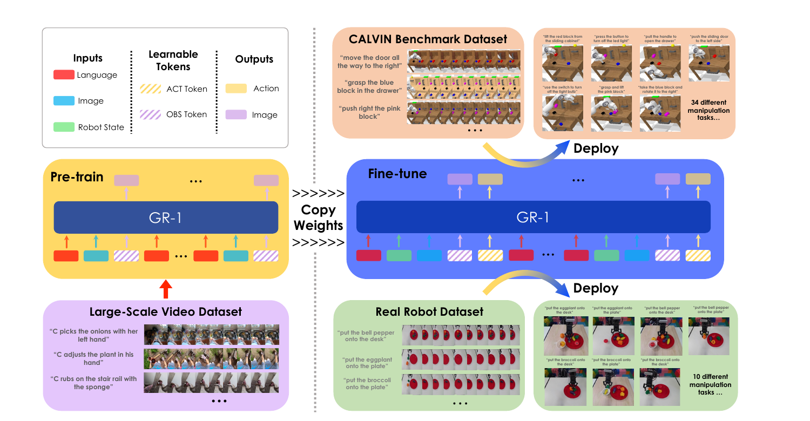
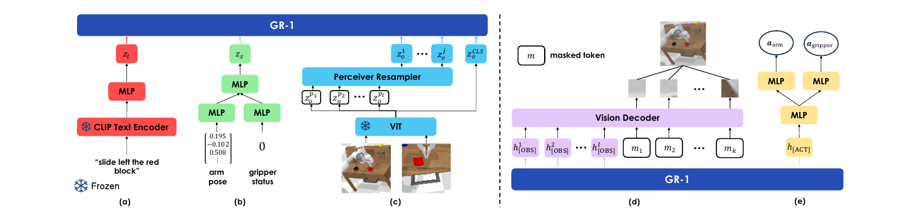
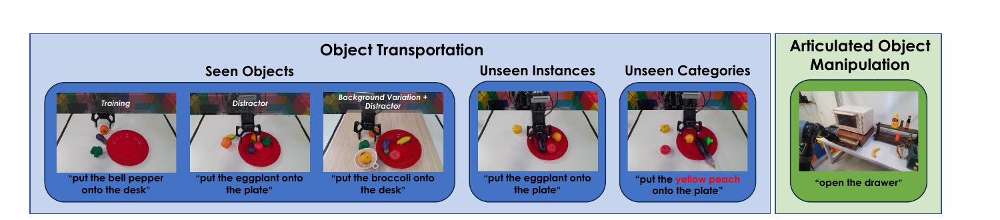
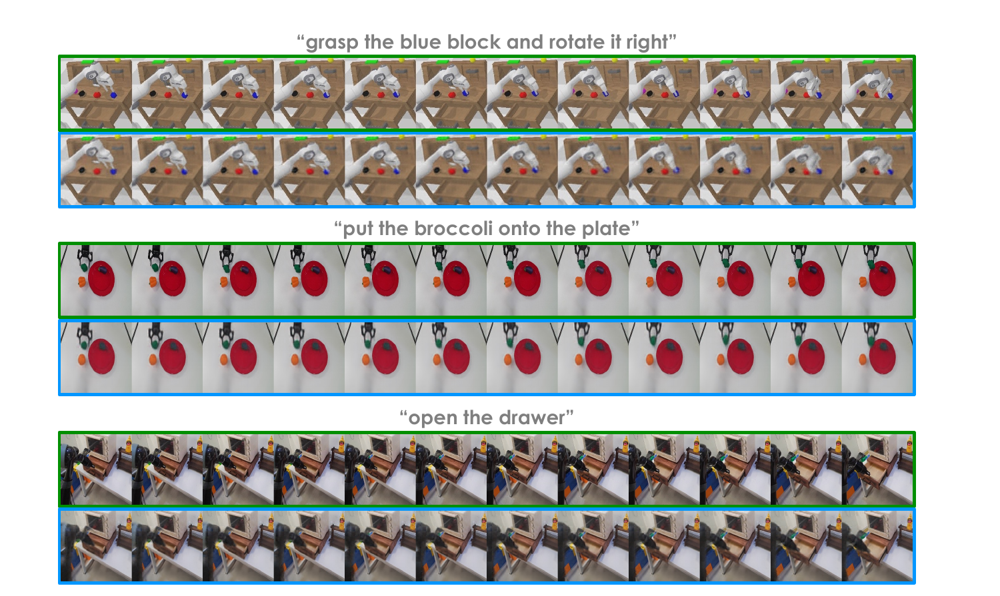

# GR-1 (2024)

Il paper [*Unleashing Large-Scale Video Generative Pre-training for Visual Robot Manipulation*](https://proceedings.iclr.cc/paper_files/paper/2024/file/2c37c5bcef24b9541550261dcd63261b-Paper-Conference.pdf), di Hongtao Wu e coautori, è stato pubblicato a ICLR 2024. GR-1 studia se un modello che ha imparato a prevedere video egocentrici umani possa trasferire questa conoscenza a una policy robotica condizionata dal linguaggio.

L'idea centrale è **preservare la stessa struttura generativa nelle due fasi**. Nel pretraining il modello predice immagini future da testo e frame passati; nel fine-tuning riceve anche lo stato del robot e aggiunge la predizione dell'azione, continuando però a ricostruire il futuro visuale. La conoscenza temporale non viene congelata in un encoder puramente percettivo né usata da un planner esterno: rimane dentro il backbone che produce le azioni.

*Fonte: Wu et al., Unleashing Large-Scale Video Generative Pre-training for Visual Robot Manipulation, Figura 1. I pesi appresi mediante previsione video vengono trasferiti allo stesso Transformer, che durante il fine-tuning robotico produce sia immagini future sia azioni.*

## Formulazione del problema

Indichiamo con $l$ la descrizione linguistica, con $o_t$ l'osservazione visuale al tempo $t$ e con $h$ la lunghezza della storia precedente. Nel pretraining, GR-1 apprende una funzione $\pi_{\mathrm{pt}}$ che usa il testo e la finestra $o_{t-h:t}$ per prevedere un'osservazione successiva:

$$
\pi_{\mathrm{pt}}(l,o_{t-h:t}) \rightarrow \hat{o}_{t+\Delta}
$$

Il simbolo $\Delta$ indica la distanza temporale del target e $\hat{o}_{t+\Delta}$ è l'immagine ricostruita. Questa fase non dispone di stati o azioni: insegna al modello regolarità visive, trasformazioni degli oggetti e associazioni tra descrizioni linguistiche ed evoluzione della scena.

Nel fine-tuning, $q_t$ rappresenta lo stato del robot, composto dalla posa 6D dell'end-effector e dallo stato binario della pinza. La policy $\pi_\theta$ riceve le storie visuali e propriocettive e produce simultaneamente l'azione corrente e il frame futuro:

$$
\pi_\theta(l,o_{t-h:t},q_{t-h:t})
\rightarrow
(\hat{a}_t,\hat{o}_{t+\Delta})
$$

La predizione $\hat{a}_t$ comprende variazioni di posizione cartesiana, variazioni degli angoli di Eulero e apertura o chiusura della pinza. Il futuro visuale non è un piano che viene successivamente tradotto in controllo: **azione e immagine sono due output dello stesso stato nascosto causale**.

## Tokenizzazione multimodale

L'istruzione $l$ viene trasformata da un text encoder **CLIP** congelato. Ogni immagine è elaborata da un Vision Transformer pre-addestrato con **Masked Autoencoding (MAE)**: il token CLS fornisce una rappresentazione globale, mentre i patch token conservano informazione locale. Un **Perceiver Resampler** comprime questi ultimi in un numero ridotto di token, evitando che la sequenza visuale domini il costo dell'attenzione.

La posa dell'end-effector e lo stato della pinza vengono codificati da MLP distinti. Proiezioni lineari portano tutte le modalità alla dimensione nascosta comune. Il modello introduce inoltre token apprendibili con due funzioni precise:

- `[OBS]` richiede la previsione di un'immagine futura;
- `[ACT]` richiede la previsione dell'azione robotica.

Il token linguistico viene ripetuto a ogni timestep, così la condizione non viene diluita da una lunga sequenza di immagini e stati. Embedding temporali relativi, condivisi dalle modalità appartenenti allo stesso istante, comunicano al Transformer la posizione di ciascun gruppo nella finestra.

*Fonte: Wu et al., Unleashing Large-Scale Video Generative Pre-training for Visual Robot Manipulation, Figura 2. CLIP, MLP propriocettivi e ViT–Perceiver producono i token di input; un vision decoder ricostruisce le patch future e due teste MLP predicono braccio e pinza.*

## Transformer causale e mascheramento

Durante il pretraining, la sequenza ripete blocchi della forma $(l,o_t,[\mathrm{OBS}])$. Nel fine-tuning ciascun blocco diventa $(l,q_t,o_t,[\mathrm{OBS}],[\mathrm{ACT}])$. Il backbone contiene 12 layer, 12 teste di attention e hidden size 384; l'intero sistema conta 195 milioni di parametri, dei quali 46 milioni sono addestrabili.

L'attenzione è causale, ma con una precauzione ulteriore: i token ordinari non possono leggere i precedenti `[OBS]` e `[ACT]`. Gli output da predire non diventano quindi scorciatoie informative per i timestep successivi. Le rappresentazioni corrispondenti ai token speciali possono invece aggregare linguaggio, immagini e stato disponibili nel loro passato causale.

Un decoder visuale Transformer parte dalle rappresentazioni `[OBS]`, aggiunge mask token con positional encoding e ricostruisce l'immagine patch per patch. Le rappresentazioni `[ACT]` passano a un MLP a tre strati, la cui parte finale si divide in una testa continua per il braccio e una testa binaria per la pinza.

## Obiettivi di apprendimento

La loss visuale $\mathcal{L}_{\mathrm{video}}$ è il mean squared error tra patch predette e patch target normalizzate. Per l'azione del braccio viene usata una Smooth-L1 loss $\mathcal{L}_{\mathrm{arm}}$, meno sensibile del puro errore quadratico ai target anomali; la pinza usa una binary cross-entropy $\mathcal{L}_{\mathrm{gripper}}$.

Nel fine-tuning i tre segnali sono sommati:

$$
\mathcal{L}_{\mathrm{finetune}} =
\mathcal{L}_{\mathrm{arm}}+
\mathcal{L}_{\mathrm{gripper}}+
\mathcal{L}_{\mathrm{video}}
$$

Questo obiettivo implementa una forma di **multi-task representation learning**. La behavior cloning insegna quale comando riprodurre, mentre la ricostruzione futura richiede che lo stato nascosto conservi informazione sull'effetto osservabile della manipolazione. Non viene tuttavia ottimizzata una loss che imponga coerenza causale fra l'azione predetta e l'immagine generata: entrambe sono supervisionate dalla stessa dimostrazione.

## Pretraining su Ego4D

Il pretraining utilizza **Ego4D**, un dataset con oltre 3,500 ore di video egocentrici e interazioni uomo–oggetto. Gli autori estraggono clip di tre secondi corredate da descrizioni linguistiche, ottenendo 800,000 clip e circa 8 milioni di frame.

I frame vengono campionati a intervalli di un terzo di secondo, abbastanza distanti da richiedere una trasformazione visibile, e il target è il timestep campionato immediatamente successivo, quindi $\Delta=1$ nella sequenza pretraining. CLIP e il ViT-MAE restano congelati sia qui sia nel fine-tuning; vengono appresi il backbone causale, il resampler, i token e i decoder compatibili con la successiva fase robotica.

Ego4D mostra mani umane anziché gli embodiment di CALVIN o del robot fisico. Il trasferimento non consiste quindi nell'imitare direttamente le azioni, che non sono disponibili, ma nell'acquisire prior su oggetti, contatti, movimento e linguaggio. Rimane però un domain gap importante fra cinematica umana, visuale egocentrica e manipolatori industriali.

## Fine-tuning sui dati robotici

I dati robotici sono temporalmente più densi. GR-1 usa una storia di dieci timestep e predice l'immagine a tre step di distanza, cioè $\Delta=3$; il paper osserva che un target troppo vicino cambia poco rispetto all'input, mentre uno troppo lontano guida meno efficacemente l'azione locale. In un'ablation senza pretraining, la lunghezza media CALVIN passa da 3.61 con $\Delta=1$ a 3.82 con $\Delta=3$, per poi scendere a 3.67 con $\Delta=5$.

Il modello usa immagini provenienti sia dalla camera statica sia dalla camera sulla pinza e viene addestrato end-to-end sui dati dimostrativi con AdamW. L'uso di due viste attenua le occlusioni, ma non costruisce una rappresentazione geometrica 3D esplicita: le relazioni fra viste devono emergere implicitamente nei token.

## Valutazione su CALVIN

**CALVIN** comprende 34 task linguistici in un ambiente con Franka Emika Panda, cassetto, porta scorrevole, blocchi colorati, pulsanti e luci. Il dataset contiene 24 ore di play teleoperato, ma soltanto circa l'1% dispone di annotazioni linguistiche crowdsourced. GR-1, RT-1 e MT-R3M vengono addestrati su questa parte etichettata, pari a oltre 20,000 traiettorie; MCIL e HULC usano invece anche dati privi di linguaggio.

Il protocollo valuta 1,000 catene di cinque istruzioni. Il robot riceve il task successivo soltanto se completa quello corrente entro 360 timestep. Si riportano sia la probabilità di completare almeno $k$ task consecutivi sia la **average length**, cioè il numero medio di task risolti per catena.

Nello split ABCD→D, che include nel training tutte e quattro le configurazioni della scena, GR-1 raggiunge 94.9% sul primo task, 73.1% su tutti e cinque e una lunghezza media di 4.21. HULC, il migliore baseline sulla lunghezza media, ottiene 88.9%, 38.3% e 3.06.

Nello split ABC→D, l'ambiente D è escluso dal training. GR-1 conserva 85.4% sul primo task, 40.1% sui cinque e 3.06 di lunghezza media. I baseline arrivano al massimo al 53.3% sul primo task e a 0.93 di lunghezza media. Con il 10% delle traiettorie etichettate dello split ABCD→D, pari a 2,244 esempi, GR-1 ottiene ancora 77.8% e 2.00.

Per testare parafrasi non osservate, gli autori fanno generare a GPT-4 50 formulazioni per ciascun task e ne campionano una durante l'evaluation. GR-1 raggiunge 76.4% sul primo task e 2.17 di lunghezza media. Il test misura robustezza a sinonimi prodotti automaticamente, non comprensione di nuovi task o composizione libera di concetti.

## Cosa dimostrano le ablation

L'ablation più informativa separa tre configurazioni. Un modello addestrato da zero senza predizione video raggiunge 3.33 di lunghezza media su ABCD→D. Aggiungere $\mathcal{L}_{\mathrm{video}}$ durante il training robotico porta il valore a 3.82; inizializzare anche dal pretraining Ego4D lo porta a 4.21.

Lo stesso ordine si mantiene nel trasferimento ABC→D, con 2.40, 2.65 e 3.06, e nel regime con il 10% dei dati, con 1.04, 1.52 e 2.00. **L'obiettivo visuale è utile anche senza dati esterni**, mentre il video pretraining fornisce un beneficio addizionale e più evidente quando scena o quantità di dati cambiano.

L'esperimento non isola completamente ogni possibile sorgente di conoscenza: GR-1 parte anche da encoder CLIP e MAE già pre-addestrati. Isola però il contributo incrementale del training generativo su Ego4D a parità della restante architettura.

## Esperimenti su robot fisico

Il setup reale impiega un **Kinova Gen2 a 7 gradi di libertà**, con una RealSense montata sull'end-effector e una Kinect Azure per la vista statica. Gli autori raccolgono 1,775 dimostrazioni di trasporto fra piatto e tavolo e 2,856 traiettorie di apertura o chiusura di un cassetto mediante un sistema HTC Vive VR.

*Fonte: Wu et al., Unleashing Large-Scale Video Generative Pre-training for Visual Robot Manipulation, Figura 5. Il protocollo distingue oggetti visti, scene con distrattori, nuove istanze, categorie non osservate e manipolazione articolata del cassetto.*

Nel trasporto, il successo è 79% con oggetti visti, 73% con nuove istanze delle stesse categorie e 30% con categorie mai presenti nei dati robotici. RT-1 ottiene rispettivamente 27%, 13% e 0%; MT-R3M 15%, 13% e 10%. Sul cassetto GR-1 raggiunge 75%, contro 35% e 30%.

Questi risultati mostrano trasferimento oltre le esatte immagini di training, ma anche un confine netto. Il modello confonde talvolta il peperone con la pesca, visivamente simili, e fallisce nell'aggancio della maniglia o nella chiusura completa del cassetto. Le categorie non viste restano molto più difficili delle nuove istanze.

## Che cosa predice il World Model

Le ricostruzioni qualitative mostrano che GR-1 anticipa spostamento dei blocchi, trasporto degli ortaggi e apertura del cassetto. Il target verde nella figura seguente è il video reale, mentre la riga blu è la predizione.

*Fonte: Wu et al., Unleashing Large-Scale Video Generative Pre-training for Visual Robot Manipulation, Figura 6. GR-1 ricostruisce la trasformazione globale richiesta, ma perde dettagli fini e contenuto occluso.*

La previsione viene ottimizzata con MSE nello spazio dei pixel e tende perciò a mediare dettagli incerti. È sufficiente come segnale di rappresentazione, ma non equivale a un rollout accurato: il modello genera un singolo target locale, non una distribuzione multimodale di traiettorie lunghe.

Soprattutto, la predizione non è condizionata su una sequenza ipotetica di azioni. GR-1 non può rispondere direttamente a domande controfattuali come «che cosa accade se eseguo questa azione invece di quella?». In questo senso è un **World Model integrato nella policy**, ma non un simulatore action-conditioned utilizzabile per model predictive control.

## Relazione con UniPi e RoboDreamer

UniPi e RoboDreamer generano prima un piano video e delegano a un inverse dynamics model la traduzione in azioni. Questa separazione rende il futuro visuale esplicito e potenzialmente ispezionabile, ma introduce un divario fra ciò che il video immagina e ciò che il robot può eseguire.

GR-1 elimina il traduttore: azione e futuro condividono il Transformer, e la testa di controllo viene supervisionata direttamente sulle dimostrazioni. L'inference è quella di una policy end-to-end e non richiede il sampling iterativo di un diffusion model. Il prezzo è che l'immagine futura non costituisce un piano operativo né una variabile attraverso cui scegliere l'azione: è principalmente un vincolo di training sulla rappresentazione.

## Novelty

- **Video generative pretraining trasferibile:** usa la previsione linguaggio–video su Ego4D per inizializzare una policy di manipolazione.
- **Backbone unificato:** mantiene lo stesso Transformer causale nelle fasi video e robotica, aggiungendo stato e token d'azione senza sostituire il modello.
- **Predizione congiunta:** apprende azioni e immagini future end-to-end durante il fine-tuning, facendo del World Model un obiettivo interno alla policy.
- **Interfaccia multimodale a token:** allinea linguaggio, patch visuali compresse, propriocezione, richieste di osservazione e richieste d'azione in una sola sequenza temporale.
- **Analisi del trasferimento:** valuta separatamente obiettivo video, pretraining, scarsità dei dati, scena non vista, parafrasi e generalizzazione reale degli oggetti.

## Limiti

GR-1 apprende correlazioni tra storia, azione dimostrata e futuro osservato, non una dinamica causale interrogabile con azioni alternative. Non effettua planning o ricerca, non assegna valore ai futuri e non può sfruttare autonomamente la propria testa video per correggere una decisione prima di eseguirla. Gli errori di behavior cloning possono quindi accumularsi fuori dalla distribuzione delle dimostrazioni.

La loss pixel-wise produce immagini attenuate e può omettere oggetti occlusi. Una singola previsione a orizzonte locale non rappresenta l'incertezza né i diversi modi validi di completare un task. Le due camere aiutano sul piano percettivo, ma non forniscono memoria 3D persistente o vincoli espliciti su collisioni e contatti.

Il pretraining sfrutta soltanto clip Ego4D con annotazione linguistica e conserva il domain gap fra mani umane e robot. CLIP e MAE sono già pre-addestrati su dati esterni, quindi parte della generalizzazione linguistica e visiva non deriva da Ego4D. Il modello conta inoltre 195 milioni di parametri pur addestrandone 46 milioni, e il paper non presenta un'analisi sistematica di costo, latenza o scaling.

Infine, CALVIN rimane un ambiente simulato strutturato. Gli esperimenti reali riguardano dieci task riconducibili al trasporto di pochi oggetti e all'apertura o chiusura di un solo cassetto; il successo sulle categorie nuove scende al 30%. Non vengono dimostrati trasferimento cross-embodiment, manipolazione mobile, apprendimento online o autonomia su orizzonti lunghi in ambienti aperti.
