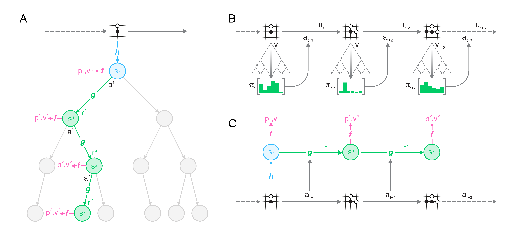
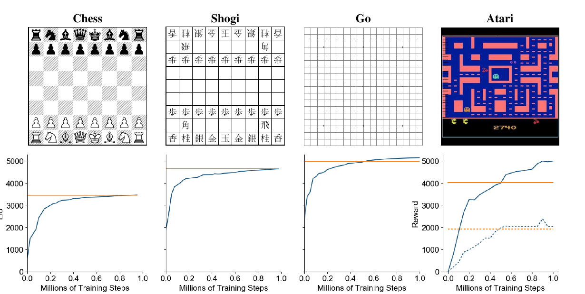

# MuZero (2020)

Il paper [*Mastering Atari, Go, Chess and Shogi by Planning with a Learned Model*](https://arxiv.org/abs/1911.08265), pubblicato da Julian Schrittwieser e coautori nel 2020, introduce **MuZero**. L'algoritmo conserva la search-based policy iteration di AlphaZero, ma sostituisce il simulatore perfetto usato nella ricerca con una dinamica latente appresa dall'esperienza.

L'idea centrale è che un World Model destinato al planning non debba necessariamente prevedere tutto ciò che accadrà. MuZero non ricostruisce immagini, pezzi o stato fisico: apprende soltanto una rappresentazione nella quale siano predicibili **reward, policy e value**. Il modello può dunque essere utile alla decisione senza essere un simulatore fedele e interpretabile del mondo.

## Dal modello generativo al modello value-equivalent

Un modello generativo cerca normalmente di approssimare la transizione reale oppure la distribuzione delle osservazioni future. Questo obiettivo dedica capacità anche a dettagli che possono essere irrilevanti per il controllo e rende costoso generare rollout visuali dentro una procedura di ricerca.

MuZero segue invece il principio della **value equivalence**: il modello appreso deve preservare le quantità necessarie affinché il planning nello spazio astratto conduca a buone decisioni nell'ambiente. Lo stato latente non è obbligato a coincidere con uno stato reale né a permettere la ricostruzione di $o_t$. La sua semantica emerge esclusivamente dagli obiettivi di reward, policy e value.

Questa scelta riduce il problema predittivo, ma cambia anche il significato di *World Model*. MuZero modella il mondo soltanto rispetto al task e al reward correnti. Dal suo latent non è possibile ottenere direttamente un frame futuro o verificare se una proprietà fisica non rilevante per il reward sia stata conservata.

## Domini e dati di training

Gli esperimenti comprendono **Go, scacchi e shogi**, usati come problemi di planning preciso, e tutti i **57 giochi Atari** dell'Arcade Learning Environment, usati come dominio visuale single-agent con reward intermedi. Si tratta esclusivamente di ambienti simulati con action space discreti; non vengono impiegati robot fisici o dataset robotici.

Nei giochi da tavolo i dati sono generati mediante self-play. Il replay buffer conserva il milione di partite più recente e gli stati vengono campionati uniformemente. La representation function riceve gli ultimi otto stati in Go e shogi e gli ultimi 100 negli scacchi, dove una storia più lunga serve anche a riconoscere le patte.

Su Atari l'input comprende gli ultimi 32 frame RGB a risoluzione $96\times96$ e le 32 azioni corrispondenti. Il replay buffer conserva 125,000 sequenze lunghe 200 mosse e usa prioritized replay. La versione principale viene addestrata con **20 miliardi di frame per gioco**; la variante MuZero Reanalyze studia invece il regime da 200 milioni di frame, riutilizzando maggiormente l'esperienza già raccolta.

## Architettura del modello

MuZero descrive il proprio modello $\mu_\theta$ mediante tre funzioni neurali, tutte parametrizzate da $\theta$. Per distinguere il tempo reale dall'avanzamento interno alla ricerca, $t$ indica lo step nell'ambiente e $k$ la profondità ipotetica del modello.

La **representation function** $h_\theta$ codifica la storia disponibile in uno stato latente iniziale:

$$
s_t^0 = h_\theta(o_1,\ldots,o_t)
$$

La **dynamics function** $g_\theta$ riceve uno stato latente e l'azione ipotetica successiva. Produce il nuovo latent e il reward previsto $\hat r_t^k$:

$$
(\hat r_t^k,s_t^k) = g_\theta(s_t^{k-1},a_{t+k})
$$

La **prediction function** $f_\theta$ trasforma ogni stato latente in una policy prior $p_t^k$ e in una stima del value $v_t^k$:

$$
(p_t^k,v_t^k) = f_\theta(s_t^k)
$$

La dynamics function è deterministica. Le tre funzioni non producono osservazioni e non ricevono un vincolo che allinei $s_t^k$ allo stato interno del gioco. L'unico grounding è indiretto: le loro predizioni devono corrispondere ai target ottenuti lungo traiettorie realmente eseguite.

*Fonte: Schrittwieser et al., Mastering Atari, Go, Chess and Shogi by Planning with a Learned Model, Figura 1. Il pannello A mostra la ricerca nella dinamica latente; il pannello B il ciclo di interazione con l'ambiente; il pannello C l'unroll usato per addestrare congiuntamente representation, dynamics e prediction.*

Le implementazioni usano reti convoluzionali residuali. Representation e dynamics impiegano 16 residual block con 256 canali nascosti, mentre la prediction function separa le teste di policy e value. Su Atari, una sequenza di downsampling riduce l'input $96\times96$ a un latent spaziale $6\times6$; l'azione one-hot viene replicata spazialmente e concatenata al latent prima della transizione.

Reward e value su Atari possono assumere scale molto differenti tra giochi. Il paper applica quindi una trasformazione scalare invertibile e rappresenta ciascun target come distribuzione categoriale su 601 supporti compresi tra $-300$ e $300$. Questa parametrizzazione rende più stabile l'ottimizzazione senza cambiare il valore scalare usato dalla ricerca.

## Planning con Monte Carlo Tree Search

A ogni step reale, MuZero calcola il root $s_t^0$ dalla storia osservata ed esegue MCTS. Ogni arco $(s,a)$ dell'albero memorizza il numero di visite $N(s,a)$, il value medio $Q(s,a)$, il prior $P(s,a)$, il reward previsto $R(s,a)$ e lo stato latente successivo $S(s,a)$.

Ogni simulazione contiene tre fasi. Durante la **selection**, la ricerca percorre gli archi che bilanciano value stimato ed esplorazione guidata dal prior. In forma compatta, la regola ha la struttura:

$$
a^* = \arg\max_a\left[\bar Q(s,a)+P(s,a)\,U(s,a)\right]
$$

Qui $\bar Q(s,a)$ è il value normalizzato usando minimo e massimo osservati nell'albero, mentre $U(s,a)$ cresce con le visite complessive del nodo e diminuisce con $N(s,a)$. La normalizzazione permette di usare la stessa logica sia nei giochi a esito limitato sia su Atari, dove reward e return non hanno una scala nota a priori.

Durante la **expansion**, il primo arco non ancora esplorato viene valutato una sola volta. La dynamics function genera reward e latent del nuovo nodo; la prediction function inizializza prior e value dei suoi archi. Non vengono generati frame e non viene chiamato il simulatore reale.

Durante il **backup**, reward e value della foglia vengono propagati lungo il percorso. Per un nodo alla profondità $k$ visitato da una simulazione che termina alla profondità $l$, il return stimato è:

$$
G^k =
\sum_{\tau=0}^{l-1-k}\gamma^\tau \hat r^{k+1+\tau}
+\gamma^{l-k}v^l
$$

Il parametro $\gamma$ è il discount factor. Il valore $Q$ di ogni arco viene aggiornato con la media dei return osservati nelle simulazioni che lo hanno attraversato.

Dopo la ricerca, la **search policy** $\pi_t$ è ottenuta dai conteggi di visita degli archi al root. L'azione reale viene campionata da questa distribuzione, l'ambiente restituisce la nuova osservazione e il reward, e la transizione viene aggiunta al replay buffer. Il processo riparte quindi da un nuovo root costruito su osservazioni reali, mantenendo il comportamento closed loop.

Nei giochi da tavolo vengono eseguite 800 simulazioni per mossa; su Atari soltanto 50, con una nuova ricerca ogni quattro frame e ripetizione dell'azione scelta. MCTS può raggiungere profondità superiori ai cinque step sui quali il modello è stato esplicitamente addestrato, riapplicando ricorsivamente la stessa dynamics function.

## Apprendimento end-to-end

Per addestrare il modello viene campionata dal replay buffer una posizione reale al tempo $t$. La representation function ne ricava $s_t^0$, poi la dynamics function viene srotolata per $K=5$ passi usando le azioni realmente eseguite nella traiettoria.

A ogni profondità $k$, MuZero confronta policy e value con i rispettivi target; dopo ogni transizione latente confronta inoltre il reward previsto con quello osservato:

- il reward previsto $\hat r_t^k$ con il reward reale $r_{t+k}$;
- il value $v_t^k$ con un return target $z_{t+k}$;
- la policy $p_t^k$ con la search policy $\pi_{t+k}$ prodotta da MCTS.

La loss complessiva assume la forma:

$$
\mathcal{L}_t(\theta) =
\sum_{k=0}^{K}
\left[
\ell_v(z_{t+k},v_t^k)
+\ell_p(\pi_{t+k},p_t^k)
\right]
+\sum_{k=1}^{K}\ell_r(r_{t+k},\hat r_t^k)
+c\lVert\theta\rVert_2^2
$$

Le funzioni $\ell_r$, $\ell_v$ e $\ell_p$ misurano rispettivamente gli errori di reward, value e policy; $c$ pesa la regolarizzazione dei parametri. Nei giochi da tavolo, privi di reward intermedi, la reward loss viene omessa e $z_t$ coincide con l'esito finale. Su Atari si usa invece un return a 10 step che effettua bootstrap dalla stima di ricerca futura $\nu_{t+10}$:

$$
z_t =
\sum_{i=1}^{10}\gamma^{i-1}r_{t+i}
+\gamma^{10}\nu_{t+10}
$$

Policy e value target non sono etichette esterne. La policy corrente genera dati, MCTS la migliora usando il modello, e l'output della ricerca diventa il target della rete. Questa alternanza realizza una forma di **generalized policy iteration**: il planning migliora localmente il comportamento e la rete distilla tale miglioramento per riutilizzarlo negli stati successivi.

Tutte le componenti sono ottimizzate congiuntamente tramite backpropagation through time. A differenza di World Models, non esistono quindi una fase separata di compressione visuale, una dinamica addestrata indipendentemente e un controller successivo. La rappresentazione viene plasmata direttamente dall'uso che ne farà la ricerca.

## Come sostituisce le regole di AlphaZero

AlphaZero usa un simulatore perfetto per avanzare lo stato, conoscere le azioni legali e riconoscere i nodi terminali. MuZero sostituisce la transizione con $g_\theta$ e, all'interno dell'albero, non interroga il simulatore né tratta esplicitamente i terminali: questi ultimi sono appresi come stati assorbenti con value costante.

L'affermazione secondo cui MuZero opera senza conoscere le regole richiede però una precisazione. **Al root della ricerca le mosse illegali vengono ancora mascherate consultando l'ambiente**; il mascheramento non viene applicato ai nodi interni. L'ambiente fornisce inoltre osservazioni e reward per le azioni realmente eseguite. MuZero non dispone dunque delle transizioni con cui simulare il futuro, ma conserva l'interfaccia necessaria a interagire e apprendere.

## Risultati

Nei giochi da tavolo MuZero viene confrontato direttamente con AlphaZero usando 800 simulazioni per mossa per entrambi. Raggiunge prestazioni comparabili negli scacchi e nello shogi e leggermente superiori nel Go, pur usando un modello appreso e 16 residual block per valutazione invece dei 20 di AlphaZero.

*Fonte: Schrittwieser et al., Mastering Atari, Go, Chess and Shogi by Planning with a Learned Model, Figura 2. Le curve blu mostrano MuZero durante il training; le linee arancioni indicano AlphaZero nei giochi da tavolo e R2D2 su Atari. Per Atari sono riportati media continua e mediana tratteggiata dei punteggi normalizzati sui 57 giochi.*

Su Atari, la versione principale raggiunge un punteggio mediano normalizzato del **2,041.1%** e una media del **4,999.2%** usando 20 miliardi di frame per gioco. Supera R2D2 in 42 giochi su 57 e il precedente metodo model-based SimPLe in tutti i giochi per cui il confronto è disponibile.

Il risultato non implica una soluzione uniforme dell'esplorazione. MuZero ottiene per esempio punteggi nulli o quasi nulli in Montezuma's Revenge, Pitfall e Venture nel protocollo con random no-op start, nonostante la media aggregata molto elevata. Le percentuali normalizzate possono inoltre essere dominate da punteggi estremi su alcuni giochi e vanno lette insieme ai risultati per singolo ambiente.

**MuZero Reanalyze** riesegue MCTS sulle vecchie traiettorie con i parametri più recenti, aggiornando il target di policy per l'80% dei sample e usando una target network per il value. Con 200 milioni di frame per gioco raggiunge una mediana del 731.1%, mostrando maggiore sample efficiency, ma continua a richiedere un'infrastruttura di training e ricerca considerevole.

Le ablation mostrano che una ricerca più ampia migliora nettamente il gioco nel Go, mentre su Atari i benefici si saturano attorno a 100 simulazioni. Anche la sola policy finale è forte, perché ha distillato ripetutamente i miglioramenti di MCTS; la ricerca mantiene comunque un vantaggio durante il training e l'esecuzione.

## Confronto con PlaNet e World Models

World Models apprende a prevedere la distribuzione del prossimo latent ricavato da un VAE e può addestrare il controller dentro l'ambiente virtuale. PlaNet apprende un RSSM stocastico con ricostruzione visuale e reward model, poi ottimizza direttamente sequenze di azioni continue con CEM.

MuZero elimina sia la ricostruzione sia la corrispondenza esplicita tra latent consecutivi inferiti dalle osservazioni. La dinamica viene supervisionata solo attraverso reward, policy e value lungo l'unroll. Il planner non ottimizza una singola sequenza con CEM, ma costruisce un albero discreto che riusa le statistiche dei prefissi condivisi.

Questa differenza rende MuZero particolarmente efficace quando le azioni sono discrete e il valore dipende da una ricerca combinatoria precisa. PlaNet è invece più direttamente applicabile ad action space continui di bassa dimensione, anche se il suo orizzonte fisso e il sampling di molte sequenze comportano altri costi.

## Novelty

- **Value-equivalent World Model:** restringe l'apprendimento alle quantità sufficienti per il planning, senza loss di ricostruzione o target sullo stato latente.
- **MCTS su dinamica appresa:** sostituisce le transizioni del simulatore di AlphaZero con rollout ricorrenti nello spazio latente.
- **Search-based policy iteration generale:** gestisce giochi single-agent, reward intermedi, discount e scale del value non note a priori.
- **Training congiunto multi-step:** addestra representation, dynamics e prediction end-to-end usando search policy, return e reward come target a ogni profondità dell'unroll.
- **Unificazione di domini differenti:** usa lo stesso principio algoritmico per giochi da tavolo a informazione perfetta e controllo visuale Atari.

## Limiti

La dynamics function è deterministica e non rappresenta incertezza aleatorica o epistemica. In ambienti parzialmente osservabili o realmente stocastici, una singola transizione latente può fondere esiti differenti e fornire alla ricerca una confidenza non calibrata. Il paper lascia esplicitamente l'estensione stocastica al lavoro futuro.

La value equivalence è specifica rispetto a policy, reward e distribuzione dei dati usati nel training. Un latent sufficiente per il task corrente può omettere proprietà necessarie a un nuovo obiettivo; non può essere ispezionato come video, riutilizzato automaticamente come simulatore generale o verificato rispetto a vincoli fisici non espressi dal reward.

L'efficienza in termini di prestazioni non coincide con un basso costo. Gli esperimenti principali su Atari usano 20 miliardi di frame per gioco e, secondo il setup riportato, 8 TPU per il training e 32 per il self-play di ciascun gioco. I giochi da tavolo impiegano 16 TPU per il training e 1,000 per il self-play. MCTS aggiunge inoltre da 50 a 800 valutazioni per ogni decisione.

Gli esperimenti considerano action space discreti, simulatori ripetibili e reward immediatamente disponibili. MuZero non affronta controllo continuo ad alta frequenza, dati offline, istruzioni linguistiche, sensori multimodali, safety constraint o interazione con robot fisici. Trasferirne il principio alla robotica richiede quindi un trattamento diverso della ricerca, dell'incertezza, della latenza e della sicurezza.

Infine, le prestazioni aggregate su Atari nascondono fallimenti nei giochi con esplorazione difficile e non dimostrano che il modello abbia appreso regole causali generali. Il successo mostra che una dinamica orientata alla decisione può sostenere planning efficace sui benchmark studiati, non che il latent costituisca una descrizione completa del mondo.
