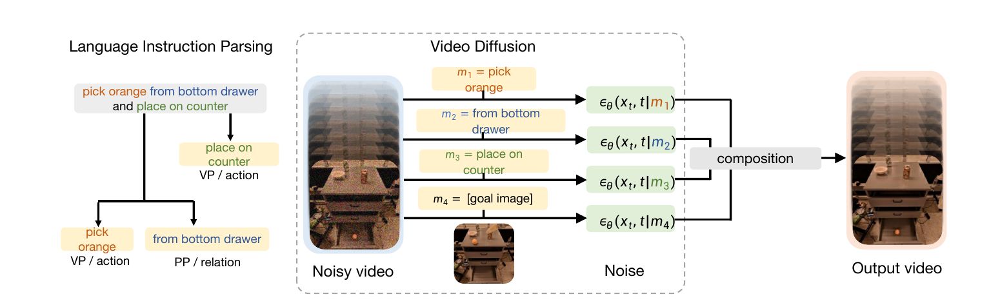
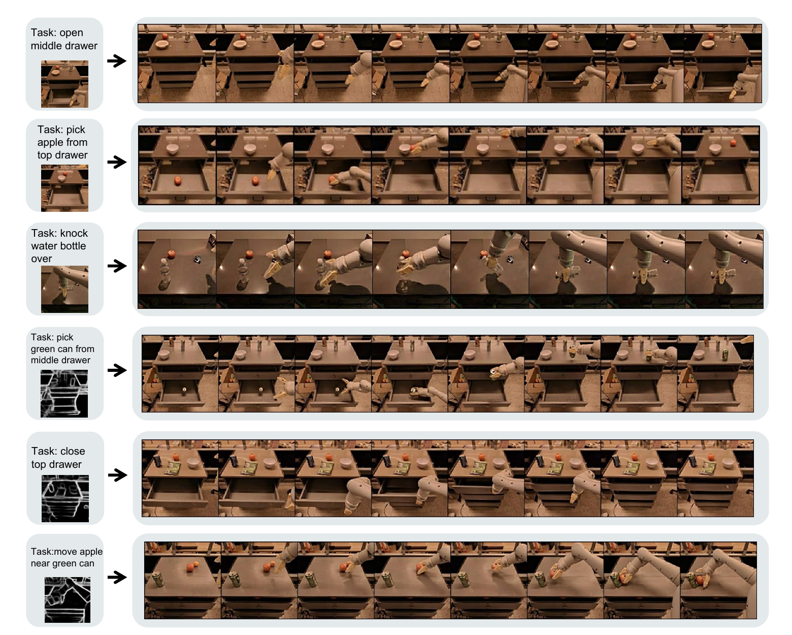
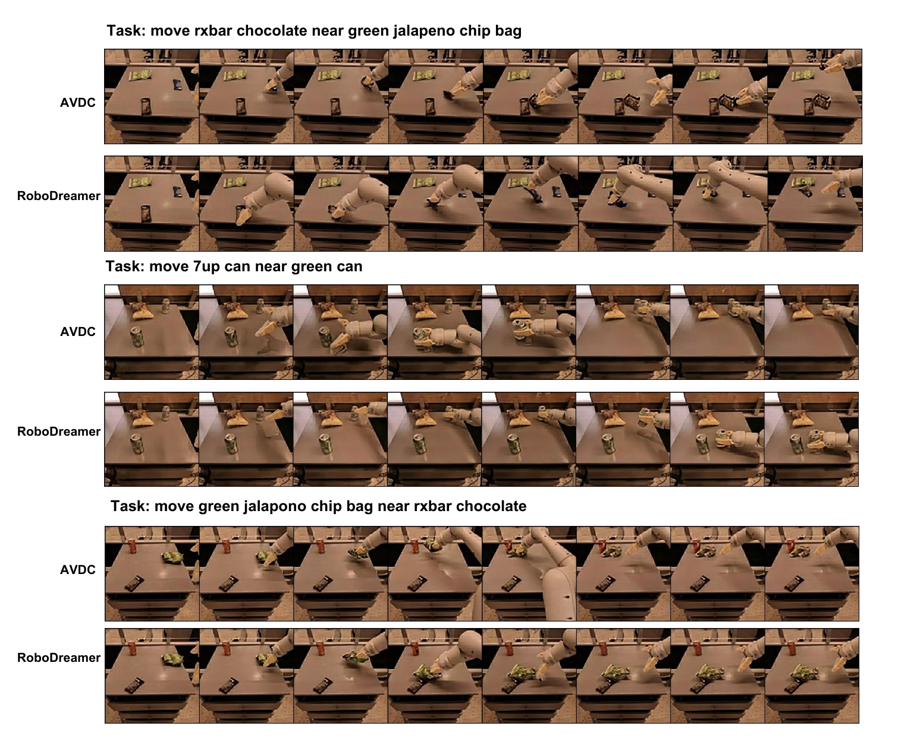
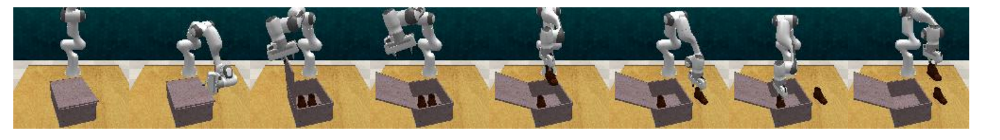

# RoboDreamer (2024)

Il paper [*RoboDreamer: Learning Compositional World Models for Robot Imagination*](https://proceedings.mlr.press/v235/zhou24f.html), di Siyuan Zhou e coautori, è stato pubblicato a ICML 2024. Il lavoro parte dalla formulazione *policy-as-video* di UniPi e affronta un limite dei generatori monolitici: un modello condizionato sull'intera istruzione può memorizzare le combinazioni frequenti senza imparare separatamente azioni, oggetti e relazioni spaziali.

RoboDreamer introduce un **video World Model composizionale**. L'istruzione viene scomposta in primitive linguistiche, ciascuna primitiva condiziona lo score diffusion e i contributi vengono combinati durante il sampling. Il modello può così generare una nuova istruzione quando le sue parti sono note anche se la loro combinazione non è apparsa nel training.

## Dal piano visuale al controllo

Come UniPi, RoboDreamer adotta l'**Unified Predictive Decision Process (UPDP)**. Indichiamo con $o_0$ l'immagine iniziale, con $l$ l'istruzione linguistica e con $\tau=(o_1,\ldots,o_H)$ il video futuro su un orizzonte $H$. Il generatore modella:

$$
p_\theta(\tau\mid o_0,l)
$$

Il video descrive un comportamento desiderato, ma non contiene direttamente i comandi del robot. Un inverse dynamics model $\pi_\phi$ riceve due frame consecutivi del piano e lo stato corrente $q_t$ del robot, quindi predice l'azione $a_t$:

$$
a_t = \pi_\phi(o_t,o_{t+1},q_t)
$$

Le azioni vengono eseguite in sequenza. Per limitare l'errore di traduzione e la divergenza fra piano e ambiente, il sistema rigenera periodicamente il video dalla nuova osservazione e continua in closed loop. Questo schema corregge gli errori visibili dopo che si sono verificati, ma non garantisce che ogni transizione generata fosse realizzabile prima dell'esecuzione.

L'inverse dynamics model usa un backbone ResNet-18 seguito da un MLP ed è addestrato per 10,000 step. Rimane un modulo specifico dell'embodiment e dell'action space: la composizionalità del generatore visuale non produce automaticamente azioni per un robot differente.

## Parsing delle istruzioni

Una frase robotica combina normalmente più vincoli. Nell'esempio «pick orange from bottom drawer and place on counter», RoboDreamer estrae componenti come *pick orange*, *from bottom drawer* e *place on counter*. Le verb phrase rappresentano prevalentemente azione e oggetto; le prepositional phrase descrivono origine, destinazione o relazione spaziale.

Il sistema usa un constituency parser pre-addestrato insieme a regole definite dagli autori. Se $l$ viene scomposta nelle componenti $l_1,\ldots,l_N$, ciascuna può essere vista come una condizione riutilizzabile. La generalizzazione non deriva quindi dalla comprensione arbitraria di una nuova frase: presuppone che il parser produca una struttura corretta e che ogni $l_i$ sia già coperta dai dati.

*Fonte: Zhou et al., RoboDreamer: Learning Compositional World Models for Robot Imagination, Figura 3. A sinistra l'istruzione viene scomposta in azioni e relazioni; a destra lo stesso video diffusion model calcola score separati per testo e goal image, poi li combina per generare il video.*

## Composizione probabilistica

RoboDreamer interpreta ogni condizione $l_i$ come un esperto che assegna probabilità alle traiettorie compatibili. La distribuzione associata all'intera istruzione viene definita come una media geometrica, equivalente a un product-of-experts normalizzato:

$$
p_\theta(\tau\mid l)
\propto
\prod_{i=1}^{N}
p_\theta(\tau\mid l_i)^{1/N}
$$

Una traiettoria riceve alta probabilità quando soddisfa congiuntamente le componenti. Per esempio, il video deve mostrare sia la presa dell'oggetto indicato sia la relazione con il contenitore corretto. L'esponente $1/N$ limita la dipendenza della scala dal numero di componenti.

Nei diffusion model il gradiente del logaritmo della densità, o **score**, della distribuzione composta è la media degli score individuali. Indicando con $\tau_k$ il video corrotto al livello di rumore $k$ e con $\epsilon_\theta(\tau_k,k\mid l_i)$ la predizione del rumore condizionata da $l_i$, la combinazione assume la forma:

$$
\bar\epsilon_\theta(\tau_k,k\mid l) =
\frac{1}{N}
\sum_{i=1}^{N}
\epsilon_\theta(\tau_k,k\mid l_i)
$$

Non vengono mantenuti $N$ modelli con parametri separati. **La stessa rete viene valutata più volte**, cambiando la condizione, e gli output vengono aggregati nel denoising. Questo permette di cambiare a inference il numero e l'associazione delle componenti, al prezzo di un costo che cresce con il loro numero.

## Obiettivo di training

Addestrare soltanto il modello sull'istruzione completa non garantirebbe che ogni componente acquisisca un significato autonomo. RoboDreamer seleziona quindi casualmente un sottoinsieme $S'$ delle componenti estratte e chiede alla media dei relativi score di ricostruire il rumore applicato al video.

Se $M=|S'|$ e $\epsilon$ è il rumore gaussiano campionato, la loss è:

$$
\mathcal{L}_{\mathrm{comp}} =
\left\lVert
\frac{1}{M}
\sum_{l_i\in S'}
\epsilon_\theta(\tau_k,k\mid l_i)
-\epsilon
\right\rVert_2^2
$$

Variare $S'$ obbliga il modello a denoisare sia da condizioni singole sia da combinazioni parziali. In fase di sampling queste stesse componenti possono essere ricombinate con classifier-free guidance. Il meccanismo migliora la modularità, ma non offre una garanzia pratica quando le condizioni sono ambigue, contraddittorie o fuori distribuzione.

## Condizioni multimodali

Il linguaggio identifica bene oggetti e azioni, ma descrive con difficoltà una posa o una configurazione geometrica precisa. RoboDreamer aggiunge quindi un insieme di condizioni visuali $m_1,\ldots,m_K$, costituite da **goal image** o **goal sketch**.

La composizione con testo e immagini estende il product-of-experts:

$$
p_\theta(\tau\mid l,m)
\propto
\prod_{i=1}^{N}p_\theta(\tau\mid l_i)^{1/(N+K)}
\prod_{j=1}^{K}p_\theta(\tau\mid m_j)^{1/(N+K)}
$$

T5-XXL codifica le componenti linguistiche. Goal image e sketch vengono compressi mediante l'encoder VQ-VAE di Stable Diffusion; un Perceiver Sampler porta le diverse modalità in una rappresentazione utilizzabile dalle cross-attention della Video U-Net. Il sistema può così combinare a inference condizioni testo–immagine non presentate insieme durante il training.

*Fonte: Zhou et al., RoboDreamer: Learning Compositional World Models for Robot Imagination, Figura 5. Le prime righe usano testo e goal image; le successive aggiungono sketch che specificano posizione e relazione spaziale desiderate.*

Le condizioni visuali forniscono però una parte della soluzione. Nell'esperimento, le goal image sono i frame finali delle dimostrazioni e gli sketch sono costruiti mediante annotatori di ControlNet. Il miglioramento rispetto al solo testo misura quindi l'utilità di informazioni geometriche aggiuntive, non una migliore comprensione linguistica a parità di input.

## Architettura video diffusion

RoboDreamer è costruito sul video model di AVDC e su componenti di Imagen. La U-Net comprende quattro ResNet block con convoluzioni spazio-temporali e cross-attention sulle istruzioni; temporal attention viene aggiunta nell'ultimo blocco dell'encoder e nel primo del decoder.

Il modello base genera otto frame da $64\times64$ pixel. Due diffusion model successivi effettuano super-resolution a $128\times128$ e $256\times256$, mantenendo otto frame. Come in UniPi, il primo frame osservato viene replicato e concatenato ai frame rumorosi per stabilizzare sfondo, oggetti ed embodiment lungo la sequenza.

Il training usa batch size 256, learning rate $5\times10^{-5}$ e circa **100 GPU NVIDIA V100**. Questo costo non include soltanto il modello base: la cascata di super-resolution e le valutazioni ripetute necessarie alla composizione rendono il sistema notevolmente più oneroso di una policy che predice direttamente le azioni.

## Dati RT-1 e valutazione dei video

Il generatore viene addestrato su circa **70,000 dimostrazioni reali RT-1**, con lunghezza media 44 frame; il paper ne campiona uno ogni cinque. I dati coprono circa 500 task come pick, place, apertura e chiusura di cassetti, knock e pull, raccolti con i manipolatori mobili Everyday Robots.

Queste traiettorie reali forniscono aspetto, dinamica e linguaggio, ma RoboDreamer non viene eseguito sui robot che le hanno raccolte. La valutazione in questo setting riguarda i video sintetizzati. Circa 128 campioni, appartenenti a più di 20 prompt, vengono giudicati da almeno tre persone con un punteggio binario: il piano appare eseguibile e completa il task oppure no.

Sulle istruzioni viste, AVDC ottiene 63.1 punti, HiP 70.3, RoboDreamer senza parsing 85.5 e il modello completo 90.1. Sulle combinazioni non viste i punteggi diventano rispettivamente 46.9, 50.1, 68.8 e **81.3**. La differenza fra modello completo e variante senza parsing è più ampia sullo split unseen, coerentemente con l'obiettivo di ricombinare primitive note.

*Fonte: Zhou et al., RoboDreamer: Learning Compositional World Models for Robot Imagination, Figura 4. Per tre relazioni oggetto–target non viste, le sequenze confrontano il generatore monolitico AVDC con RoboDreamer.*

Con il solo testo, RoboDreamer ottiene 81.3 nella valutazione umana e FVD 487.8. Aggiungendo uno sketch raggiunge 94.7 e FVD 454.7; con la goal image arriva a 95.8 e FVD 444.3. Una metrica aggiuntiva basata sull'IoU delle bounding box rilevate da Grounding DINO segue lo stesso andamento, passando da 63.5 a 72.5 e 78.1.

I giudizi umani catturano meglio di FVD l'allineamento con un'istruzione, ma il campione è piccolo e non vengono riportati intervalli di confidenza. Anche l'IoU misura soprattutto la posizione degli oggetti target, non la plausibilità dei contatti o la realizzabilità di tutti i frame intermedi.

## Esecuzione su RLBench

L'esecuzione delle azioni viene studiata in **RLBench**, quindi in simulazione. L'embodiment è un Franka Panda a 7 gradi di libertà con Franka gripper. RoboDreamer riceve soltanto immagini RGB dalla camera frontale e l'istruzione linguistica; le goal image non vengono usate in questo confronto.

*Fonte: Zhou et al., RoboDreamer: Learning Compositional World Models for Robot Imagination, Figura 6. Una sequenza RLBench mostra il Franka Panda simulato mentre esegue le azioni inferite dal piano visuale.*

Benché RLBench contenga 74 task, la tabella principale ne valuta sei con macro-step: *lamp off*, *lamp on*, *stack blocks*, *lift block*, *take shoes* e *close box*. Il successo medio è 49.3%, rispetto a 44.2% di Hiveformer, 41.0% di UniPi e 31.6% di Image-BC.

RoboDreamer ottiene il valore migliore in quattro task, inclusi 18.5% su *stack blocks* e 10.5% su *take shoes*. Hiveformer rimane migliore su *lamp on* e *lift block*. Il vantaggio aggregato è quindi reale nel protocollo riportato, ma non dimostra superiorità uniforme né copertura dell'intero benchmark.

## Relazione con UniPi

Entrambi i metodi generano un futuro desiderato da $o_0$ e $l$, traducono frame adiacenti mediante inverse dynamics e possono ripianificare in closed loop. Condividono inoltre first-frame tiling e una cascata di diffusion model per aumentare la risoluzione.

La differenza centrale è il **livello al quale viene applicato il condizionamento**. UniPi apprende una sola distribuzione per l'istruzione completa. RoboDreamer scompone l'istruzione e valuta separatamente la stessa rete per ogni parte, combinandone gli score. Guadagna generalizzazione sistematica su nuove associazioni di componenti, ma dipende da un parser, richiede più forward pass per denoising step e può produrre compromessi instabili quando gli esperti non concordano.

Come UniPi, RoboDreamer è meglio descritto come un **goal-directed video planner** che come una dinamica action-conditioned. Il generatore non risponde alla domanda «cosa accadrà se eseguo $a_t$?», ma «quale video sarebbe coerente con questo obiettivo?». Il legame causale con l'azione viene delegato interamente all'inverse dynamics model.

## Novelty

- **Composizione nello spazio degli score:** rappresenta un'istruzione come product-of-experts di condizioni linguistiche riutilizzabili.
- **Training su sottoinsiemi:** obbliga componenti singole e combinazioni parziali a denoisare correttamente, evitando che soltanto la frase completa acquisisca significato.
- **Parsing strutturale:** separa azioni, oggetti e relazioni spaziali per ricombinarli in task non osservati congiuntamente.
- **Composizione multimodale:** integra testo, goal image e sketch nella stessa procedura probabilistica senza richiedere ogni possibile combinazione durante il training.
- **Validazione sul controllo:** collega i video composti a un inverse dynamics model e mostra un miglioramento medio su sei task RLBench.

## Limiti

Il presupposto chiave è che ciascuna primitiva sia in distribuzione. RoboDreamer non acquisisce automaticamente un verbo, un oggetto o una relazione mai osservati; generalizza soltanto la loro associazione. Il constituency parser e le regole possono inoltre produrre componenti errate o troppo specifiche, soprattutto per istruzioni ambigue e strutture linguistiche diverse da quelle attese.

Il product-of-experts privilegia le regioni sulle quali tutte le condizioni concordano. Quando due score sono incompatibili, la loro combinazione può condurre il denoising verso una regione a bassa qualità per entrambi. Il paper non introduce un meccanismo per diagnosticare conflitti, calibrare l'affidabilità dei singoli esperti o ridurre il peso di una condizione fuori distribuzione.

La generazione è costosa: la cascata diffusion viene addestrata su circa 100 V100 e ogni componente richiede ulteriori valutazioni della U-Net durante il sampling. Questo costo si somma alla necessità di rigenerare video per il controllo closed loop e limita la frequenza alla quale il robot può reagire.

Le traiettorie non sono condizionate sulle azioni candidate e possono violare cinematica, collisioni o dinamica. L'inverse dynamics separato riceve soltanto frame adiacenti e stato corrente; non garantisce che una transizione sintetica sia raggiungibile né che l'azione scelta mantenga valida la parte successiva del video.

Gli autori riconoscono tre limiti percettivi: uso di una sola camera, generalizzazione debole a numerose immagini reali e difficoltà con camere in movimento. Mancano una rappresentazione 3D e una memoria esplicita delle parti occluse. Infine, i video reali RT-1 sono valutati attraverso pochi giudizi umani, mentre l'esecuzione è limitata a sei task simulati con macro-step: non viene dimostrato controllo su robot fisici, trasferimento cross-embodiment o robustezza in scene aperte.
