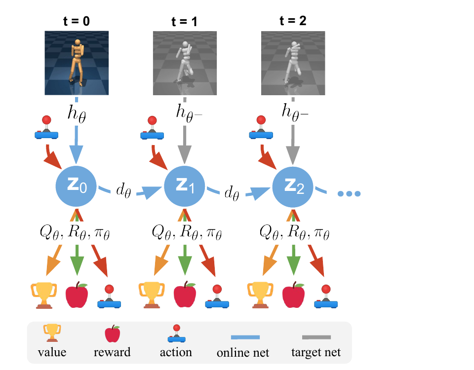
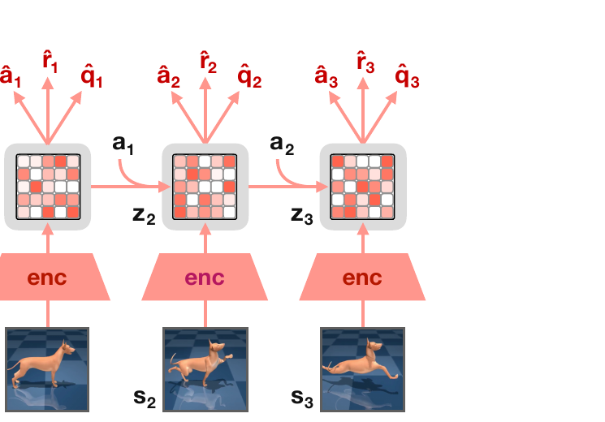
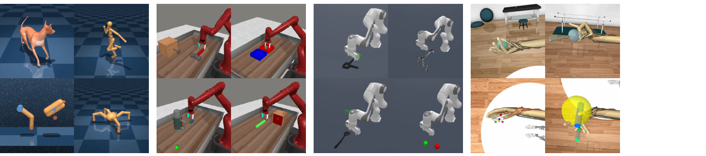
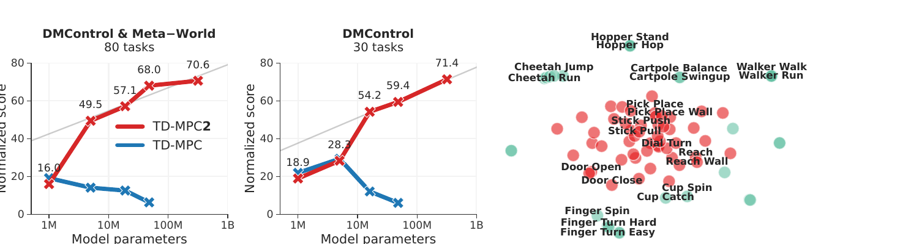

# TD-MPC (2022) e TD-MPC2 (2024)

I paper [*Temporal Difference Learning for Model Predictive Control*](https://arxiv.org/abs/2203.04955), pubblicato da Nicklas Hansen, Xiaolong Wang e Hao Su nel 2022, e [*TD-MPC2: Scalable, Robust World Models for Continuous Control*](https://arxiv.org/abs/2310.16828), pubblicato da Nicklas Hansen, Hao Su e Xiaolong Wang nel 2024, sviluppano una stessa idea: usare un **World Model implicito e orientato al controllo** per pianificare a breve termine, affidando a una value function appresa la stima delle conseguenze più lontane.

La famiglia TD-MPC si colloca tra model-based e model-free reinforcement learning. Il comportamento viene calcolato online mediante Model Predictive Control, ma modello, value function e policy prior vengono appresi con temporal-difference learning. Il World Model non genera osservazioni future: produce soltanto i latent, i reward e i value necessari a confrontare azioni continue.

## Perché combinare MPC e temporal-difference learning

Il **Model Predictive Control (MPC)** ottimizza una sequenza di azioni su un orizzonte finito $H$, esegue la prima azione e ripianifica dopo la nuova osservazione. Un orizzonte breve riduce il costo e limita l'accumulo degli errori del modello, ma rende il controller miope: un'azione utile soltanto dopo $H$ step può apparire priva di valore.

TD-MPC chiude questo intervallo mediante una funzione $Q$ terminale. Il modello predice reward affidabili nel tratto locale; il $Q$-value riassume il return atteso dopo la fine del rollout. Per una sequenza candidata $a_{t:t+H}$, il planner usa quindi il criterio:

$$
J(a_{t:t+H}) =
\sum_{k=0}^{H-1}\gamma^k\hat r_{t+k}
+\gamma^H Q(s_{t+H},a_{t+H})
$$

Qui $s_t$ è lo stato latente, $a_t$ l'azione continua, $\hat r_t$ il reward predetto e $\gamma$ il discount factor. **Il rollout esplicito copre il futuro vicino, mentre il bootstrap terminale approssima il resto dell'orizzonte infinito**.

## TD-MPC e il modello TOLD

TD-MPC introduce il **Task-Oriented Latent Dynamics model (TOLD)**. Dato $o_t$, che può essere uno stato propriocettivo, un'immagine o un input multimodale, il modello contiene cinque componenti deterministiche:

$$
\begin{aligned}
s_t &= h_\theta(o_t) && \text{encoder}\\
s_{t+1} &= d_\theta(s_t,a_t) && \text{dinamica latente}\\
\hat r_t &= R_\theta(s_t,a_t) && \text{reward model}\\
\hat q_t &= Q_\theta(s_t,a_t) && \text{value function}\\
\hat a_t &= \pi_\theta(s_t) && \text{policy prior}
\end{aligned}
$$

L'encoder $h_\theta$ viene applicato soltanto alla prima osservazione del rollout immaginato. Gli stati successivi sono prodotti ricorsivamente da $d_\theta$, senza ricevere nuove osservazioni. Reward, value e azioni proposte vengono predetti a ogni profondità, così tutti gli obiettivi esercitano supervisione anche sulle transizioni latenti multi-step.

*Fonte: Hansen et al., Temporal Difference Learning for Model Predictive Control, Figura 2. Il primo latent è calcolato dalla rete online; dynamics, reward, value e policy vengono srotolati ricorsivamente. Le osservazioni successive sono codificate dalla target network e forniscono target di consistenza soltanto durante il training.*

TOLD non è addestrato a ricostruire $o_t$. La rappresentazione conserva invece ciò che serve a prevedere reward, value e transizioni rilevanti per il task. Come MuZero, TD-MPC rinuncia quindi a una semantica fisica imposta sul latent; diversamente da MuZero, introduce un target diretto nello spazio delle rappresentazioni e usa un planner progettato per azioni continue.

## Obiettivo congiunto di TD-MPC

Una sequenza di transizioni $(o_i,a_i,r_i,o_{i+1})$ viene campionata dal replay buffer. A partire da $s_t=h_\theta(o_t)$, il modello viene srotolato per più step e minimizza tre termini a ogni profondità.

La **reward loss** confronta la ricompensa predetta con quella osservata:

$$
\mathcal{L}_r =
\lVert R_\theta(s_i,a_i)-r_i\rVert_2^2
$$

La **value loss** usa un target TD one-step. Una copia lenta dei parametri, indicata con $\bar\theta$, riduce l'instabilità del bootstrap:

$$
y_i =
r_i+\gamma Q_{\bar\theta}
\left(
\bar s_{i+1},
\pi_\theta(\bar s_{i+1})
\right)
$$

$$
\mathcal{L}_Q =
\lVert Q_\theta(s_i,a_i)-y_i\rVert_2^2
$$

Lo stato $\bar s_{i+1}=h_{\bar\theta}(o_{i+1})$ è prodotto dal target encoder. Lo stesso stato fornisce il riferimento per la **latent consistency loss**:

$$
\mathcal{L}_{\mathrm{cons}} =
\lVert d_\theta(s_i,a_i)-\operatorname{sg}(\bar s_{i+1})\rVert_2^2
$$

L'operatore $\operatorname{sg}$, o *stop gradient*, impedisce che il target venga modificato direttamente dalla loss. Il modello deve avvicinare la propria transizione alla rappresentazione dell'osservazione realmente raggiunta, senza dover prevedere pixel o coordinate fisiche.

I termini vengono sommati su un orizzonte di training e pesati geometricamente, attribuendo maggiore importanza alle predizioni vicine:

$$
\mathcal{L}_{\mathrm{TOLD}} =
\sum_{k=0}^{H}\lambda^k
\left(
c_r\mathcal{L}_r^{t+k}
+c_Q\mathcal{L}_Q^{t+k}
+c_s\mathcal{L}_{\mathrm{cons}}^{t+k}
\right)
$$

I coefficienti $c_r$, $c_Q$ e $c_s$ bilanciano le tre loss, mentre $\lambda$ riduce il peso degli step più lontani. La propagazione dei gradienti attraverso l'intero unroll insegna alla dynamics function a mantenere reward e value predicibili anche dopo transizioni ricorsive.

La policy deterministica $\pi_\theta$ viene addestrata separatamente a massimizzare $Q_\theta(s,\pi_\theta(s))$. Non è normalmente la policy eseguita nell'ambiente: serve a calcolare efficientemente i target TD e a proporre traiettorie al planner. Durante la raccolta dei dati riceve rumore gaussiano con ampiezza decrescente per sostenere l'esplorazione.

## Planning con MPPI

TD-MPC usa una variante di **Model Predictive Path Integral (MPPI)**. Il planner mantiene, per ogni posizione dell'orizzonte, una gaussiana con media e varianza diagonale sulle azioni. Inizialmente campiona 512 sequenze; una piccola frazione viene generata seguendo la policy prior anziché la gaussiana corrente.

Ogni candidato viene valutato con la somma dei reward latenti e il $Q$ terminale. Il planner conserva le 64 traiettorie migliori e aggiorna media e deviazione standard mediante una media pesata esponenzialmente dal return. La procedura viene ripetuta normalmente per sei iterazioni, con orizzonte $H=5$; Dog e Humanoid richiedono un numero maggiore di iterazioni.

La distribuzione trovata allo step precedente viene traslata di una posizione e usata come *warm start*. Dopo l'ottimizzazione viene campionata ed eseguita soltanto la prima azione, poi il piano viene ricalcolato. Questo **receding-horizon control** consente alle osservazioni reali di correggere continuamente gli errori del rollout.

Le ablation mostrano che aumentare orizzonte e iterazioni migliora i task dinamicamente complessi, ma con rendimenti decrescenti. È anche possibile usare direttamente la policy prior per ridurre la latenza, perdendo però prestazioni rispetto al planning.

## Esperimenti di TD-MPC

TD-MPC viene valutato in 92 configurazioni basate su **DeepMind Control Suite** e **Meta-World v2**. Gli esperimenti comprendono locomozione Humanoid e Dog con action space fino a 38 dimensioni, 15 task DMControl da stato, benchmark visuali da frame RGB, due task multimodali con propriocezione e camera egocentrica, 50 task di manipolazione goal-conditioned con il robot Sawyer simulato e il setting multi-task MT10.

Non viene utilizzato un dataset statico iniziale. L'agente alterna planning nell'ambiente, inserimento delle transizioni nel replay buffer e aggiornamento di TOLD. Per gli input visuali usa tre frame RGB $84\times84$ sovrapposti e random shift augmentation; il medesimo obiettivo latente rimane invariato rispetto alle osservazioni di stato.

TD-MPC supera o eguaglia i baseline nella maggior parte dei task e mostra i guadagni maggiori su dinamiche complesse come Humanoid, Dog, Quadruped e Bin Picking. Il paper riporta il primo risultato capace di risolvere i task Dog di DMControl e prestazioni competitive con metodi specializzati nel controllo da immagini, pur mantenendo gli stessi iperparametri tra task.

Il comportamento non è però uniforme. Nel task Finger Turn Hard, caratterizzato da esplorazione difficile, TD-MPC è meno sample-efficient di SAC e LOOP. Il risultato evidenzia che un buon modello locale e una policy guidata dal value non risolvono automaticamente il problema di scoprire reward rari.

## Da TD-MPC a TD-MPC2

Lo scaling diretto del TOLD originale non è stabile. Aumentando dimensione del modello e varietà dei task possono comparire gradienti esplosivi, scale dei reward incompatibili e target $Q$ distorti. TD-MPC2 conserva encoder, dinamica, reward, value e policy prior, ma ne modifica rappresentazione, loss e parametrizzazione.

*Fonte: Hansen et al., TD-MPC2: Scalable, Robust World Models for Continuous Control, Figura 3. Le osservazioni vengono codificate in latent normalizzati; il modello avanza ricorsivamente usando le azioni e predice a ogni step policy prior, reward e value terminale, senza decoder visuale.*

Nella configurazione basata sullo stato, le componenti sono MLP con **LayerNorm** e attivazioni Mish; negli esperimenti visuali l'encoder viene sostituito da una piccola rete convoluzionale. La rappresentazione viene stabilizzata mediante **Simplicial Normalization (SimNorm)**: il latent è diviso in gruppi di dimensione $V$ e a ogni gruppo viene applicata una softmax. Se $s^{(j)}$ è il gruppo $j$ e $\tau$ la temperatura, la normalizzazione è:

$$
\operatorname{SimNorm}(s^{(j)})_i =
\frac{\exp(s_i^{(j)}/\tau)}
{\sum_{m=1}^{V}\exp(s_m^{(j)}/\tau)}
$$

Ogni gruppo appartiene così a un simplesso: i valori sono limitati, sommano a uno e tendono a una rappresentazione sparsa senza imporre una quantizzazione discreta. Le ablation mostrano che SimNorm è essenziale soprattutto nei task più difficili e nel training multi-task.

TD-MPC2 apprende cinque funzioni $Q$ anziché due. Per costruire il target seleziona casualmente due membri dell'ensemble e ne usa il minimo, riducendo l'overestimation bias. Alle value function viene inoltre applicato un dropout dell'1%.

Reward e value non sono più appresi con una regressione quadratica continua. I target vengono trasformati su scala logaritmica e rappresentati come distribuzioni morbide su 101 bin; la cross-entropy risultante è meno sensibile alla diversa ampiezza dei reward tra domini. La consistenza latente rimane invece una regressione continua, perché il latent è già normalizzato da SimNorm.

La policy prior diventa stocastica e viene addestrata con un obiettivo **maximum-entropy**. Un coefficiente adattato tramite statistiche mobili bilancia $Q$ ed entropia, evitando che quest'ultima collassi prematuramente quando cambiano scala del reward o fase del training. Il planner resta MPPI, ma usa un orizzonte predefinito di 3, sei iterazioni, 512 candidati e 24 traiettorie provenienti dalla policy prior; aggiunge due iterazioni quando l'action space ha almeno 20 dimensioni.

## Obiettivo di TD-MPC2

Indichiamo con $e$ il task embedding e manteniamo $s_t$ per il latent. Le cinque componenti diventano:

$$
\begin{aligned}
s_t &= h_\theta(o_t,e)\\
s_{t+1} &= d_\theta(s_t,a_t,e)\\
\hat r_t &= R_\theta(s_t,a_t,e)\\
\hat q_t &= Q_\theta(s_t,a_t,e)\\
\hat a_t &\sim p_\theta(\cdot\mid s_t,e)
\end{aligned}
$$

Per una sequenza campionata dal replay buffer, l'obiettivo principale può essere scritto come:

$$
\mathcal{L}_{\mathrm{TD\text{-}MPC2}} =
\sum_{k=0}^{H}\lambda^k
\left[
\lVert s_{t+k+1}-\operatorname{sg}(h_{\bar\theta}(o_{t+k+1},e))\rVert_2^2
+\operatorname{CE}(\hat r_{t+k},r_{t+k})
+\operatorname{CE}(\hat q_{t+k},y_{t+k})
\right]
$$

Il simbolo $\operatorname{CE}$ indica la cross-entropy sui target discretizzati. Il target TD usa il reward reale e una value function target aggiornata mediante exponential moving average. Rispetto a TD-MPC, la logica rimane la stessa, ma normalizzazione e classificazione discreta rendono il training meno dipendente dalla scala numerica del singolo task.

TD-MPC2 abbandona inoltre il prioritized replay in favore del campionamento uniforme e rimuove il momentum dagli aggiornamenti MPPI. Sono semplificazioni importanti: la robustezza non deriva soltanto dall'aggiunta di moduli, ma anche dall'eliminazione di euristiche sensibili al dominio.

## Un modello per task ed embodiment differenti

Per il training multi-task, ogni componente è condizionata da un embedding $e$ appreso a partire dall'identificatore del task. La norma di $e$ viene limitata a uno per stabilizzare l'ottimizzazione. Il paper osserva che gli embedding emergenti raggruppano soprattutto task con dinamiche simili, per esempio perché condividono embodiment o oggetti, più che verbi semanticamente affini.

Osservazioni e azioni con dimensioni diverse vengono portate alla dimensione massima mediante **zero-padding**. Un action mask impedisce alla policy di produrre o valorizzare dimensioni inesistenti e il planner campiona soltanto quelle valide. Questa soluzione non richiede conoscenza specifica della struttura di ciascun robot, ma presuppone che le coordinate possano essere allineate in un vettore comune.

L'embedding non è un'istruzione linguistica e non viene inferito autonomamente dalla scena. In fase di test il task deve essere identificato; per un task nuovo, l'embedding può essere inizializzato da quello di un task ritenuto simile oppure casualmente e poi ottimizzato durante il fine-tuning.

## Domini e protocolli di TD-MPC2

La valutazione single-task comprende **104 task di controllo continuo** distribuiti in quattro simulatori:

- 39 task DMControl, con locomozione di Dog, Humanoid, Quadruped e altri sistemi;
- 50 task Meta-World con un unico robot manipolatore e obiettivi differenti;
- 5 task ManiSkill2 di manipolazione, tra cui Lift Cube, Stack Cube e Pick YCB su 74 oggetti;
- 10 task MyoSuite con una mano muscoloscheletrica, 39 attuatori e obiettivi di reaching, posa e manipolazione.

*Fonte: Hansen et al., TD-MPC2: Scalable, Robust World Models for Continuous Control, Figura 2. Da sinistra a destra sono mostrati DMControl, Meta-World, ManiSkill2 e MyoSuite, che introducono locomozione, manipolatori differenti e controllo muscoloscheletrico.*

Gli action space arrivano a 39 dimensioni e alcuni task hanno reward sparsi, oggetti multipli o forte randomizzazione. Dieci task DMControl vengono inoltre valutati da immagini. Nel protocollo online il replay buffer è inizialmente vuoto e viene popolato dall'agente mediante MPC; TD-MPC2 usa lo stesso insieme di iperparametri in tutti i domini.

Lo studio di scaling adotta invece un regime offline. Cinque modelli da 1 a 317 milioni di parametri vengono addestrati su 545 milioni di transizioni raccolte dai replay buffer di 240 agenti single-task. I dati coprono 80 task, 50 Meta-World e 30 DMControl, e includono comportamenti da casuali a esperti. Un secondo dataset contiene 345 milioni di transizioni per i soli 30 task DMControl.

## Risultati e scaling

Negli esperimenti online TD-MPC2 supera in aggregato SAC, DreamerV3 e TD-MPC in tutti e quattro i domini. I vantaggi più marcati emergono nella locomozione ad alta dimensionalità e nella manipolazione fine; il TOLD originale può invece divergere per gradienti esplosivi quando viene applicato alle configurazioni più difficili.

*Fonte: Hansen et al., TD-MPC2: Scalable, Robust World Models for Continuous Control, Figura 7. A sinistra il punteggio normalizzato cresce con la dimensione di TD-MPC2 sui dataset da 80 e 30 task, mentre lo scaling diretto di TD-MPC peggiora. A destra, la proiezione t-SNE mostra la struttura degli embedding di task appresi.*

Sul dataset da 80 task, il punteggio normalizzato passa da 16.0 con 1 milione di parametri a 70.6 con **317 milioni di parametri**. Il modello più grande richiede circa 33 GPU-day su una NVIDIA RTX 3090 secondo la stima degli autori. Il trend non dimostra una legge di scaling universale, ma mostra che le modifiche di TD-MPC2 impediscono il deterioramento osservato aumentando la capacità di TD-MPC.

Il paper esplora anche il trasferimento a dieci task esclusi dal pretraining. Un modello da 19 milioni di parametri pre-addestrato su 70 task e aggiornato online per 20,000 step ottiene un punteggio aggregato di 47.0, contro 24.0 del training da zero. Si tratta di **fine-tuning few-shot**, non di esecuzione zero-shot: il nuovo task richiede comunque dati, reward e aggiornamenti dei parametri.

## Relazione con PlaNet e MuZero

PlaNet, MuZero e TD-MPC apprendono tutti una dinamica latente usata durante il planning, ma impongono supervisioni differenti. PlaNet ricostruisce le immagini e usa una dinamica stocastica; MuZero apprende reward, policy e value senza target sul latent; TD-MPC aggiunge invece una consistenza tra latent predetto e latent dell'osservazione successiva.

Anche il planner riflette il dominio. PlaNet e TD-MPC ottimizzano sequenze continue mediante sampling, ma TD-MPC aggiunge un $Q$ terminale e una policy prior. MuZero usa MCTS su azioni discrete e condivide statistiche tra i rami dell'albero. TD-MPC2 porta il paradigma del planning continuo task-oriented verso il multi-task, senza trasformarlo in un modello generativo o linguistico.

## Novelty

- **Planning locale con valore globale:** TD-MPC combina reward previsti su rollout brevi e bootstrap da un $Q$ terminale appreso con TD learning.
- **TOLD decoder-free:** reward, value e consistenza latente addestrano congiuntamente una dinamica orientata al task senza ricostruire osservazioni.
- **Policy-guided MPPI:** una policy appresa accelera sia il calcolo del target TD sia il campionamento delle sequenze, lasciando al planner la decisione finale.
- **Robustezza di TD-MPC2:** SimNorm, LayerNorm, discrete regression ed ensemble di $Q$ stabilizzano il training tra reward scale e domini diversi.
- **World Model multi-task scalabile:** task embedding, zero-padding e action masking consentono a un unico modello da 317 milioni di parametri di coprire 80 task, più embodiment e action space differenti.

## Limiti

Le dynamics function sono deterministiche e non modellano distribuzioni sui futuri né incertezza epistemica. MPPI può quindi assegnare return elevati a rollout fuori distribuzione senza disporre di un criterio esplicito per riconoscere l'errore del modello. Il receding horizon attenua il problema dopo ogni nuova osservazione, ma non protegge la singola decisione da model exploitation.

La rappresentazione è supervisionata dal reward e dalla struttura dei dati disponibili. Questa specializzazione migliora il controllo sul task corrente, ma può eliminare dettagli indispensabili a un obiettivo futuro. Poiché manca un decoder, non è possibile ispezionare direttamente cosa il modello immagini o verificare la plausibilità visiva e fisica di una traiettoria.

Il costo di inferenza rimane significativo: la configurazione standard di TD-MPC2 valuta 512 sequenze per sei iterazioni a ogni azione, oltre ai candidati della policy prior. La policy può essere usata da sola quando serve bassa latenza, ma il paper mostra che in generale non raggiunge la qualità del planning.

TD-MPC2 supporta action space continui; l'estensione alle azioni discrete viene lasciata come problema aperto. Padding e mascheramento permettono dimensionalità diverse, ma non risolvono automaticamente differenze semantiche tra attuatori o observation space. Il task embedding è un ID appreso e richiede fine-tuning per nuovi obiettivi, quindi non dimostra composizionalità linguistica o generalizzazione zero-shot.

Il pretraining multi-task usa dati offline eterogenei senza un obiettivo specifico di offline RL. Gli autori riconoscono il rischio di extrapolation error quando la copertura stato-azione è limitata o sbilanciata. Tutti gli esperimenti avvengono inoltre in simulazione: non vengono valutati rumore reale, ritardi, safety constraint, trasferimento sim-to-real o danni causati da reward misspecification.
