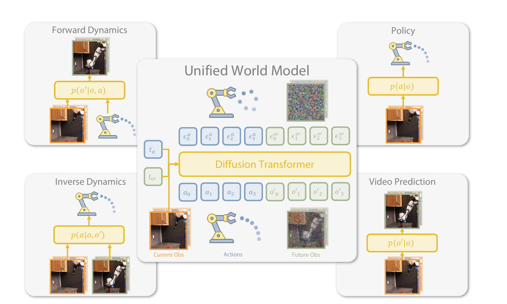
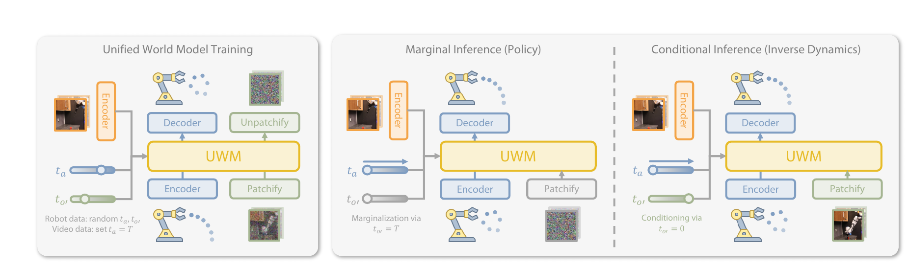
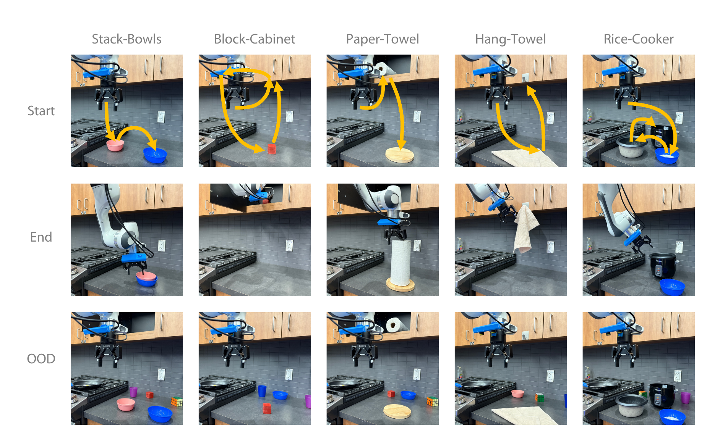
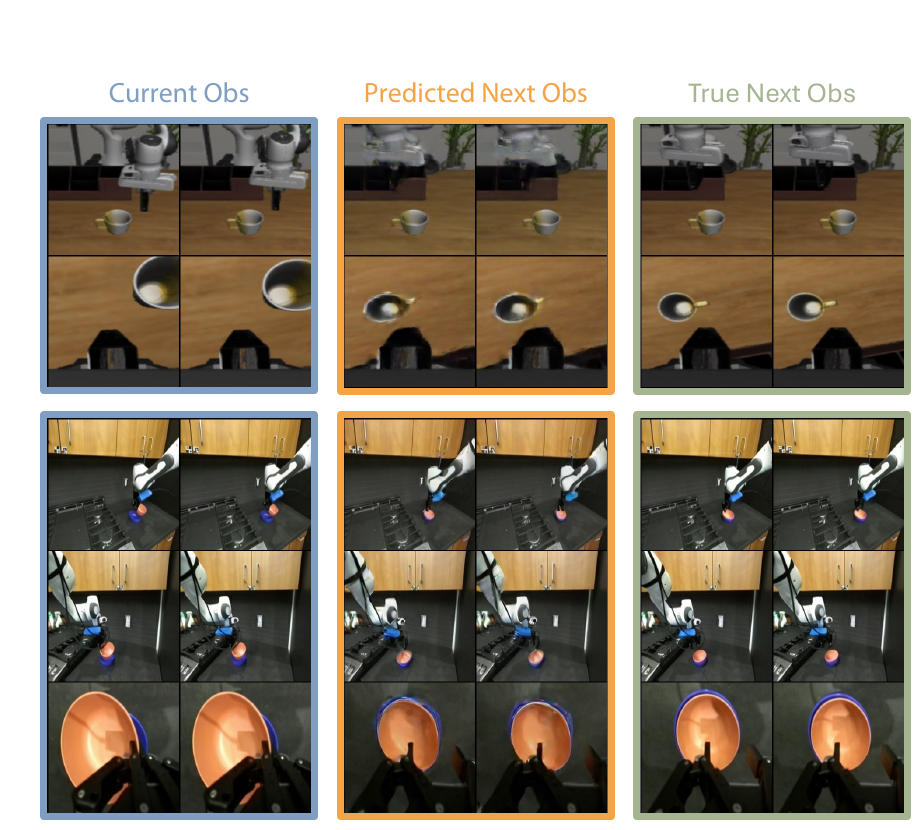

# Unified World Models (2025)

Il paper [*Unified World Models: Coupling Video and Action Diffusion for Pretraining on Large Robotic Datasets*](https://www.roboticsproceedings.org/rss21/p015.pdf), di Chuning Zhu e coautori, è stato pubblicato a Robotics: Science and Systems 2025. Il lavoro propone **Unified World Models (UWM)** per avvicinare due formulazioni normalmente separate: la policy diffusion, che genera azioni, e il video World Model, che genera osservazioni future.

L'unificazione non consiste soltanto nel collocare due teste sullo stesso backbone. UWM apprende una distribuzione diffusion congiunta sulle azioni e sulle immagini future, usando però un livello di rumore distinto per ciascuna modalità. Questa indipendenza permette allo stesso modello di marginalizzare o condizionare selettivamente una variabile e di assumere quattro ruoli diversi senza essere riaddestrato.

*Fonte: Zhu et al., Unified World Models: Coupling Video and Action Diffusion for Pretraining on Large Robotic Datasets, Figura 1. Un solo Diffusion Transformer rappresenta policy, forward dynamics, inverse dynamics e video prediction controllando separatamente il rumore di azioni e osservazioni future.*

## Distribuzione congiunta di azioni e futuro

Indichiamo con $o_t$ il blocco di osservazioni correnti, con $\mathbf{a}_t=(a_t,\ldots,a_{t+h_a-1})$ un chunk di $h_a$ azioni e con $o_t^+$ il blocco visuale successivo all'esecuzione del chunk. Il dataset robotico fornisce triple $(o_t,\mathbf{a}_t,o_t^+)$; un dataset video action-free fornisce invece soltanto coppie $(o_t,o_t^+)$.

Da queste variabili si possono ottenere quattro distribuzioni utili. La policy campiona $p(\mathbf{a}_t\mid o_t)$, la forward dynamics campiona $p(o_t^+\mid o_t,\mathbf{a}_t)$, l'inverse dynamics campiona $p(\mathbf{a}_t\mid o_t,o_t^+)$ e il video predictor campiona $p(o_t^+\mid o_t)$. I metodi tradizionali addestrano spesso un modello differente per ciascuna distribuzione; UWM cerca di rappresentarle come viste della stessa distribuzione congiunta condizionata su $o_t$.

## Due processi diffusion accoppiati

Siano $k_a$ e $k_o$ i timestep diffusion rispettivamente del chunk di azioni e dell'osservazione futura. I due segnali vengono corrotti in modo indipendente:

$$
\mathbf{a}_t^{(k_a)} =
\sqrt{\bar\alpha_{k_a}}\mathbf{a}_t+
\sqrt{1-\bar\alpha_{k_a}}\epsilon_a
$$

$$
o_t^{+,(k_o)} =
\sqrt{\bar\alpha_{k_o}}o_t^++
\sqrt{1-\bar\alpha_{k_o}}\epsilon_o
$$

I rumori $\epsilon_a$ e $\epsilon_o$ sono campioni gaussiani, mentre $\bar\alpha_k$ determina quanta parte del segnale pulito rimane al timestep $k$. Per $k=0$ la variabile è pulita e agisce da condizione; per $k=T$ è quasi interamente rumore e viene di fatto mascherata.

Il network $s_\theta$ riceve $o_t$, entrambe le variabili rumorose e i due timestep, quindi predice i rumori applicati:

$$
(\hat\epsilon_a,\hat\epsilon_o)=
s_\theta\left(
o_t,
\mathbf{a}_t^{(k_a)},
o_t^{+,(k_o)},
k_a,
k_o
\right)
$$

Durante il training $k_a$ e $k_o$ vengono campionati indipendentemente. Il modello osserva quindi combinazioni in cui azioni e immagini sono pulite, parzialmente corrotte o quasi completamente mascherate, anziché un solo livello condiviso come nei joint diffusion model precedenti.

## Obiettivo di training

La loss è la somma pesata dei due errori di denoising:

$$
\mathcal{L}(\theta)=
\mathbb{E}\left[
w_a\lVert\hat\epsilon_a-\epsilon_a\rVert_2^2+
w_o\lVert\hat\epsilon_o-\epsilon_o\rVert_2^2
\right]
$$

I coefficienti $w_a$ e $w_o$ bilanciano azione e osservazione futura; negli esperimenti sono entrambi pari a $1.0$. La previsione del rumore visuale richiede di rappresentare come la scena cambia lungo la traiettoria, mentre quella del rumore d'azione preserva la distribuzione multimodale della policy.

Un'ablation confronta questo obiettivo con la ricostruzione dell'osservazione corrente. Nei task reali Stack-Bowls e Block-Cabinet, predire il futuro ottiene rispettivamente 0.86 e 0.76, ricostruire il presente 0.70 e 0.66, mentre la Diffusion Policy priva di ricostruzione raggiunge 0.48 e 0.60. Il vantaggio non dipende quindi soltanto da maggiore supervisione percettiva: **la componente temporale del target contribuisce al trasferimento**.

## Quattro modalità di inference

I due timestep diventano un'interfaccia per scegliere la distribuzione desiderata. Una modalità viene condizionata impostandone il timestep a $0$, marginalizzata fissandolo a $T$ con rumore gaussiano, oppure generata eseguendo il reverse diffusion da $T$ a $0$.

| Modalità | Azioni | Osservazioni future | Distribuzione |
|---|---|---|---|
| Policy | denoise da $T$ a $0$ | fissate a rumore con $k_o=T$ | $p(\mathbf{a}_t\mid o_t)$ |
| Video prediction | fissate a rumore con $k_a=T$ | denoise da $T$ a $0$ | $p(o_t^+\mid o_t)$ |
| Forward dynamics | pulite con $k_a=0$ | denoise da $T$ a $0$ | $p(o_t^+\mid o_t,\mathbf{a}_t)$ |
| Inverse dynamics | denoise da $T$ a $0$ | pulite con $k_o=0$ | $p(\mathbf{a}_t\mid o_t,o_t^+)$ |

La policy non deve generare prima un video: l'osservazione futura viene marginalizzata e soltanto le azioni vengono denoisate. Analogamente, la forward dynamics riceve il chunk di azioni pulito e genera le immagini. L'unificazione riguarda dunque i parametri e la distribuzione appresa, non l'obbligo di calcolare sempre entrambe le modalità.

*Fonte: Zhu et al., Unified World Models: Coupling Video and Action Diffusion for Pretraining on Large Robotic Datasets, Figura 2. A sinistra i timestep vengono campionati per i dati robotici e le azioni sono mascherate nei video; a destra l'osservazione futura viene marginalizzata per la policy oppure mantenuta pulita per l'inverse dynamics.*

## Co-training con video privi di azioni

Per una coppia video $(o_t,o_t^+)$ l'azione è sconosciuta. UWM imposta $k_a=T$, sostituisce il chunk mancante con rumore gaussiano e applica lo stesso obiettivo. Il rumore completo funziona come una maschera compatibile con l'interfaccia diffusion, evitando di introdurre un token speciale disponibile soltanto per una parte dei dati.

Il paper interpreta questa procedura come marginalizzazione dell'azione. Operativamente, la loss visuale rimane ben supervisionata, mentre la testa d'azione riceve anche esempi nei quali non è possibile inferire un comando specifico dal solo futuro. L'efficacia dipende dalla capacità del backbone di condividere caratteristiche senza diluire il segnale proveniente dalle traiettorie annotate.

Nel confronto, GR-1 usa un mask token apprendibile e mostra trasferimento misto: il co-training peggiora alcuni task. UWM migliora invece in tutte le condizioni reali della tabella principale. Questo risultato supporta l'uso dei timestep come meccanismo uniforme di mascheramento, pur non dimostrando che funzionerebbe allo stesso modo con video molto lontani dal dominio robotico.

## Architettura

UWM usa un **Diffusion Transformer** con 12 layer, 12 teste di attention, dimensione nascosta 768 e MLP ratio 4. Le osservazioni correnti comprendono due frame per ciascuna camera e vengono codificate con un ResNet-18 inizializzato da ImageNet ma aggiornato durante il training. I loro embedding, insieme alle codifiche sinusoidali di $k_a$ e $k_o$, modulano ogni blocco attraverso Adaptive Layer Normalization.

Le immagini future da $224\times224$ pixel sono compresse da un VAE SDXL congelato in latenti da $28\times28\times4$. Una convoluzione 3D le divide in patch spazio-temporali da $4\times4\times2$. Il chunk di 16 azioni è convertito in token da un MLP superficiale; token d'azione, patch visuali e otto **register token** apprendibili formano il contesto self-attention.

I register non producono output e vengono scartati. Offrono uno spazio intermedio nel quale token visuali e d'azione possono scambiarsi informazione senza sovrascrivere rappresentazioni che devono direttamente predire rumore. Su due task LIBERO, otto register superano quattro register, l'assenza di register e una variante con cross-attention.

Il training usa 100 timestep diffusion. L'inference impiega DDIM con dieci step, produce un chunk di 16 azioni, esegue le prime otto e poi ricalcola la policy dalla nuova osservazione. Il pretraining DROID per 100,000 gradient step richiede circa 24 ore su quattro NVIDIA A100.

## Pretraining su DROID

Per gli esperimenti reali gli autori estraggono **2,000 traiettorie annotate da DROID**, selezionate in base al luogo di raccolta, come dataset di pretraining. Per il co-training scelgono altre 2,000 traiettorie DROID da località differenti e ne eliminano le azioni, trattandole come semplici video.

Questa costruzione controlla la disponibilità delle annotazioni ma mantiene favorevoli embodiment e dominio: i video action-free provengono ancora da robot Franka in setup DROID. Dimostra che UWM può usare traiettorie robotiche senza azione, non ancora che possa assorbire senza difficoltà video umani eterogenei.

Nell'appendice, un co-training con Kinetics-400 e Something-Something-v2 porta Stack-Bowls da 0.86 a 0.88 e Block-Cabinet da 0.76 a 0.80. I video DROID privi di azioni raggiungono 0.92 e 0.84. Il trasferimento da Internet è quindi positivo ma più piccolo; inoltre le tre viste robotiche mancanti vengono imitate mediante crop casuali dello stesso video.

## Fine-tuning e robot fisico

Il setup usa un **Franka Panda a 7 gradi di libertà** con due scene camera e una wrist camera, secondo la piattaforma DROID. L'action space contiene la variazione di posa dell'end-effector e un valore continuo per la pinza. Il controllo opera a 10 Hz.

Gli autori raccolgono 50 dimostrazioni per Stack-Bowls, Block-Cabinet e Hang-Towel, 100 per Paper-Towel e 150 per Rice-Cooker. I primi quattro task vengono valutati su 50 configurazioni sia in-distribution sia con distrattori OOD; Rice-Cooker, più lungo e fragile, usa 20 configurazioni vicine alla distribuzione di training e non ha una variante OOD.

*Fonte: Zhu et al., Unified World Models: Coupling Video and Action Diffusion for Pretraining on Large Robotic Datasets, Figura 5. Le righe mostrano configurazione iniziale, completamento e variante OOD per cinque skill reali, dalla composizione di oggetti al task multistage Rice-Cooker.*

Con il solo pretraining annotato, UWM ottiene una media del 73.3% sulle nove condizioni riportate; aggiungendo i video DROID action-free sale all'81.0%. Diffusion Policy raggiunge il 44.1%, GR-1 il 55.3% senza co-training e PAD il 19.3%. Il miglioramento di UWM è consistente in ciascuna colonna, per esempio da 0.76 a 0.84 su Stack-Bowls OOD e da 0.60 a 0.72 su Block-Cabinet OOD.

La valutazione concede tre tentativi per inizializzazione per ridurre l'effetto delle vibrazioni delle camere. Questo rende il protocollo più stabile, ma il successo non va interpretato come probabilità di riuscita al primo tentativo. Le failure includono viewpoint con oggetti visibili da una sola camera, instabilità fisica del rotolo di carta e difficoltà dei baseline nel distinguere la ciotola target dai distrattori.

## Esperimenti simulati su LIBERO

LIBERO-100 contiene 90 task di training e dieci task di valutazione, ciascuno con 50 dimostrazioni. UWM viene pre-addestrato sulle **4,500 traiettorie LIBERO-90** e adattato separatamente a cinque task scelti da LIBERO-10: Book-Caddy, Soup-Cheese, Bowl-Drawer, Moka-Moka e Mug-Mug.

La valutazione amplia di $0.03$ il range di inizializzazione degli oggetti e rimuove elementi dello sfondo. Dopo 100,000 step di pretraining e 10,000 di fine-tuning, UWM raggiunge un successo medio di $0.79\pm0.11$, contro $0.71\pm0.12$ di Diffusion Policy, $0.58\pm0.14$ di GR-1 e $0.57\pm0.19$ di PAD.

Il vantaggio simulato è più contenuto di quello reale. Gli autori lo attribuiscono alla minore complessità delle dinamiche di simulazione, che riduce il valore aggiunto della supervisione visuale e permette alla behavior cloning di coprire meglio il problema.

## Forward e inverse dynamics

Per interrogare la forward dynamics, UWM mantiene pulito il chunk d'azione e denoisa le osservazioni future. Le sequenze qualitative riproducono in modo plausibile posa del robot e spostamento degli oggetti in LIBERO e nel setup fisico.

*Fonte: Zhu et al., Unified World Models: Coupling Video and Action Diffusion for Pretraining on Large Robotic Datasets, Figura 8. Le colonne confrontano osservazione corrente, futuro generato condizionato sulle azioni e futuro reale su esempi simulati e fisici.*

La validazione della forward dynamics rimane prevalentemente qualitativa e il paper riconosce artefatti di ricostruzione. Non viene mostrato che errori piccoli nelle immagini corrispondano a dinamiche corrette per contatti, collisioni o oggetti occlusi, né che rollout autoregressivi rimangano stabili.

L'inverse dynamics viene invece valutata su 50 traiettorie expert LIBERO. Con lo stesso limite temporale della traiettoria di riferimento, raggiunge 0.65 su Book-Caddy e 0.55 su Soup-Cheese, rispetto a 0.47 e 0.26 della policy. Se la policy riceve fino a 1,000 step arriva a 1.00 e 0.97: può recuperare dalle deviazioni, ma segue meno fedelmente il percorso desiderato.

## In quale senso il modello è causale

I timestep indipendenti obbligano la rete a rappresentare diverse fattorizzazioni della distribuzione congiunta. In particolare, la forward dynamics lega azioni pulite a futuri da generare, mentre l'inverse dynamics lega futuri puliti alle azioni che li realizzano. È un vincolo più ricco della sola behavior cloning e più flessibile di un timestep condiviso.

Questo non basta però a identificare causalità in senso forte. Le traiettorie expert sono dati osservazionali: azioni, stati e futuri possono condividere confondenti, e il modello non osserva sistematicamente azioni alternative dalla stessa condizione iniziale. È più prudente parlare di **struttura condizionale azione–futuro** appresa dai dati, non di una garanzia causale fuori distribuzione.

## Relazione con GR-1

GR-1 condivide un backbone fra regressione delle azioni e ricostruzione visuale, ma il suo futuro è un obiettivo ausiliario deterministico. Le modalità mancanti vengono rappresentate con mask token e la rete non fornisce direttamente tutte le distribuzioni marginali e condizionali.

UWM sostituisce la regressione con una distribuzione diffusion multimodale e interpreta il livello di rumore come maschera continua. Il vantaggio è un'interfaccia probabilistica uniforme e la possibilità di condizionare sul futuro o sulle azioni. Il costo è un sampling iterativo più oneroso e una testa visuale la cui qualità diventa parte integrante del modello, anche quando in deployment si desidera soltanto la policy.

## Novelty

- **Coupled video–action diffusion:** apprende nello stesso Transformer i rumori di azioni e osservazioni future.
- **Timestep indipendenti:** separa $k_a$ e $k_o$ per rappresentare combinazioni marginali e condizionali con un solo checkpoint.
- **Inference riconfigurabile:** ottiene policy, video prediction, forward dynamics e inverse dynamics modificando soltanto il regime di denoising.
- **Co-training action-free:** usa rumore completo come maschera delle azioni mancanti senza cambiare loss o architettura.
- **Feature sharing multimodale:** introduce register token e previsione latente del futuro per trasferire dinamica visuale alla policy.

## Limiti

UWM non riceve un'istruzione linguistica o un goal simbolico. Ogni task downstream richiede un proprio dataset e fine-tuning, quindi il modello non è una policy generalista capace di selezionare skill da un comando. La finestra osservativa è di due frame e non offre memoria esplicita per dipendenze a lungo termine.

La forward dynamics genera pixel latenti ma non viene utilizzata per model predictive control, ricerca o valutazione di azioni candidate. Le figure mostrano ricostruzioni locali e gli autori segnalano artefatti che potrebbero compromettere il planning. Non sono misurati errore autoregressivo, calibrazione dell'incertezza o fedeltà delle conseguenze fisiche a lungo orizzonte.

I timestep indipendenti espongono la rete a numerose distribuzioni condizionali, ma non risolvono l'identificazione causale da dimostrazioni. Se le azioni expert coprono soltanto una porzione dello spazio o correlano con specifiche scene, il modello può conservare scorciatoie visive e fallire su interventi nuovi.

Il principale co-training action-free usa lo stesso embodiment e lo stesso dominio DROID. I dati Internet producono guadagni ridotti e richiedono un'imputazione artificiale delle viste; il gap tra attività umane e controllo Franka rimane aperto. Anche la scala è limitata rispetto al nome: gli esperimenti principali usano 2,000 traiettorie annotate e 2,000 video senza azioni, non l'intero DROID o corpus web-scale.

Infine, la policy richiede dieci step DDIM per ogni chunk e il pretraining occupa quattro A100 per circa 24 ore. I cinque task reali condividono un solo setup, Rice-Cooker non ha test OOD e il protocollo concede tre tentativi per configurazione. Questi risultati dimostrano un promettente trasferimento locale, non ancora robustezza aperta, cross-embodiment o deployment generalista.
