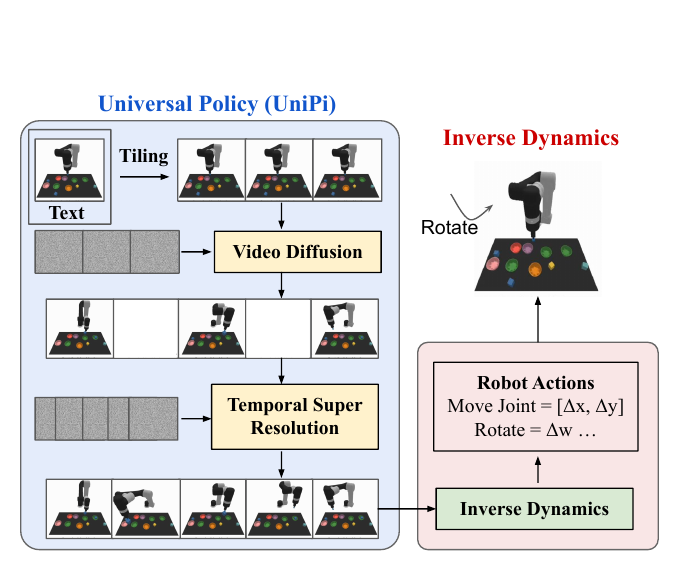
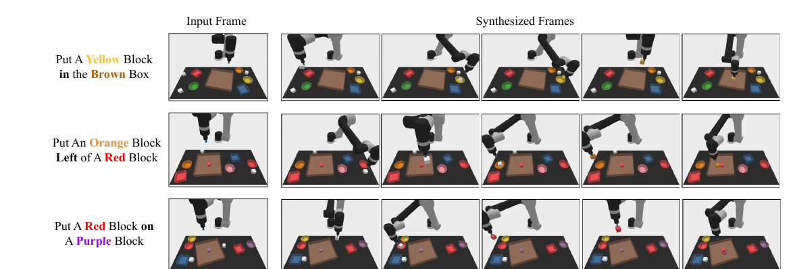
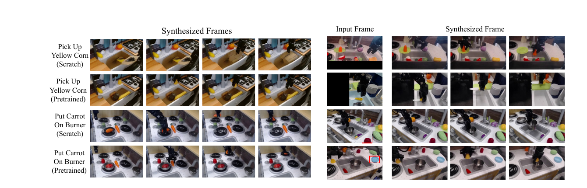

# UniPi (2023)

Il paper [*Learning Universal Policies via Text-Guided Video Generation*](https://papers.nips.cc/paper_files/paper/2023/hash/1d5b9233ad716a43be5c0d3023cb82d0-Abstract-Conference.html), di Yilun Du e coautori, introduce **UniPi**, una formulazione nella quale la policy genera prima un video del comportamento desiderato e ricava successivamente le azioni mediante inverse dynamics.

L'idea affronta due fonti di eterogeneità. Action space e stato interno cambiano tra robot e ambienti, mentre un'immagine può rappresentare tutti questi domini; reward e goal sono difficili da uniformare, mentre un'istruzione linguistica può descriverli attraverso lo stesso vocabolario. UniPi usa quindi **video come interfaccia del comportamento** e testo come interfaccia del task.

## Unified Predictive Decision Process

Gli autori chiamano questa astrazione **Unified Predictive Decision Process (UPDP)**. Indichiamo con $o_0$ l'immagine corrente, con $l$ l'istruzione e con $\tau=(o_0,o_1,\ldots,o_H)$ una traiettoria visuale lunga $H$ step. Il problema viene separato in due distribuzioni:

$$
p_\theta(\tau\mid o_0,l)
$$

$$
\pi_\phi(a_{0:H-1}\mid\tau,l)
$$

La prima è il **planner visuale**: genera un possibile futuro coerente con la scena e con il goal. La seconda è l'**action generator**: traduce quella traiettoria in azioni $a_{0:H-1}$. Nell'implementazione UniPi, $p_\theta$ è un video diffusion model e $\pi_\phi$ è un inverse dynamics model specifico dell'ambiente.

Questa decomposizione non elimina la dipendenza dall'embodiment. Il video planner può essere condiviso perché opera in uno spazio visuale comune, ma il secondo modulo deve conoscere come il particolare robot realizza una transizione. Il termine *universal policy* descrive dunque una **interfaccia potenzialmente universale**, non una singola rete capace di emettere direttamente azioni per qualsiasi robot.

## Video diffusion condizionata

Il planner deve soddisfare un requisito più forte di un normale text-to-video model. Non basta produrre un filmato semanticamente compatibile con $l$: il primo frame deve coincidere con $o_0$ e oggetti, robot e sfondo devono mantenere identità e posizione durante l'intera traiettoria.

UniPi usa una Video U-Net condizionata sugli embedding di **T5-XXL**. Durante il training, l'immagine iniziale viene fornita esplicitamente insieme al testo. Durante ogni passo di denoising, una copia di $o_0$ viene concatenata ai canali di ogni frame rumoroso. Questa operazione, chiamata **first-frame tiling**, offre al modello un riferimento visuale costante invece di imporre la scena iniziale soltanto al termine del sampling.

Con classifier-free guidance, il denoiser guidato può essere scritto come:

$$
\hat s_\theta(\tau_k,k\mid o_0,l) =
(1+\omega)s_\theta(\tau_k,k\mid o_0,l)
-\omega s_\theta(\tau_k,k)
$$

Qui $\tau_k$ è il video rumoroso al livello di diffusione $k$, $s_\theta$ è il denoiser e $\omega$ controlla la forza del condizionamento. Aumentare $\omega$ rende più determinanti testo e primo frame, ma non garantisce da solo fattibilità cinematica o correttezza causale delle azioni.

## Planning gerarchico e inverse dynamics

Generare direttamente un video lungo e ad alta frequenza è costoso e tende a degradare la coerenza. UniPi adotta una gerarchia temporale: un primo diffusion model produce **keyframe radi**, che descrivono le fasi principali del comportamento; un secondo modello di **temporal super-resolution** inserisce frame intermedi e rende il piano abbastanza denso da consentire la stima delle azioni.

*Fonte: Du et al., Learning Universal Policies via Text-Guided Video Generation, Figura 2. L'osservazione iniziale viene replicata come contesto del video diffusion model; la temporal super-resolution densifica il piano e un inverse dynamics model lo converte in comandi del robot.*

L'inverse dynamics model è una piccola CNN addestrata separatamente su traiettorie per le quali sono disponibili immagini e azioni. Nei simulatori predice un controllo a sette dimensioni: sei valori articolari e un comando di contatto discreto. Questa separazione permette al video planner di sfruttare dati privi di azioni, ma introduce un possibile **grounding gap**: una transizione visuale plausibile può non corrispondere ad alcun comando fisicamente realizzabile.

Le azioni stimate possono essere eseguite tutte in open loop oppure in closed loop. Nel secondo caso, dopo l'esecuzione viene acquisito un nuovo $o_t$ e viene generata una nuova sequenza, secondo la logica del Model Predictive Control. Il replanning può correggere deviazioni osservabili, ma richiede un nuovo costoso sampling del diffusion model.

UniPi supporta anche guidance aggiuntiva in fase di generazione. Un classificatore sulle immagini o un'immagine intermedia desiderata possono modificare la distribuzione campionata senza riaddestrare il generatore, rendendo il piano visuale parzialmente steerable.

## Generalizzazione composizionale

Il primo benchmark è un ambiente PyBullet nel quale un braccio deve colorare blocchi bianchi depositandoli in una ciotola e poi disporli in una scatola secondo $l$. Le istruzioni specificano collocazioni, come mettere un blocco in un contenitore, oppure relazioni geometriche, come collocarlo a sinistra di un altro blocco.

Un agente scripted genera **200,000 video**. Il 70% delle combinazioni linguistiche viene usato nel training e il 30% soltanto al test; posizione e posa di blocchi, ciotole e piatti vengono randomizzate. L'inverse dynamics usa le annotazioni di azione disponibili in 20,000 video e produce comandi nello spazio articolare, senza primitive di pick-and-place predefinite.

*Fonte: Du et al., Learning Universal Policies via Text-Guided Video Generation, Figura 3. Ogni riga mostra il frame iniziale e un piano generato per una combinazione linguistica esclusa dal training.*

Sulle istruzioni nuove, UniPi raggiunge il **60.1%** nei task *Place* e il **46.1%** nei task *Relation*. Il migliore risultato tra Transformer BC da stato, Transformer BC da immagini, Trajectory Transformer e Diffuser è rispettivamente 13.2% e 9.6%. Anche sulle istruzioni viste UniPi ottiene 59.1% e 53.2%, indicando che il vantaggio non dipende soltanto dalla composizionalità del testo.

Le ablation chiariscono il contributo della pipeline. Senza condizionamento sul frame iniziale, tiling o gerarchia temporale, le accuracy sui task visti sono 13.2% e 12.4%. Il solo first-frame conditioning porta a 52.4% e 34.7%; tiling e temporal super-resolution conducono infine a 59.1% e 53.2%.

## Trasferimento fra task simulati

Il secondo benchmark deriva da **CLIPort**. Un agente oracle raccoglie 200,000 video su dieci task di training, comprendenti inserimento in ciotole, composizione di kit, stacking, Tower of Hanoi e packing di oggetti. Tre task vengono esclusi per misurare il trasferimento: *Place Bowl*, *Pack Object* e *Pack Pair*.

UniPi ottiene accuracy del 51.6%, 75.5% e 45.7% sui tre task. I migliori baseline raggiungono rispettivamente 14.8%, 21.7% e 10.5%. Il risultato mostra che generare una traiettoria nello spazio delle immagini può favorire il riuso tra goal visualmente differenti, almeno quando embodiment, camera e struttura del simulatore rimangono compatibili.

Il confronto con CLIPort non è diretto. CLIPort predice pose per primitive di pick-and-place, mentre UniPi e i baseline del paper producono valori articolari continui e un segnale di contatto. Il simulatore collega l'oggetto più vicino al gripper quando il contatto supera una soglia, una semplificazione importante rispetto alla presa fisica.

## Pretraining e dati robotici reali

Per studiare il trasferimento dal web, il video model viene pre-addestrato sugli stessi dati usati dal modello video di riferimento: **14 milioni di coppie video–testo**, 60 milioni di coppie immagine–testo e LAION-400M. Viene poi adattato su 7,200 coppie video–testo di **Bridge**, divise 80/20 tra training e test; gli ID dei task vengono impiegati come descrizioni linguistiche.

*Fonte: Du et al., Learning Universal Policies via Text-Guided Video Generation, Figure 8 e 9. A sinistra il modello pre-addestrato segue istruzioni non presenti nei dati robotici meglio del training da zero; a destra sono mostrati piani generati dopo crop o inserimento artificiale di oggetti nello sfondo.*

Il pretraining migliora FID da 17.75 a 14.54 e FVD da 288.02 a 264.66, mentre il CLIP score passa da 24.43 a 24.54. Poiché queste metriche non verificano il completamento del task, gli autori addestrano un classificatore sul frame finale: il successo stimato cresce dal 72.6% al 77.1%.

Questi risultati riguardano **video sintetizzati**, non traiettorie eseguite da un robot fisico. Il classificatore è una proxy appresa e può condividere bias con i dati o confondere un'immagine finale plausibile con una manipolazione realmente eseguibile. Il paper mostra quindi trasferimento alla generazione di piani in scene robotiche reali, ma non chiude sperimentalmente il ciclo video–azione–robot sul Bridge setup.

## Costi di training e inference

Nei benchmark simulati, il generatore del primo stadio e quello di temporal super-resolution hanno ciascuno circa **1.7 miliardi di parametri**. Gli embedding provengono da T5-XXL, da 4.6 miliardi di parametri. I diffusion model vengono addestrati per 2 milioni di step con batch size 2,048 usando 256 TPU-v4.

Il sampling è il collo di bottiglia operativo. Secondo gli autori, un video ad alta qualità può richiedere circa un minuto. Una sperimentazione preliminare di distillazione riduce il tempo di un fattore 16, ma il costo resta molto diverso da quello di una policy feed-forward e rende oneroso il replanning a ogni step.

## Relazione con Deep Visual Foresight

Deep Visual Foresight e UniPi condividono la struttura **predict-then-act**, ma rappresentano due epoche differenti. Il primo condiziona esplicitamente il video sulle azioni candidate e usa CEM per scegliere quali eseguire; il goal è uno spostamento di pixel e il planning resta a cortissimo orizzonte.

UniPi inverte il rapporto: genera dal testo un futuro desiderato senza conoscere preventivamente le azioni e chiede a un modello inverso di ricostruirle. Guadagna composizionalità, accesso a video privi di azioni e piani interpretabili, ma perde il vincolo causale diretto che collega ogni frame a un comando candidato. **La plausibilità del futuro e la sua raggiungibilità diventano due problemi separati**.

## Novelty

- **Policy-as-video:** formula il comportamento come generazione di una traiettoria visuale condizionata dall'istruzione e dalla scena iniziale.
- **UPDP:** separa un planner nello spazio condiviso delle immagini da un action generator specifico dell'embodiment.
- **Coerenza della scena:** first-frame conditioning e tiling mantengono visibile la configurazione osservata durante tutto il denoising.
- **Planning gerarchico:** genera keyframe a bassa frequenza e li densifica mediante temporal super-resolution.
- **Generalizzazione:** mostra composizione linguistica e trasferimento verso task simulati esclusi dal training con margini ampi sui baseline considerati.
- **Trasferimento dal web:** riusa pretraining video e immagine–testo non robotico per migliorare la generazione su Bridge.

## Limiti

Il diffusion sampling introduce una latenza elevata e un consumo computazionale consistente sia nel training sia nell'inference. La scala dei modelli e l'uso di 256 TPU-v4 rendono difficile riprodurre l'intero studio; rigenerare frequentemente il piano in closed loop amplifica ulteriormente il costo.

Il video planner non riceve le azioni come condizione e non incorpora esplicitamente cinematica, collisioni o limiti degli attuatori. Può quindi generare una traiettoria semanticamente corretta ma irrealizzabile. L'inverse dynamics è piccolo e task-specifico, viene addestrato su una quantità limitata di azioni annotate e deve estrapolare quando il video sintetico esce dalla distribuzione dei dati reali.

Gli ambienti analizzati sono prevalentemente fully observed. In presenza di occlusioni o informazione mancante, il diffusion model può inventare oggetti e movimenti invece di mantenere un belief sui futuri possibili. Il modello non rappresenta esplicitamente incertezza epistemica e la selezione di un singolo video può nascondere l'ambiguità della scena.

La dimostrazione di controllo è confinata a simulatori con contatto semplificato e dati prodotti da agenti scripted. Nel setting Bridge non vengono apprese o eseguite azioni reali e il successo deriva da un classificatore del frame finale. Di conseguenza, il paper non dimostra una universal policy cross-embodiment pronta per il controllo fisico, ma una promettente **rappresentazione universale dei piani visuali**.
