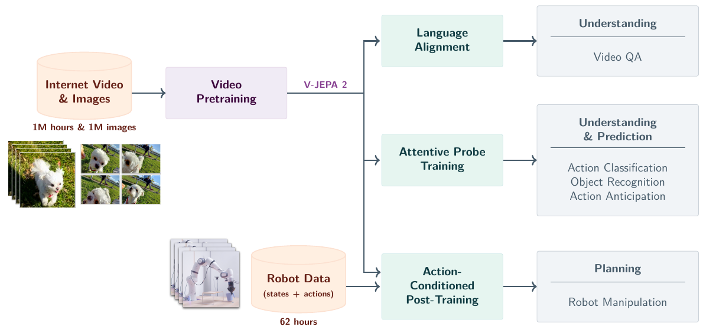
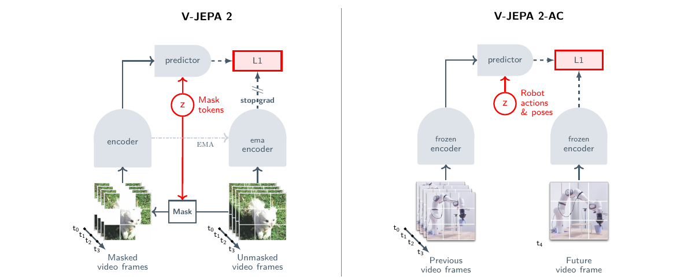
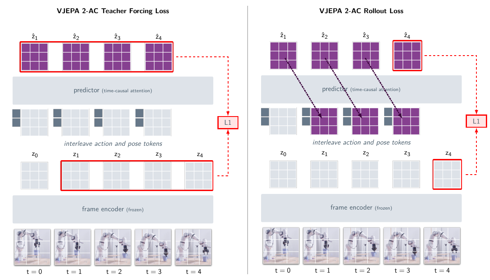
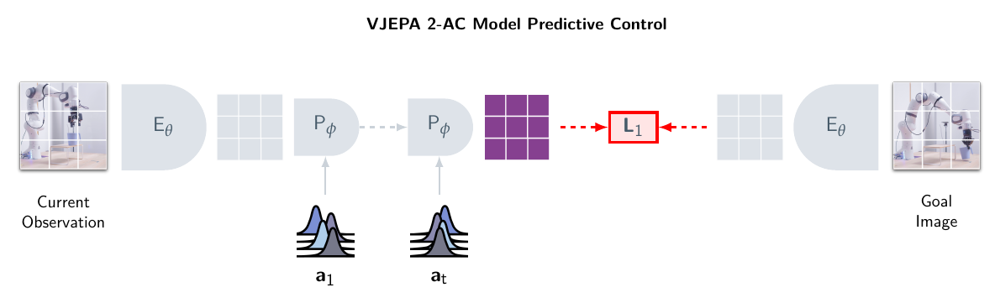
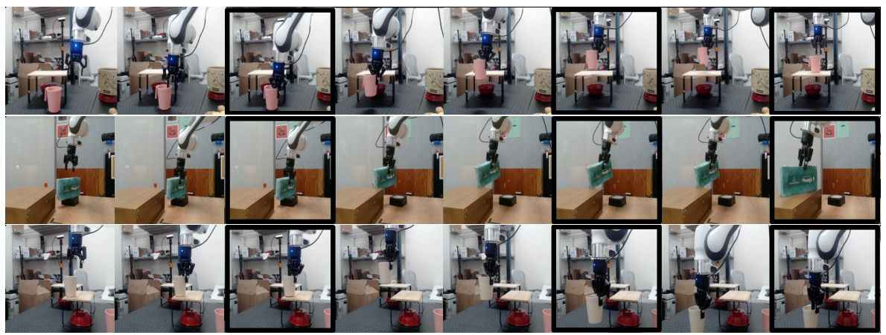

# V-JEPA 2 (2025)

Il paper [*V-JEPA 2: Self-Supervised Video Models Enable Understanding, Prediction and Planning*](https://arxiv.org/abs/2506.09985v1), di Mahmoud Assran e coautori, studia come passare dall'apprendimento visuale su larga scala al controllo robotico con una quantità relativamente contenuta di dati di interazione. Questo approfondimento segue **la versione arXiv v1 del giugno 2025**, comprese le appendici. Il [repository ufficiale](https://github.com/facebookresearch/vjepa2) raccoglie codice e checkpoint; ospita anche sviluppi successivi, che vanno distinti dalla ricetta qui descritta.

Il contributo deve essere letto su due livelli. **V-JEPA 2** apprende rappresentazioni spazio-temporali predicendo parti mancanti di video nello spazio delle feature. **V-JEPA 2-AC**, dove AC significa *action-conditioned*, congela l'encoder pre-addestrato e apprende un nuovo predittore delle conseguenze delle azioni robotiche. È questa seconda componente che permette di cercare azioni mediante planning.

*Fonte: Assran et al., V-JEPA 2: Self-Supervised Video Models Enable Understanding, Prediction and Planning, Figura 1, arXiv v1. Il pretraining visuale alimenta tre percorsi distinti: allineamento linguistico, valutazione con probe e post-training robotico condizionato dalle azioni.*

## Il problema: apprendere dai video e intervenire sul mondo

I video disponibili sul web mostrano moltissime trasformazioni: oggetti spostati, mani che afferrano, materiali che cambiano forma, corpi che interagiscono. Offrono quindi una copertura visuale e temporale molto più ampia dei dataset robotici. Normalmente, però, **non forniscono i comandi che hanno prodotto quelle trasformazioni**, né una descrizione dello stato fisico completo.

Un modello può imparare che cosa tende ad accadere dopo una certa scena senza sapere che cosa accadrebbe sotto una specifica azione scelta da un robot. Prevedere il proseguimento plausibile di una manipolazione e prevedere l'effetto di una traslazione dell'end-effector sono problemi collegati, ma richiedono condizioni diverse.

V-JEPA 2 organizza questo passaggio in due fasi. Il pretraining action-free costruisce un **prior rappresentazionale** a partire da osservazioni visuali. Il post-training robotico associa quel prior ad azioni e propriocezione, imparando una dinamica utilizzabile per confrontare interventi candidati. La seconda fase non apprende una policy mediante imitazione: apprende a prevedere il prossimo stato visuale latente.

Il termine **self-supervised** indica che i target vengono ricavati dai dati stessi. Non implica assenza di ogni segnale strutturato: il post-training utilizza pose dell'end-effector e azioni derivate dalle loro variazioni. L'assenza di annotazioni riguarda reward, identità del task e successo delle dimostrazioni, non i segnali necessari a collegare osservazioni e controllo.

## Perché predire rappresentazioni invece di pixel

Una **Joint-Embedding Predictive Architecture (JEPA)** confronta una rappresentazione predetta con la rappresentazione di un target. Nel caso visuale, il target non è l'immagine originale: è il risultato di un encoder applicato a quell'immagine o al video completo.

La motivazione è che il mondo contiene dettagli difficili da prevedere e spesso poco utili all'azione. L'esatta texture di uno sfondo o il movimento di ogni foglia possono rendere costosa la ricostruzione di un futuro fotorealistico senza migliorare la decisione su dove spostare una pinza. Predire feature permette, in linea di principio, di concentrare capacità su regolarità più stabili.

**Questa selezione non viene imposta attraverso un elenco di variabili fisiche.** Il modello non riceve una specifica che gli ordini di conservare posizione, contatto e velocità eliminando texture e illuminazione. L'utilità del latent emerge dall'obiettivo predittivo, dai dati, dal masking e dall'architettura; deve quindi essere verificata sperimentalmente.

La scelta comporta un compromesso. Si evita di generare un video per ogni azione candidata, ma la rappresentazione può trascurare dettagli decisivi per il controllo, come una piccola apertura della pinza o un contatto parzialmente occluso. Una buona rappresentazione per classificare movimenti non coincide automaticamente con uno stato sufficiente per la manipolazione.

## Pretraining action-free

### Encoder online, target encoder e predictor

Il modello riceve una clip $O=(o_1,\ldots,o_T)$, dove $o_t$ è il frame osservato al tempo $t$ e $T$ il numero di frame. La clip viene suddivisa in patch spazio-temporali; una parte viene rimossa mediante masking. Indichiamo con $\mathcal{M}$ l'insieme delle posizioni mascherate e con $O_{\mathrm{vis}}$ i token visuali rimasti visibili.

L'**encoder online** $E_\theta$, con parametri $\theta$, elabora soltanto il contenuto visibile. Il **predictor** $P_\phi$, con parametri $\phi$, riceve le feature del contesto e mask token che identificano le posizioni da predire. Un **target encoder** $E_{\bar\theta}$ elabora invece la clip completa e fornisce i target.

Riscrivendo l'Equazione 1 del paper in modo da rendere esplicito che la loss riguarda soltanto le patch mascherate, l'obiettivo ha la forma:

$$
\mathcal{L}_{\mathrm{JEPA}} =
\frac{1}{|\mathcal{M}|}
\sum_{i\in\mathcal{M}}
\left\|
\left[P_\phi\!\left(E_\theta(O_{\mathrm{vis}}),m_{\mathcal{M}}\right)\right]_i
-\operatorname{sg}\!\left([E_{\bar\theta}(O)]_i\right)
\right\|_1
$$

Qui $i$ identifica una patch, $|\mathcal{M}|$ è il numero di patch mascherate, $m_{\mathcal{M}}$ rappresenta i mask token con informazione posizionale e $[\cdot]_i$ seleziona la feature della posizione $i$. La norma $\|\cdot\|_1$ misura lo scarto assoluto fra le feature; $\operatorname{sg}$ è l'operazione di **stop gradient**, che impedisce la propagazione dei gradienti attraverso il target.

I parametri del target encoder seguono una **exponential moving average (EMA)** dei parametri online. Indicando con $\tau$ il coefficiente di inerzia, l'aggiornamento è:

$$
\bar\theta \leftarrow \tau\bar\theta+(1-\tau)\theta
$$

L'encoder online e il predictor vengono aggiornati dalla loss; il target encoder viene aggiornato mediante questa media. Il percorso target fornisce così un riferimento che evolve più lentamente. Il paper utilizza l'asimmetria fra i percorsi e lo stop gradient per contrastare il **representation collapse**, nel quale input diversi vengono rappresentati da feature quasi costanti. Questa ricetta empirica non costituisce una garanzia generale di assenza di collasso.

*Fonte: Assran et al., V-JEPA 2: Self-Supervised Video Models Enable Understanding, Prediction and Planning, Figura 2, arXiv v1. A sinistra il target encoder EMA supervisiona le patch mascherate; a destra l'encoder congelato fornisce le rappresentazioni sulle quali viene addestrato un nuovo predictor robotico.*

### Masking e causalità temporale

Il pretraining conserva il **multiblock masking** di V-JEPA: vengono rimossi blocchi spazio-temporali anziché singoli pixel indipendenti. Il compito richiede quindi di sfruttare struttura e contesto, anziché limitarsi a interpolare un dettaglio fra vicini immediati.

Il punto concettuale è che **masked video modeling e forward dynamics non sono lo stesso obiettivo**. Il contesto visibile può contenere informazione distribuita lungo la clip; il pretraining non impone che ogni predizione dipenda soltanto dal passato e da un'azione. Questo schema è appropriato per apprendere rappresentazioni, ma da solo non fornisce un simulatore temporale controllabile.

La causalità richiesta dal controllo viene introdotta nel predictor AC mediante una maschera temporale specifica e dati di interazione. Separare questi due passaggi evita di attribuire al pretraining action-free capacità di intervento che il modello acquisisce soltanto dopo.

### Tokenizzazione e architettura

Encoder e predictor sono **Vision Transformer (ViT)**. La clip viene tokenizzata mediante tubelet di dimensione $2\times16\times16$: ogni token iniziale copre due frame e una regione spaziale di $16\times16$ pixel. Per una clip di 16 frame a risoluzione $256\times256$, prima del masking si ottengono $8\times16\times16=2,048$ token.

V-JEPA 2 introduce una versione tridimensionale dei **Rotary Position Embedding (3D-RoPE)**. Le componenti della feature vengono ripartite fra asse temporale, altezza e larghezza, applicando separatamente le rotazioni posizionali. Il paper riporta una maggiore stabilità dei modelli grandi rispetto agli embedding posizionali sinusoidali assoluti della ricetta precedente.

La famiglia comprende tre scale principali. I valori sono quelli arrotondati della Tabella 12 del paper:

| Componente | Parametri | Layer | Dimensione interna | Teste di attenzione |
| --- | ---: | ---: | ---: | ---: |
| Encoder ViT-L | 300M | 24 | 1,024 | 16 |
| Encoder ViT-H | 600M | 32 | 1,280 | 16 |
| Encoder ViT-g | 1B | 40 | 1,408 | 22 |
| Predictor del pretraining | 22M | 12 | 384 | 12 |

**Il predictor piccolo del pretraining e il predictor AC da circa 300M sono reti differenti.** Nel confronto di scala degli encoder, il predictor visuale resta fisso; il predictor robotico viene invece addestrato successivamente e dispone di ingressi e maschera di attenzione dedicati.

## Dataset e ricetta di scaling

### VideoMix22M

Il pretraining utilizza **VideoMix22M (VM22M)**, una miscela di circa 22 milioni di campioni provenienti da video e immagini. Le sorgenti video includono Something-Something v2, Kinetics, HowTo100M e YT-Temporal-1B; ImageNet estende la copertura degli oggetti e dell'aspetto visuale.

La Tabella 1 del paper riporta i seguenti ordini di grandezza e probabilità di campionamento:

| Sorgente | Campioni riportati | Peso nel sampling |
| --- | ---: | ---: |
| Something-Something v2 | 168K | 0.056 |
| Kinetics | 733K | 0.188 |
| HowTo100M | 1.1M | 0.318 |
| YT-Temporal-1B | 19M | 0.188 |
| ImageNet | 1M | 0.250 |

I pesi sono scelti empiricamente e non coincidono con la proporzione dei campioni disponibili. La sorgente più grande non domina quindi automaticamente ogni batch. Le immagini vengono replicate temporalmente e trattate come clip statiche di 16 frame, così da usare lo stesso percorso di elaborazione.

La copertura complessiva è superiore a **1 milione di ore di video**. Questa quantità descrive il materiale disponibile, non la durata di video distinto necessariamente osservato per intero durante ogni training run. Il numero di iterazioni, il sampling e l'estrazione delle clip determinano l'esposizione effettiva del modello.

Per YT-Temporal-1B viene applicata una curatela basata su retrieval e clustering delle scene. La distribuzione di riferimento utilizza i training set di Kinetics, SSv2, COIN ed Epic-Kitchens; il paper dichiara l'esclusione dei video di validazione di riferimento dal pool iniziale. **Assenza di label nella loss non significa assenza di scelte di curatela orientate ai domini di interesse**. Dataset e procedura sono descritti nella [Sezione 2.3 e nell'Appendice A.2](https://arxiv.org/html/2506.09985v1#S2.SS3).

### Modello, durata del training e risoluzione progressiva

Il lavoro sviluppa quattro leve: più dati, encoder più grandi, training più lungo e maggiore risoluzione spazio-temporale. Nella sequenza di ablation della Figura 3, la media su sei task passa da 84.2 a 85.2 con più dati, a 86.7 con un modello più grande, a 87.5 con training più lungo e a 88.2 aumentando risoluzione e durata delle clip.

Questi valori descrivono **una sequenza specifica di configurazioni cumulative**. Non sono contributi indipendenti che possano essere trasferiti invariati a qualunque backbone, né misurano il successo robotico. La media aggrega classificazione visuale su SSv2, Diving-48, Jester, Kinetics, COIN e ImageNet.

La ricetta usa un learning rate con **warmup, fase costante e cooldown**. Il training parte da clip corte e a risoluzione contenuta; soltanto nel tratto finale aumenta durata e risoluzione. La configurazione descritta nel testo principale comprende 12K iterazioni di warmup, 228K a learning rate costante e 12K di cooldown, per 252K iterazioni complessive.

L'obiettivo è evitare di pagare per tutto il training il costo di clip da 64 frame a $384\times384$. Il paper riporta, per questo regime progressivo, una riduzione del tempo GPU di circa **8.4 volte rispetto alla stima di un training interamente alla risoluzione finale**. Non si tratta di uno speedup del planner robotico.

L'aumento della durata durante il pretraining migliora la classificazione anche mantenendo corte le clip di valutazione. Nei task studiati, passare a 128 o 256 frame non produce ulteriori miglioramenti rispetto a 64. Questo risultato riguarda il protocollo di comprensione visuale e non dimostra che il modello possa pianificare in modo affidabile per 64 transizioni robotiche.

## Dal video encoder al World Model V-JEPA 2-AC

### DROID e significato delle 62 ore

Il post-training usa un sottoinsieme del dataset **DROID**, raccolto mediante teleoperazione con Franka Emika Panda a 7 gradi di libertà e pinza a due dita. Gli autori considerano circa **23,000 traiettorie**, includendo successi e fallimenti, e scartano i video più corti di quattro secondi. Il sottoinsieme risultante contiene meno di 62 ore di video.

Vengono campionate clip di quattro secondi, a **4 fps** e risoluzione $256\times256$, ottenendo 16 frame per clip. Si utilizza la vista esterna sinistra di DROID; nell'Appendice B.1 gli autori segnalano che mescolare viste sinistre e destre senza fornire la posizione della camera peggiora il risultato. L'augmentazione comprende random resized crop con aspect ratio fra 0.75 e 1.35.

Per evitare ambiguità con lo stato generico dell'ambiente, indichiamo con **$q_t$ lo stato osservato del robot**. Qui $q_t\in\mathbb{R}^7$ contiene tre coordinate cartesiane dell'end-effector, tre angoli di Eulero estrinseci e lo stato della pinza, espressi rispetto alla base del robot. **Non è il vettore delle sette posizioni articolari**: è una descrizione dell'end-effector. Il paper usa per questa variabile il simbolo $s_t$, adattato qui alla notazione della raccolta.

Le azioni vengono derivate dalla variazione dello stato fra frame adiacenti. Con la convenzione del lavoro:

$$
a_t = q_{t+1}-q_t
$$

L'azione $a_t\in\mathbb{R}^7$ esprime quindi un cambiamento di posa e pinza. La formula descrive la costruzione dei target nel dataset; non identifica queste componenti con coppie articolari, velocità dei motori o un comando di controllo a basso livello.

Non vengono usate descrizioni linguistiche, etichette del task, reward o indicatori di successo. Il target è il futuro effettivamente osservato, anche quando la traiettoria non completa il compito. Un fallimento può quindi essere informativo sulla dinamica senza richiedere che il modello impari a riprodurlo come comportamento desiderato.

### Encoder congelato e feature spaziali

L'encoder ViT-g pre-addestrato viene **congelato** e utilizzato come image encoder, codificando separatamente ciascun frame. Definiamo:

$$
z_t = E(o_t)\in\mathbb{R}^{16\times16\times1,408}
$$

Il simbolo $z_t$ indica la mappa visuale latente: 256 posizioni spaziali, ciascuna descritta da 1,408 componenti. La mappa non viene ridotta a un unico vettore globale. Conservare token spaziali permette al predictor di rappresentare relazioni locali fra braccio, pinza, oggetto e sfondo.

Il fatto che il backbone sia stato pre-addestrato sui video non implica che nel percorso robotico legga sempre una lunga clip congiunta. **Nel post-training AC descritto dal paper, le rappresentazioni dei frame sono calcolate indipendentemente; la storia temporale viene integrata dal predictor causale.**

Congelare l'encoder stabilizza il sistema di coordinate del latent durante l'apprendimento della dinamica e conserva il prior visuale. Al tempo stesso impedisce alla loss robotica di correggere l'encoder se una variabile essenziale per il contatto non è adeguatamente rappresentata.

### Predictor action-conditioned e attenzione block-causal

Il predictor AC è un Transformer da circa **300M parametri**, con 24 layer, 16 teste di attenzione, dimensione interna 1,024 e attivazioni GELU. Azioni, stato dell'end-effector e feature visuali vengono proiettati con trasformazioni affini separate nella dimensione interna del modello.

A ogni istante vengono intercalati token di azione, posa e immagine. Il predictor usa **attenzione block-causal**: i token visuali di un istante possono leggere azione, posa e altre patch dello stesso istante, oltre ai blocchi precedenti; non possono accedere ai frame futuri. Le feature prodotte vengono poi riproiettate nella dimensione 1,408 dell'encoder.

Per i token visuali si usa 3D-RoPE, mentre azioni e pose ricevono la componente temporale del positional embedding. La maschera è causale lungo il tempo, ma consente interazione spaziale entro il frame: non impone un ordine autoregressivo fra le patch della medesima osservazione.

La predizione one-step può essere espressa schematicamente come:

$$
\hat z_{t+1} = P_\phi\!\left((a_i,q_i,z_i)_{i\leq t}\right)
$$

Il simbolo $\hat z_{t+1}$ indica il futuro predetto. L'azione corrente è disponibile perché è proprio l'intervento di cui si vogliono prevedere gli effetti; la rappresentazione visuale futura resta invece un target escluso dagli ingressi di quella predizione.

## Teacher forcing e rollout loss

### Predire il futuro da una storia osservata

Nel **teacher forcing**, ogni predizione viene condizionata sulle feature dei frame realmente osservati. Con 16 frame si hanno $K=15$ transizioni supervisionate. L'Equazione 2 del paper diventa, usando la notazione della raccolta:

$$
\mathcal{L}_{\mathrm{TF}}(\phi) =
\frac{1}{K}\sum_{t=1}^{K}
\left\|
P_\phi\!\left((a_i,q_i,z_i)_{i\leq t}\right)-z_{t+1}
\right\|_1
$$

Il predictor apprende così l'effetto delle azioni su contesti corretti e può elaborare più transizioni di una clip con una sola struttura di attenzione causale. I target sono stabili perché provengono dall'encoder congelato.

Il limite è il **divario fra training e rollout**: durante il planning il futuro non è osservato e il modello deve riutilizzare le proprie predizioni. Una piccola distorsione nel primo latent può diventare parte del contesto del secondo passo, producendo input differenti da quelli incontrati con il solo teacher forcing.

### Riutilizzare le proprie predizioni

Per attenuare il problema viene aggiunta una **rollout loss a due step**. Definiamo $F_\phi(z_1,q_1,a_{1:R})$ come il latent finale ottenuto applicando autoregressivamente il predictor per $R$ azioni candidate, a partire da $z_1$ e $q_1$. Il simbolo $F_\phi$ è una notazione compatta per il rollout dello stesso predictor, non una rete aggiuntiva.

Con $R=2$, la loss confronta il secondo futuro immaginato con il corrispondente frame reale:

$$
\mathcal{L}_{\mathrm{rollout}}(\phi) =
\left\|F_\phi(z_1,q_1,a_{1:2})-z_3\right\|_1
$$

La prima feature predetta viene reinserita nel predictor e il gradiente attraversa questo riutilizzo. Il modello viene quindi penalizzato anche per errori che compromettono la transizione successiva. Il training minimizza la somma dei due termini:

$$
\mathcal{L}_{\mathrm{AC}}(\phi) =
\mathcal{L}_{\mathrm{TF}}(\phi)+\mathcal{L}_{\mathrm{rollout}}(\phi)
$$

*Fonte: Assran et al., V-JEPA 2: Self-Supervised Video Models Enable Understanding, Prediction and Planning, Figura 6, arXiv v1. Il teacher forcing usa i latent osservati; il rollout reinserisce le feature predette. La figura illustra quattro transizioni, mentre il rollout della ricetta sperimentale usa due step. I simboli originali vanno letti secondo la notazione del paper.*

Una loss a due step migliora l'esposizione agli errori autoregressivi, ma **non dimostra consistenza su orizzonti arbitrariamente lunghi**. Inoltre, il predictor resta deterministico: non costruisce una distribuzione esplicita dei possibili esiti di un contatto o di un'occlusione.

L'[Appendice B.1](https://arxiv.org/html/2506.09985v1#A2.SS1) specifica AdamW, weight decay 0.04, batch size 256 e una schedulazione di 4,500 iterazioni di warmup, 85,500 a learning rate costante e 4,500 di decay. Il learning rate cresce da $7.5\times10^{-5}$ a $4.25\times10^{-4}$, per poi scendere a zero nel tratto finale. Questi parametri appartengono al post-training del predictor, non al pretraining dell'encoder.

## Planning mediante distanza latente

### Il goal visuale come funzione di costo

Durante l'esecuzione vengono forniti l'osservazione corrente $o_t$, lo stato del robot $q_t$ e un'immagine obiettivo $o_g$. Il pedice $g$ identifica il goal. L'encoder congelato produce $z_t=E(o_t)$ e $z_g=E(o_g)$.

Per una sequenza candidata $A=(a_t,\ldots,a_{t+H-1})$, dove $H$ è l'orizzonte di planning, il costo è la distanza fra il latent finale immaginato e il latent del goal:

$$
\mathcal{E}(A;z_t,q_t,z_g) =
\left\|F_\phi(z_t,q_t,A)-z_g\right\|_1
$$

Il planner cerca la sequenza ammissibile con energia minima:

$$
A^\star = \underset{A\in\mathcal{A}_H}{\arg\min}\;
\mathcal{E}(A;z_t,q_t,z_g)
$$

Qui $\mathcal{A}_H$ è l'insieme delle sequenze che rispettano i limiti imposti alle azioni. Il termine **energia** indica uno score da minimizzare, non un'energia meccanica misurata in joule. Durante questa ottimizzazione i parametri del World Model restano fissi: vengono cercate le azioni.

**Non viene appresa una reward function del task.** La distanza dal goal costituisce comunque un criterio esplicito di scelta del comportamento. Il metodo è quindi privo di reward di training e di fine-tuning specifico del task, ma dispone di un obiettivo visuale e di una funzione di costo definita dal progettista.

*Fonte: Assran et al., V-JEPA 2: Self-Supervised Video Models Enable Understanding, Prediction and Planning, Figura 7, arXiv v1. Il predictor simula gli effetti delle azioni nel latent; la distanza dal goal guida la ricerca con Cross-Entropy Method. L'indice temporale originale della figura è distinto dall'orizzonte $H$ usato nel testo.*

### Cross-Entropy Method e receding horizon

La ricerca usa il **Cross-Entropy Method (CEM)**, un metodo di ottimizzazione per campionamento. Si inizializzano distribuzioni gaussiane sulle componenti delle azioni, si campionano sequenze candidate e si valuta ciascuna con il World Model. Le statistiche dei candidati migliori aggiornano media e varianza delle gaussiane per il campionamento successivo.

Nel protocollo dell'[Appendice B.2](https://arxiv.org/html/2506.09985v1#A2.SS2) vengono utilizzati **800 candidati per iterazione, dieci iterazioni di raffinamento e dieci elite**. Dopo la ricerca, la media della distribuzione finale determina la sequenza selezionata. Il sistema esegue soltanto la prima azione, acquisisce una nuova osservazione e ripete il processo: è il principio del **Model Predictive Control (MPC)** a orizzonte mobile.

Gli esperimenti principali utilizzano **$H=1$**. La formulazione ammette più step e il training contiene una rollout loss, ma i task considerati sono sufficientemente locali da essere affrontati con ricerca one-step e subgoal. Il risultato dimostra quindi l'utilità della previsione latente per il controllo closed loop; non dimostra una ricerca profonda su piani di manipolazione articolati.

Le azioni candidate vengono limitate per evitare grandi spostamenti fuori distribuzione. Il paper riporta un raggio 0.075 e uno spostamento cartesiano massimo di circa 13 cm per comando. Nella descrizione del reaching compare però l'espressione “L1-ball”: **questi due valori non sono coerenti se interpretati come vincolo L1 sulla sola traslazione**, perché in quel caso la norma euclidea non potrebbe superare 7.5 cm. È quindi opportuno conservare il limite e lo spostamento dichiarati dagli autori senza ricavarne una geometria del vincolo non verificata nel codice.

### Perché una distanza fra feature può guidare il robot

La funzione di costo non confronta soltanto due immagini osservate. Confronta il goal con il futuro che il modello associa a ciascuna azione: il valore della distanza dipende quindi sia dalla rappresentazione sia dalla dinamica appresa.

La Figura 9 del paper esplora localmente l'energia variando le traslazioni su due assi in un task di reaching. Il minimo si trova nella regione del movimento corretto e la superficie appare sufficientemente regolare da guidare la ricerca. È un'evidenza locale a favore dell'utilità del costo, non una dimostrazione di convessità globale o di corrispondenza esatta con la distanza fisica.

Una distanza visuale latente può assegnare costi inadeguati quando il contatto non è visibile, lo sfondo domina le feature o il goal richiede un passaggio intermedio apparentemente più lontano. Il planning dipende quindi da una proprietà ulteriore rispetto alla classificazione: **le differenze fra feature devono ordinare utilmente le conseguenze delle azioni**.

## Esperimenti robotici e significato di zero-shot

### Embodiment e trasferimento

Il modello viene eseguito su **Franka Emika Panda con pinze RobotiQ in due laboratori**, entrambi assenti da DROID. Le osservazioni provengono da una camera RGB monoculare esterna non calibrata. I pesi e il codice di inference sono gli stessi; l'esecuzione si appoggia a controller di basso livello simili, basati su operational space control.

Il termine **zero-shot** indica che non si raccolgono dati per addestrare il modello sui robot dei laboratori di test e non si effettua training specifico per quei task. Non significa assenza di dati robotici: il predictor ha appreso da DROID. Inoltre, l'embodiment resta nella famiglia dei bracci Franka; non si dimostra trasferimento arbitrario fra morfologie.

La camera non richiede una calibrazione geometrica esplicita, ma la sua posizione viene scelta manualmente dopo prove preliminari. Il trasferimento è quindi senza fine-tuning locale, non senza ogni scelta di setup. Questa distinzione è particolarmente rilevante perché l'azione è espressa rispetto alla base del robot, mentre l'effetto deve essere inferito da pixel in coordinate camera.

### Task atomici e pick-and-place con subgoal

Il **reaching** richiede di portare l'end-effector nella posizione mostrata dal goal. Il **grasp** richiede di afferrare un oggetto a partire da un'immagine obiettivo; nel **reach with object** il robot deve spostarsi mantenendo l'oggetto in presa.

Per il **pick-and-place** vengono forniti **due subgoal visuali oltre al goal finale**. Le immagini rappresentano presa, trasporto vicino alla destinazione e posa. Il controller ottimizza verso il primo obiettivo per quattro step, verso il secondo per dieci e verso il terzo per quattro.

Il passaggio fra subgoal segue dunque una **schedulazione prestabilita**, non una decomposizione autonoma del task e neppure un riconoscitore appreso del completamento di ogni fase. Questa struttura rende la sequenza affrontabile con un orizzonte locale, ma fornisce al sistema una parte sostanziale del piano ad alto livello.

*Fonte: Assran et al., V-JEPA 2: Self-Supervised Video Models Enable Understanding, Prediction and Planning, Figura 10, arXiv v1. Le sequenze mostrano manipolazioni in configurazioni diverse. I riquadri evidenziano momenti associati ai subgoal; il protocollo passa al goal successivo secondo il numero di step prefissato.*

### Risultati per oggetto e confronto con Octo

La [Tabella 2 del paper](https://arxiv.org/html/2506.09985v1#S4.T2) riporta dieci prove per laboratorio e condizione, con variazioni di posizione dell'oggetto e posa iniziale. La tabella seguente riproduce le medie dei due laboratori; tazza e scatola rimangono separate perché presentano difficoltà di presa differenti.

| Task | Oggetto | V-JEPA 2-AC | Octo |
| --- | --- | ---: | ---: |
| Reach | — | 100% | 100% |
| Grasp | Tazza | 65% | 15% |
| Grasp | Scatola | 25% | 0% |
| Reach with object | Tazza | 75% | 15% |
| Reach with object | Scatola | 75% | 70% |
| Pick-and-place | Tazza | 80% | 15% |
| Pick-and-place | Scatola | 65% | 10% |

Il confronto usa **Octo-base-1.5**, inizializzato dai pesi pre-addestrati su Open X-Embodiment e adattato con behavior cloning all'intero DROID. Il fine-tuning usa image goal e stato dell'end-effector con hindsight relabeling, cioè scegliendo come obiettivo un frame futuro della traiettoria. Non è quindi un baseline eseguito senza adattamento robotico.

V-JEPA 2-AC migliora soprattutto l'interazione con gli oggetti, ma il risultato non è uniforme: il grasp della scatola resta al 25%. Il successo dell'80% sul pick-and-place della tazza non va presentato come un successo generale dell'80% su tutta la manipolazione. Anche il confronto fra grasp e pick-and-place richiede cautela, perché quest'ultimo riceve una sequenza di subgoal.

Le percentuali derivano da pochi trial: una prova in più o in meno modifica di dieci punti il risultato di un singolo laboratorio. La differenza fra sistemi è informativa nel setup considerato, ma non isola il contributo della sola architettura: pretraining, quantità di dati, obiettivo di apprendimento e meccanismo di selezione delle azioni sono differenti.

### Confronto con Cosmos e costo computazionale

La [Tabella 3 del paper](https://arxiv.org/html/2506.09985v1#S4.T3) confronta il planner latente con un **Cosmos latent diffusion-7B** adattato alle azioni di DROID. È il modello generativo considerato nel paper del 2025, non [Cosmos Policy](../cosmos_policy/README.md), che appartiene a un lavoro successivo.

Entrambi vengono utilizzati con CEM su una singola **NVIDIA RTX 4090**, orizzonte uno e dieci raffinamenti. Cosmos valuta 80 candidati per iterazione e richiede circa quattro minuti per azione; V-JEPA 2-AC ne valuta 800 in circa **16 secondi per azione**. Il rapporto fra latenze è circa 15, mentre il numero di candidati è dieci volte maggiore per V-JEPA 2-AC: non si tratta di un benchmark a identico numero di predizioni.

Nel laboratorio 2, Cosmos raggiunge l'80% sul reaching, ma 0% e 20% sul grasp di tazza e scatola e 0% sul pick-and-place. V-JEPA 2-AC raggiunge rispettivamente 100%, 60%, 20%, 80% e 50%. Questi valori appartengono al protocollo della Tabella 3 e non vanno confusi con le medie fra laboratori della Tabella 2.

**Predire latent rende la ricerca molto meno costosa della generazione video nel confronto studiato, ma non rende il sistema real-time.** Il controllo è blocking: si attende il completamento di un comando prima di inviare il successivo. I 4 fps dei dati di training non rappresentano quindi la frequenza effettiva del ciclo decisionale robotico.

## Comprensione visuale, anticipazione e linguaggio

### Che cosa misurano i probe

Un **probe** è una rete addestrata sopra feature congelate per verificare quali informazioni siano accessibili nella rappresentazione. Il paper usa attentive probe di quattro blocchi Transformer, con una query appresa per aggregare i token e produrre la classificazione. Non è quindi una semplice valutazione zero-shot e neppure un linear probe.

V-JEPA 2 raggiunge **77.3% top-1 su Something-Something v2**, usando la configurazione e il protocollo multi-view riportati nel paper. Il dato supporta la capacità di conservare informazione sul movimento; la media su task di appearance e motion aiuta a verificare che il backbone non si specializzi in una sola dimensione.

Le label dei benchmark vengono usate per addestrare i probe, anche se il pretraining dell'encoder non usa quelle label nella propria loss. Occorre quindi distinguere **pretraining self-supervised** e **valutazione downstream supervisionata**. I punteggi di riconoscimento non costituiscono misure dirette della correttezza delle conseguenze di azioni robotiche.

### Action anticipation su Epic-Kitchens-100

L'**action anticipation** predice quale azione umana inizierà dopo un contesto visuale. Su Epic-Kitchens-100, l'anticipation time standard è un secondo: il video osservato termina un secondo prima dell'inizio dell'azione da classificare. Il benchmark comprende 3,568 categorie di azione, costruite da verbi e nomi.

Il modello usa le feature del contesto e le feature future prodotte dal predictor action-free. Queste vengono concatenate e fornite a un probe con tre query, dedicate ad azione, verbo e nome. Encoder e predictor restano congelati; il probe apprende dalle annotazioni del benchmark.

La configurazione migliore riportata nella [Sezione 6](https://arxiv.org/html/2506.09985v1#S6) raggiunge **39.7 mean-class recall-at-5**, contro 27.6 di PlausiVL nel confronto del paper. La metrica verifica se l'azione corretta compare fra le prime cinque proposte, mediando sulle classi: non equivale a una top-1 accuracy del 39.7% e non misura la riuscita di un'azione eseguita dal robot.

L'anticipazione resta limitata a un vocabolario chiuso di attività in cucina e peggiora aumentando l'intervallo temporale. Dimostra un uso predittivo delle rappresentazioni, ma non attribuisce al modello una capacità generale di inferire intenzioni umane o di pianificare interventi.

### Allineamento con un language model

Per il **video question answering**, gli embedding visuali vengono proiettati nello spazio di ingresso di un language model tramite un MLP. La Sezione 7 distingue un confronto controllato con **Qwen2.5-7B** e un esperimento di scala basato su **Llama 3.1 8B Instruct**, con una miscela di 88.5 milioni di esempi immagine–testo e video–testo.

La configurazione di scala riporta **84.0 su PerceptionTest** e **76.9 su TempCompass**, secondo le rispettive metriche e split della [Tabella 8](https://arxiv.org/html/2506.09985v1#S7.T8). Queste capacità richiedono allineamento e visual instruction tuning: non appartengono all'encoder visuale isolato. Inoltre, i risultati definiti state of the art nel paper sono confronti riferiti al momento della pubblicazione.

**Il language model per il question answering non è il pianificatore robotico degli esperimenti AC.** Il controller descritto riceve immagini obiettivo e propriocezione, non un'istruzione linguistica $l$. La presenza di un ramo VidQA non dimostra che il sistema esegua direttamente richieste verbali sul robot.

## Visualizzare un futuro che non viene generato in pixel

L'Appendice B.3 addestra separatamente un **decoder visuale** per trasformare le rappresentazioni in immagini interpretabili. Si tratta di una rete deterministica basata su ViT-L, supervisionata con una loss di ricostruzione L2 sui frame DROID e applicata successivamente ai latent predetti dal modello AC.

Questo decoder serve a ispezionare qualitativamente movimento e pinza. **Non partecipa al costo del planner e non trasforma il training JEPA in una ricostruzione pixel-wise.** Le immagini decodificate possono perdere dettagli per limiti del decoder, del latent o del predictor; da sole non permettono di attribuire l'errore a una sola componente.

La valutazione più rilevante per il controllo resta quindi l'esecuzione closed loop. Un futuro gradevole da vedere non garantisce una previsione corretta degli effetti dell'azione, mentre una ricostruzione sfocata può corrispondere a feature comunque utili alla decisione.

## Novelty

- **Scala il pretraining JEPA video** mediante VM22M, encoder fino a circa 1B parametri, training esteso e risoluzione spazio-temporale progressiva, verificando separatamente il contributo di questi ingredienti.
- **Separa prior visuale e grounding delle azioni**: congela l'encoder appreso dai video e addestra un nuovo predictor causale con meno di 62 ore di dati robotici privi di label di task e reward.
- **Combina teacher forcing e rollout loss** per apprendere una dinamica di feature spaziali condizionata da azioni e stato dell'end-effector.
- **Dimostra planning robotico nello spazio latente** con image goal e CEM, trasferendo gli stessi pesi a due laboratori assenti dai dati robotici di training.
- **Valuta distintamente rappresentazione, anticipazione e controllo**, mostrando che un encoder pre-addestrato senza linguaggio può anche supportare video question answering dopo un allineamento dedicato.

## Limiti

### Riferimenti geometrici e posizione della camera

Il predictor deve mettere in relazione azioni espresse nella base del robot e variazioni osservate dalla camera. Se la base non è visibile, questa corrispondenza può essere ambigua. L'Appendice B.4 misura errori nel riferimento di azione inferito al variare della posizione della camera; gli autori scelgono manualmente una posizione efficace per gli esperimenti.

L'assenza di calibrazione esplicita non equivale dunque a invarianza al punto di vista. Il peggioramento osservato mescolando viste DROID diverse senza fornire la posa della camera conferma che il problema riguarda il grounding geometrico, non soltanto la robustezza dell'encoder a cambiamenti di texture.

### Orizzonte breve e dipendenza dai subgoal

Il protocollo principale usa planning one-step e una sequenza esterna di immagini intermedie. Non viene dimostrato che il modello possa scoprire da solo una presa necessaria per una posa futura, affrontare vicoli ciechi o scegliere azioni inizialmente sfavorevoli alla distanza visuale ma utili a lungo termine.

Estendere l'orizzonte aumenta sia l'accumulo degli errori autoregressivi sia la difficoltà della ricerca nello spazio delle azioni. La rollout loss a due step affronta soltanto una parte del primo problema. Non sono presenti value function terminali o un planner gerarchico appreso che risolvano il secondo.

### Stato parzialmente osservato, contatto e incertezza

La mappa latente non è garantita essere uno stato markoviano sufficiente: oggetti occlusi, forze di contatto, attrito e configurazioni fuori campo possono determinare esiti diversi a parità di immagine. La storia del predictor può offrire contesto, ma il lavoro non dimostra memoria persistente su task lunghi o una ricostruzione esplicita dello stato fisico nascosto.

La dinamica deterministica non rappresenta esplicitamente né multimodalità degli esiti né incertezza epistemica. Inoltre, una rappresentazione che trascura dettagli imprevedibili può omettere segnali piccoli ma decisivi per la presa. Il basso successo sul grasp della scatola mostra quanto il risultato dipenda ancora dal tipo di interazione.

### Costo, copertura sperimentale e causalità

Sedici secondi per decisione restano incompatibili con molte interazioni dinamiche. Il vantaggio sul baseline generativo è rilevante, ma viene misurato in un setup blocking e su una gamma contenuta di skill, oggetti ed embodiment. I pochi trial per condizione limitano la precisione delle stime di successo.

Infine, **condizionare la predizione sulle azioni non garantisce l'identificazione completa della causalità fisica**. DROID offre dati di interazione teleoperata, ma copre una distribuzione limitata di movimenti e contatti. Un planner può cercare azioni per cui la distanza latente è bassa pur sfruttando errori del modello; il lavoro non fornisce garanzie di affidabilità per interventi arbitrari fuori distribuzione.

## Collegamenti con gli altri modelli della raccolta

Come [PlaNet](../planet/README.md), V-JEPA 2-AC sceglie azioni mediante CEM e feedback visuale. La differenza è nel modo di apprendere lo spazio predittivo: PlaNet ottimizza un modello latente probabilistico con ricostruzione e reward nel ciclo di raccolta online; V-JEPA 2-AC usa un encoder visuale già appreso su larga scala, dinamica deterministica offline e distanza da un image goal.

[Dreamer](../dreamer/README.md) usa il World Model per apprendere actor e critic in imagination, spostando gran parte del costo prima dell'esecuzione. V-JEPA 2-AC cerca invece azioni online e non apprende una policy dal reward immaginato. Rispetto a [TD-MPC](../td_mpc/README.md), manca anche un value terminale che rappresenti conseguenze oltre il breve rollout.

Il collegamento con [VLA-JEPA](../vla_jepa/README.md) riguarda soprattutto la rappresentazione: quel lavoro usa un encoder V-JEPA 2 congelato per costruire target futuri durante il pretraining di una policy condizionata dal linguaggio. **VLA-JEPA e V-JEPA 2-AC non sono due nomi dello stesso sistema**: il primo usa la previsione latente per formare una policy, il secondo usa la dinamica latente per scegliere azioni mediante planning. Questa distinzione collega la raccolta VLA ai World Models preservando la differenza fra apprendimento del comportamento e simulazione delle sue conseguenze.
