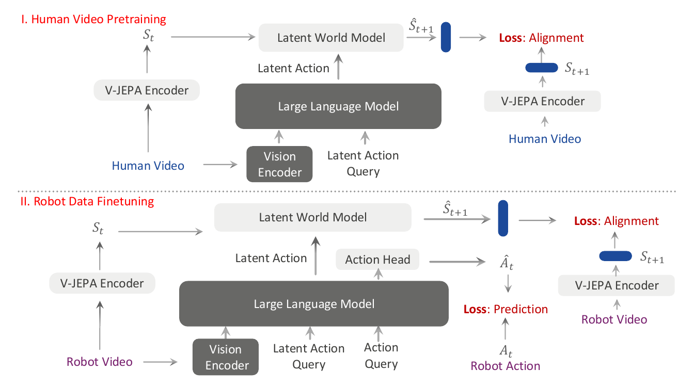
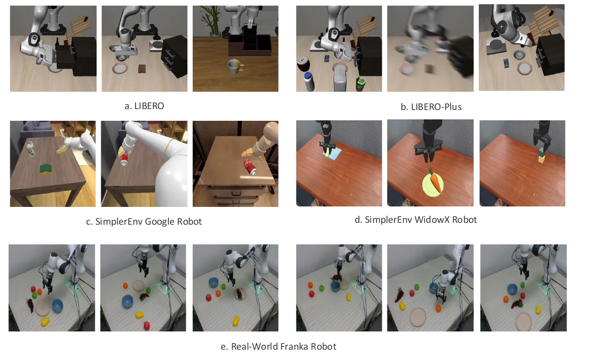
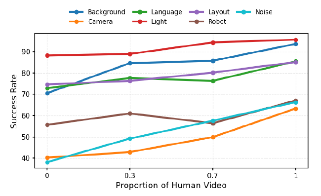
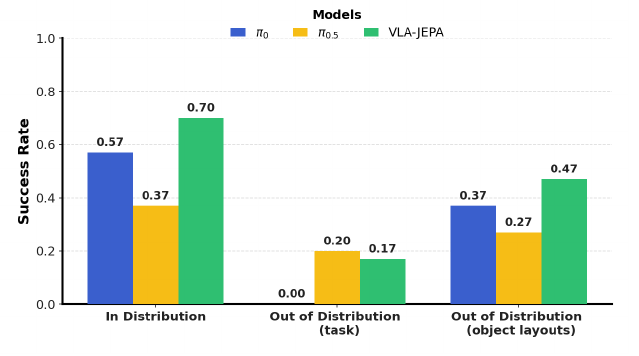

# VLA-JEPA (2026)

Il paper [*VLA-JEPA: Enhancing Vision-Language-Action Model with Latent World Model*](https://arxiv.org/pdf/2602.10098v2), di Jingwen Sun e coautori, propone un pretraining per policy robotiche fondato sulla **predizione di rappresentazioni future**, anziché sulla generazione dei pixel. Questo capitolo segue la revisione arXiv v2 del febbraio 2026; gli autori pubblicano [progetto](https://ginwind.github.io/VLA-JEPA/) e [codice](https://github.com/ginwind/VLA-JEPA/).

La motivazione è che un cambiamento visuale non coincide necessariamente con un cambiamento controllabile. Un video può mostrare movimento della camera, variazioni di illuminazione o oggetti sullo sfondo. Apprendere una rappresentazione del delta fra frame può quindi catturare ciò che cambia nell'immagine senza isolare ciò che aiuta a produrre azioni robotiche.

## JEPA e il ruolo del futuro

Una **Joint-Embedding Predictive Architecture (JEPA)** confronta la rappresentazione predetta con quella di un target, invece di ricostruire il segnale originale. In VLA-JEPA un encoder **V-JEPA2 congelato** costruisce gli stati latenti; un World Model predice gli stati successivi condizionato da rappresentazioni prodotte dal VLM.

Il target futuro può essere usato per insegnare la predizione senza essere fornito come input al percorso che deve imparare a prevederlo. Questa separazione è centrale: se il modulo che produce una latent action legge già il futuro, può codificarlo direttamente e ottenere una buona loss senza apprendere una rappresentazione utile quando il futuro non è disponibile.

VLA-JEPA applica il principio al **VLM che genera i latent action token**: esso riceve osservazioni iniziali e istruzione, mentre i frame futuri costruiscono la supervisione. Il World Model usa inoltre una maschera temporale causale per non leggere stati futuri durante la predizione.

*Fonte: Sun et al., VLA-JEPA: Enhancing Vision-Language-Action Model with Latent World Model, revisione v2, Figura 2. Il video umano fornisce target latenti per il World Model; il dato robotico aggiunge una testa di azione e una loss sui comandi mantenendo l'allineamento delle rappresentazioni future.*

## Backbone e notazione

Il backbone è **Qwen3-VL-2B**. Token apprendibili indicati nel paper come `latent_i` producono rappresentazioni delle transizioni; un ulteriore token `action` fornisce il condizionamento per la testa che genera i comandi robotici.

Indichiamo con $o_t$ le osservazioni visuali correnti, con $l$ l'istruzione linguistica, con $a_t$ il comando fisico e con $s_t$ lo **stato latente visuale** prodotto dall'encoder. Il simbolo $z_t$ indica invece la rappresentazione di latent action: non è un comando eseguibile e non va confuso con $a_t$.

Per una vista $v$, $o_t^{(v)}$ è l'osservazione associata. Con $F$ encoder congelato e $\operatorname{concat}_v$ concatenazione fra viste, lo stato latente è:

$$
s_t = \operatorname{concat}_v F(o_t^{(v)})
$$

L'encoder è un encoder video: la scrittura compatta va intesa come rappresentazione temporale ricavata dall'input predisposto per il modello, non come garanzia che ogni token sia prodotto da una funzione frame-wise indipendente. L'appendice seleziona due viste quando ne sono disponibili più di due e duplica la rappresentazione quando è disponibile una sola vista.

Il VLM riceve **l'osservazione iniziale $o_{t_0}$**, con $t_0$ inizio della clip, e $l$, producendo token di transizione associati a passi futuri. I latent action token possono quindi rappresentare una sequenza prevista sulla base del contesto iniziale, senza osservare direttamente tutti i frame che dovranno spiegare.

## Latent World Model e attenzione temporale

Il World Model è un Transformer autoregressivo che riceve stati visuali latenti e latent action token. Una forma della predizione causale a un passo è:

$$
\widehat{s}_{t+1} = g_\theta(s_{\leq t},z_{\leq t})
$$

$g_\theta$ è il predittore con parametri $\theta$; $s_{\leq t}$ e $z_{\leq t}$ sono le sequenze disponibili fino al tempo $t$. Entro lo stesso passo i token di stato e latent action possono leggere reciprocamente le proprie rappresentazioni; tra passi diversi l'attenzione è causale.

L'appendice descrive un World Model con **12 layer e 8 attention head**, rappresentazioni da 2,048 dimensioni, 256 image token per passo e orizzonte futuro di 8. I token `latent_i` vengono replicati per dare capacità alla rappresentazione di ciascuna transizione; nella configurazione indicata sono tre per passo.

Il training usa **teacher forcing**: quando si predice il futuro di un passo, la storia degli stati può provenire dall'encoder sulle osservazioni reali, anziché dalle precedenti predizioni del modello. Ricevere uno stato passato reale non equivale a ricevere il target futuro corrente, ma rende il training diverso da un rollout autonomo lungo.

Il frozen encoder offre uno spazio di target stabile. Il percorso che produce le latent action non può modificare il target soltanto per facilitare la propria loss, e i frame futuri non possono entrare nel VLM attraverso la sequenza di input prevista dagli autori.

## Obiettivo di allineamento e precisione del formalismo

L'obiettivo operativo è ridurre una distanza fra lo stato predetto e il target del frozen encoder. Una scrittura esplicita del principio è:

$$
\mathcal{L}_{\mathrm{WM}} =
\sum_{k=1}^{H_v}d\left(\widehat{s}_{t_k},\operatorname{sg}(s_{t_k})\right)
$$

$H_v$ è l'orizzonte futuro visuale, $t_k$ identifica i passi della clip, $d$ è una distanza scalare fra rappresentazioni e $\operatorname{sg}$ lo stop-gradient. Questa forma chiarisce quale informazione è target e quale è predetta, senza attribuire una norma specifica non esplicitata correttamente nella formula del paper.

**La formulazione matematica della revisione richiede cautela.** L'Equazione 5 scrive una differenza fra vettori senza esplicitare una norma o una riduzione scalare. L'Equazione 4 propone inoltre una lettura variazionale e sostiene che la KL si annulli perché l'encoder è deterministico; la sola deterministicità non è sufficiente a giustificare tale conclusione senza definire le distribuzioni e le relative ipotesi.

Il significato verificabile del metodo è quindi l'**allineamento predittivo in uno spazio latente congelato**. Non è necessario assumere una ELBO rigorosamente derivata per comprenderne il funzionamento o interpretarne i risultati.

## Dalla latent action al comando fisico

Nel fine-tuning, i dati robotici supervisionano due compiti: previsione degli stati futuri e generazione dei comandi. I token `action` leggono il contesto visuale, l'istruzione e le latent action, producendo una rappresentazione $z_a$ usata dalla testa di azione.

La testa impiega **conditional flow matching**, che apprende un campo di velocità per trasformare rumore gaussiano in un chunk di comandi continui. Indichiamo il chunk reale con $\mathbf{a}$ e il rumore con $\epsilon\sim\mathcal{N}(0,I)$, dove $I$ è la matrice identità. Usiamo $\tau\in[0,1]$ per il tempo del processo generativo, distinto dal tempo fisico $t$:

$$
\mathbf{a}^{(\tau)} = (1-\tau)\epsilon+\tau\mathbf{a}
$$

La testa $v_\phi$, con parametri $\phi$, deve predire la velocità $\mathbf{a}-\epsilon$ lungo questo percorso. La loss è:

$$
\mathcal{L}_{\mathrm{FM}} =
\mathbb{E}_{\mathbf{a},\epsilon,\tau}\left[
\left\|v_\phi(\mathbf{a}^{(\tau)},\tau\mid z_a)-(\mathbf{a}-\epsilon)\right\|_2^2
\right]
$$

L'aspettativa è sui chunk del dataset, sul rumore e su $\tau$ uniforme. In inferenza si integra il campo da rumore a dati per ottenere le azioni. Non si cerca online fra sequenze mediante il World Model.

Per i dati annotati l'obiettivo congiunto è:

$$
\mathcal{L} = \mathcal{L}_{\mathrm{FM}}+\beta\mathcal{L}_{\mathrm{WM}}
$$

$\beta$ bilancia azione e predizione latente. Sui video action-free rimane soltanto il termine World Model. La testa descritta nell'appendice è un DiT-B da 16 layer e 12 attention head, con action dimension 7, orizzonte di azione riportato di 7 e quattro passi di integrazione/denoising.

## Pretraining, fine-tuning e dati

Il pretraining combina **Something-Something-v2**, con circa 220,000 video umani, e **DROID**, con circa 76,000 traiettorie robotiche. I video umani non contengono i comandi del robot target; i dati robotici permettono invece di aggiungere la loss di flow matching.

Si tratta di video di interazioni umane con oggetti, non di una dimostrazione sperimentale su tutti i video Internet. La descrizione di pretraining da video su larga scala non va estesa automaticamente a contenuti privi di interazione, istruzioni o struttura temporale utile.

Il fine-tuning per LIBERO e LIBERO-Plus usa circa **2,000 dimostrazioni expert LIBERO**, senza dati aumentati di LIBERO-Plus. Per SimplerEnv vengono usati **Fractal** per Google Robot e **BridgeV2** per WidowX. Il robot fisico usa 100 dimostrazioni su tre task.

Le immagini in input al VLM vengono ridimensionate a $224\times224$ e le clip del world-state encoder a $256\times256$. L'appendice riporta pretraining per 50,000 step, fine-tuning simulato per 30,000 e fisico per 20,000, su otto A100 con batch globale 256. Questi sono aggiornamenti supervisionati, non nuove interazioni online del robot.

## Benchmark ed embodiment

*Fonte: Sun et al., VLA-JEPA: Enhancing Vision-Language-Action Model with Latent World Model, revisione v2, Figura 3. Il confronto comprende LIBERO, perturbazioni LIBERO-Plus, Google Robot e WidowX in SimplerEnv e manipolazione tabletop con Franka fisico.*

**LIBERO** misura controllo in-distribution su un Franka Panda simulato, con quattro suite e 50 episodi per task. **LIBERO-Plus** mantiene il training originale e altera camera, robot, linguaggio, luce, sfondo, rumore e layout, verificando robustezza fuori distribuzione.

**SimplerEnv** confronta policy addestrate su dati reali con simulazioni visualmente allineate a Google Robot e WidowX. La variante visual matching rende il test una valutazione real-to-sim; non equivale a nuovi esperimenti fisici su quei due robot.

Il setup reale usa un **Franka Research 3**, una pinza **Robotiq 2F-85** e tre **Intel RealSense D435**, due esterne e una al polso. I task di training consistono in pick-and-place di frutta verso piatti o ciotole. I test OOD cambiano task, oggetti o disposizione; l'appendice riporta dieci trial indipendenti per task.

## Risultati e contributo dei video umani

Su LIBERO il modello completo raggiunge **97.2%** medio e la variante senza video umani **96.1%**. Nella tabella del paper OpenVLA-OFT raggiunge 97.1% e $\pi_{0.5}$ 96.9%. La differenza aggregata è piccola e i modelli non condividono necessariamente pretraining e quantità di dati.

Il contributo dei video emerge più chiaramente su **LIBERO-Plus**: il modello completo raggiunge **79.5%**, contro **62.9%** senza video umani e 69.6% di OpenVLA-OFT. Il vantaggio non è uniforme fra perturbazioni: camera e noise restano casi nei quali altri baseline possono ottenere punteggi superiori.

*Fonte: Sun et al., VLA-JEPA: Enhancing Vision-Language-Action Model with Latent World Model, revisione v2, Figura 5. Il contributo dei video cambia fra tipi di perturbazione; non tutte le curve crescono monotonamente.*

Su SimplerEnv Google Robot, la variante completa raggiunge **65.2%**, mentre quella senza video umani raggiunge **78.4%**. Su WidowX entrambe riportano **57.3%**. Questi risultati impediscono di attribuire al pretraining umano un beneficio universale: dati robotici di qualità e allineamento del dominio restano determinanti.

Anche la scelta dell'orizzonte visuale cambia il risultato. L'ablation con $H_v$ pari a 4, 8 e 16 riporta rispettivamente 94.8%, 96.1% e 95.5% medio su LIBERO. Aumentare il futuro da predire non aumenta automaticamente la qualità della policy.

## Risultati sul robot reale

*Fonte: Sun et al., VLA-JEPA: Enhancing Vision-Language-Action Model with Latent World Model, revisione v2, Figura 4. VLA-JEPA raggiunge circa 0.70 in-distribution, 0.17 sui task nuovi e 0.47 su nuove disposizioni degli oggetti.*

Il successo in-distribution è circa **70%**, quello su task OOD circa **17%** e quello con layout OOD circa **47%**. Nel confronto, $\pi_{0.5}$ supera VLA-JEPA sui task nuovi, mentre VLA-JEPA ottiene risultati migliori in-distribution e sulle disposizioni alterate.

Gli autori riportano traiettorie più stabili e tentativi ripetuti di grasp dopo un errore, ma anche difficoltà nel seguire precisamente il linguaggio e nel scegliere l'oggetto corretto. La capacità di recupero è un'osservazione qualitativa; non costituisce una garanzia di sicurezza né una misura generale di comprensione fisica.

## Che cosa è dimostrato e che cosa resta aperto

Il metodo dimostra che un **obiettivo predittivo latente può migliorare rappresentazioni e robustezza di una policy**. La rimozione dei frame futuri dal VLM elimina uno shortcut importante nel percorso che produce i token di transizione.

Questo non prova però che la latent action sia un fattore causale identificato o un comando robotico recuperato dal video umano. La rappresentazione può combinare intenzione, previsione e regolarità statistiche. La corrispondenza con controlli fisici viene appresa mediante i dati annotati e la testa flow matching.

L'isolamento degli input al VLM non sostituisce inoltre la verifica dell'intero percorso temporale: **teacher forcing, encoder video e costruzione dei target** determinano quali informazioni siano effettivamente disponibili a ogni passo. Per valutare un rollout autonomo occorrerebbe controllare anche questi dettagli e misurare l'accumulo degli errori senza stati reali intermedi.

Il paper non valuta selezione online di azioni candidate, predizione di reward o value, né un simulatore di comandi fisici arbitrari. L'assenza del decoder dei pixel rende l'allineamento più compatto, ma limita l'ispezione visuale del futuro e non garantisce da sola una minore latenza complessiva della policy.

## Novelty

- **Predizione di stati V-JEPA2:** allinea futuri latenti congelati senza obiettivi di ricostruzione dei pixel.
- **Percorso latent action senza frame futuri:** limita l'information leakage nel VLM che deve produrre rappresentazioni utili anche in inferenza.
- **Pretraining misto action-free e action-labeled:** unifica video umani e dati robotici mediante obiettivi compatibili.
- **Fine-tuning con dinamica e azioni:** conserva la loss latente durante l'apprendimento della testa flow matching.
- **Valutazione della robustezza:** confronta dati standard, perturbazioni, real-to-sim e robot fisico, includendo ablation sul video umano.

## Limiti

Il futuro appreso è una rappresentazione del frozen encoder, che può perdere proprietà necessarie al controllo. Latent semanticamente robusti non garantiscono accuratezza di contatti, forze o cinematica. Mancano misure dirette di calibrazione dell'incertezza e fedeltà ai comandi fisici candidati.

La formalizzazione variazionale è incompleta nella revisione analizzata, mentre teacher forcing e training supervisionato non dimostrano la stabilità dei rollout lunghi. Il metodo richiede comunque dati robotici per apprendere i comandi, e il pretraining umano ha benefici dipendenti dal benchmark.

Gli esperimenti fisici rimangono piccoli e il trasferimento a nuovi task è debole. La migliore robustezza ai layout non equivale a grounding linguistico aperto, pianificazione a lungo orizzonte o generalizzazione fra embodiment senza riaddestramento.

Il confronto con [WorldVLA](../worldvla/README.md) mette in evidenza target latenti rispetto a futuri visuali decodificabili. [Cosmos Policy](../cosmos_policy/README.md) aggiunge invece value e valutazione esplicita dei futuri per il planning: sono ruoli del World Model distinti, che richiedono evidenze sperimentali diverse.
