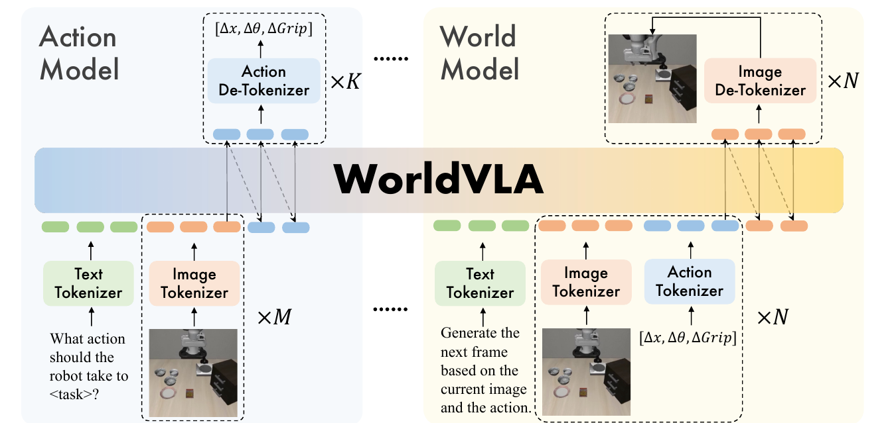
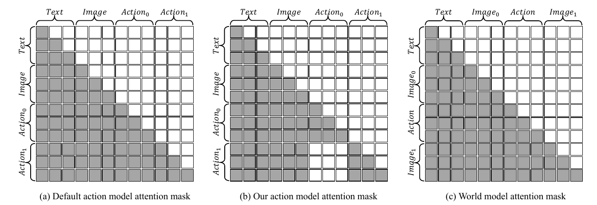
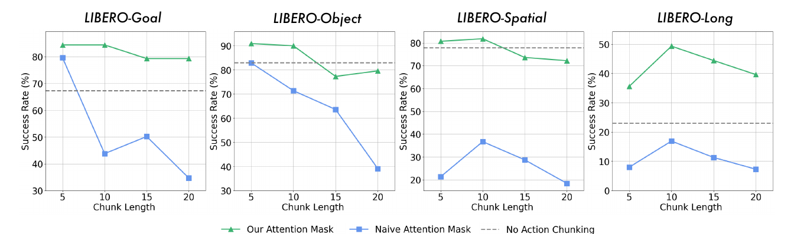

# WorldVLA (2025)

Il paper [*WorldVLA: Towards Autoregressive Action World Model*](https://arxiv.org/pdf/2506.21539v1), di Jun Cen e coautori, propone un **action world model** che usa lo stesso Transformer per generare azioni robotiche e immagini future. Questo capitolo segue il preprint arXiv v1 del giugno 2025; il [codice degli autori](https://github.com/alibaba-damo-academy/WorldVLA) accompagna il lavoro.

Il punto di partenza è una separazione frequente nei sistemi embodied. Un VLA interpreta immagini e linguaggio per produrre azioni; un World Model interpreta osservazioni e azioni per prevedere il futuro. **WorldVLA condivide rappresentazioni e parametri fra questi due compiti**, con l'ipotesi che la comprensione delle transizioni migliori la policy e che la supervisione delle azioni migliori la previsione visuale.

## Due modalità dello stesso modello

Indichiamo con $o_t$ l'osservazione visuale al tempo $t$, con $a_t$ l'azione e con $l$ l'istruzione linguistica. Una storia di $M$ immagini è $o_{t-M+1:t}$; un chunk di $K$ azioni è $\mathbf{a}_t=(a_t,\ldots,a_{t+K-1})$.

Le due modalità possono essere espresse come distribuzioni condizionate:

$$
\begin{aligned}
\mathbf{a}_t &\sim p_\theta(\mathbf{a}_t\mid o_{t-M+1:t},l)\\
o_{t+1} &\sim p_\theta(o_{t+1}\mid o_t,a_t)
\end{aligned}
$$

$\theta$ indica i parametri condivisi. La seconda riga descrive la configurazione one-step impiegata per il training del World Model; la formulazione generale del paper ammette anche storie di immagini e azioni. Per predizioni più lunghe il modello viene applicato ricorsivamente.

*Fonte: Cen et al., WorldVLA: Towards Autoregressive Action World Model, Figura 2. A sinistra il modello genera azioni da testo e immagini; a destra genera immagini da osservazioni e azioni. Le modalità usano lo stesso backbone e tokenizzatori dedicati.*

La policy riceve un prompt che richiede l'azione necessaria per il task. Il World Model riceve un prompt generico che richiede il prossimo frame sulla base di immagine e azione. **L'istruzione del task non è necessaria come input dinamico**: il modello deve rappresentare gli effetti dell'azione, non soltanto un futuro coerente con l'obiettivo.

Questo non rende la transizione fisica deterministica. Un'immagine e un comando possono non identificare velocità, attrito o contatti nascosti; la distribuzione appresa resta condizionata alle informazioni disponibili nei dati.

## Backbone e tokenizzazione

WorldVLA viene inizializzato da **Chameleon**, un modello multimodale pre-addestrato per comprensione e generazione di immagini e testo. Il lavoro non parte quindi da pesi casuali, anche quando indica l'assenza di pretraining robotico nella tabella dei risultati.

Il tokenizer visuale è un **VQ-GAN**, che converte l'immagine in indici di un codebook da 8,192 elementi. Il fattore di compressione spaziale è 16: un frame da $256\times256$ produce 256 token, mentre un frame da $512\times512$ ne produce 1,024.

Il testo viene codificato con un tokenizer BPE. Il vocabolario complessivo contiene 65,536 token, includendo i codici visuali e 256 token destinati alle azioni. Token speciali delimitano immagini, azioni e sequenze, così il Transformer può riconoscere la modalità da interpretare o generare.

Ogni azione robotica è rappresentata da **sette token**: tre variazioni di posizione dell'end-effector, tre variazioni di orientamento e uno stato assoluto della pinza. Ogni componente continua viene discretizzata in 256 bin in base all'intervallo presente nei dati di training.

L'unificazione rende possibile usare la stessa predizione del token successivo per tutte le modalità, ma introduce una **quantizzazione dei comandi**. La risoluzione dell'azione dipende dalla larghezza dei bin e non può essere interpretata come una precisione continua arbitraria.

## Training congiunto

Le dimostrazioni vengono trasformate in due tipi di esempi. Gli esempi policy contengono istruzione e immagini come input e azioni come target; gli esempi World Model contengono immagine e azione come input e il frame successivo come target.

La loss viene calcolata soltanto sui token da generare, escludendo i token di contesto. Indicando con $\mathcal{L}_{\mathrm{action}}$ e $\mathcal{L}_{\mathrm{world}}$ le rispettive cross-entropy, l'obiettivo è:

$$
\mathcal{L} = \mathcal{L}_{\mathrm{action}}+\alpha\mathcal{L}_{\mathrm{world}}
$$

Il coefficiente $\alpha=0.04$ bilancia i contributi. La predizione visuale contiene molti più token dei sette di una singola azione, quindi la scala dei due compiti richiede attenzione. Il training del World Model usa un solo round di transizione, indicato con $N=1$ nel paper, per contenere il costo.

La storia visuale predefinita comprende **due immagini**. L'action chunk contiene cinque azioni per LIBERO-Spatial, Object e Goal, e dieci per LIBERO-Long. Le ablation mostrano che aumentare la storia può migliorare la percezione del movimento, ma rallenta l'inferenza e offre benefici minori quando il chunking è già attivo.

Il World Model non fornisce un reward per reinforcement learning: agisce come **obiettivo predittivo aggiuntivo** sul backbone. Gli aggiornamenti restano supervisionati dalle dimostrazioni e dalle transizioni visuali osservate.

## Maschera di attenzione per gli action chunk

Una normale maschera causale permette a un'azione successiva di leggere le azioni precedenti del chunk. In training quelle azioni sono corrette perché provengono dalle dimostrazioni; in esecuzione sono generate dal modello e possono essere inesatte. La dipendenza tra azioni può quindi trasformare un errore iniziale in una catena di errori.

WorldVLA **blocca l'attenzione fra blocchi di azioni di passi diversi**, mantenendo accesso al testo e alle immagini. All'interno del blocco di una singola azione resta la struttura di attenzione prevista per i suoi token; non bisogna confondere l'indipendenza fra passi del chunk con l'indipendenza fra tutte le sette componenti del comando.

*Fonte: Cen et al., WorldVLA: Towards Autoregressive Action World Model, Figura 3. Il pannello centrale rimuove l'accesso delle azioni successive ai blocchi di azioni precedenti; il World Model mantiene la maschera causale del pannello destro.*

La maschera riduce il canale attraverso cui gli errori di un'azione influenzano la successiva e rende possibile il trattamento parallelo dei diversi passi. Il modello continua a condividere lo stesso contesto visuale e linguistico fra tutte le azioni del chunk.

Il vantaggio ha un limite operativo: allungare il chunk riduce comunque la frequenza con cui arrivano nuove osservazioni. **La maschera corregge una dipendenza interna alla generazione, non l'assenza di feedback durante l'esecuzione del chunk**.

## Dataset ed embodiment

La valutazione usa **LIBERO**, con un Franka Emika Panda simulato. Le quattro suite principali contengono task che variano relazioni spaziali, oggetti, obiettivi e lunghezza delle sequenze; LIBERO-90 è presentato come raccolta disponibile per pretraining, ma il risultato principale di WorldVLA non usa pretraining robotico su larga scala.

Gli autori rimuovono traiettorie non riuscite e azioni di no-operation. Per valutare la predizione video, il 90% delle traiettorie viene usato nel training e il 10% nella validazione. **La Tabella 2 usa invece tutti i dati disponibili**, per il confronto principale delle policy; non va confusa con le ablation e le metriche del World Model.

Ogni task viene valutato su 50 rollout con stati iniziali diversi. La policy viene misurata mediante success rate; la qualità dei video viene misurata con FVD, PSNR, SSIM e LPIPS. Non vengono presentati esperimenti su robot fisici o altri embodiment.

## Risultati della policy e ablation

La Tabella 2 riporta il **79.1%** medio per WorldVLA a $256\times256$ e l'**81.8%** a $512\times512$. OpenVLA ottiene il 76.5%, ma OpenVLA-OFT raggiunge il 95.4%. Il risultato sostiene l'utilità dell'architettura nel confronto con il baseline discreto, senza dimostrare superiorità generale sui VLA.

L'ablation a backbone condiviso è più informativa sul contributo specifico del World Model. Senza chunking, aggiungere la loss visuale porta il successo medio dal **62.8% al 67.2%**. Con chunking e maschera proposta, l'incremento è dal **76.6% al 78.1%**. Sono risultati di configurazioni diverse e non devono essere combinati come se descrivessero lo stesso esperimento.

La generazione ingenua del chunk raggiunge il 54.0% medio; usando la maschera, il modello policy-only sale al 76.6%. Questo incremento è più grande di quello della sola supervisione visuale nell'ablation, mostrando il peso della scelta di decoding.

*Fonte: Cen et al., WorldVLA: Towards Autoregressive Action World Model, Figura 6. Allungare il chunk degrada soprattutto la maschera causale ordinaria; la maschera proposta attenua il problema, ma non elimina il calo per chunk eccessivamente lunghi.*

## Predizione visuale e ruolo del planning

Il training congiunto migliora varie metriche di previsione, soprattutto sui rollout più lunghi. Nella Tabella 4, a 50 frame FVD scende da **718.6 a 674.1**, mentre a 10 frame sale da **250.0 a 255.1**. Il beneficio non è quindi uniforme fra metriche e orizzonti.

Una diversa ablation confronta predizione del futuro condizionata dalle azioni e video prediction condizionata soltanto da immagine e task. Il primo obiettivo migliora tutte le suite nel confronto riportato, mentre il secondo mostra benefici meno consistenti. Questo è compatibile con l'idea che le azioni forniscano informazione più precisa sulla transizione; non dimostra però che dai dati sia stata identificata la causalità fisica.

Il paper motiva il World Model anche attraverso la possibilità di simulare azioni candidate. **Gli esperimenti di controllo non descrivono però un ciclo di ricerca online con scoring dei futuri**. Non vengono introdotti reward model, value function o un planner che selezioni sistematicamente fra rollout alternativi.

Il comportamento dimostrato è quindi una policy diretta che beneficia del training congiunto. Per studiare un utilizzo esplicito di futuro e value nella scelta delle azioni, il confronto pertinente è [Cosmos Policy](../cosmos_policy/README.md).

## Novelty

- **Action world model autoregressivo:** usa un vocabolario condiviso per comprensione e generazione di testo, immagini e comandi.
- **Supervisione reciproca:** addestra policy e forward prediction con gli stessi parametri e ne misura i benefici nelle ablation.
- **Action attention masking:** limita la propagazione degli errori fra azioni di uno stesso chunk.
- **Confronto fra futuri condizionati da task e azioni:** isola il contributo dell'action conditioning nel training della policy.

## Limiti

La comprensione della fisica è una motivazione del metodo, ma viene verificata indirettamente mediante successo del task e qualità dei video. Le metriche percettive non assicurano che cambiando un'azione il modello produca una risposta fisicamente corretta, né che il rollout possa essere usato per valutare una policy fuori distribuzione.

La tokenizzazione visuale richiede molte predizioni per frame e quella delle azioni introduce quantizzazione. L'inferenza autoregressiva può essere lenta; chunk più lunghi ammortizzano il costo ma riducono la reattività. La maschera non elimina gli errori dovuti a osservabilità parziale o mismatch tra dinamica reale e appresa.

I dati coprono dimostrazioni riuscite di un unico benchmark simulato. Mancano test su hardware, fallimenti sistematici, trasferimento fra embodiment ed evaluation di planning online. L'81.8% medio non sostiene una superiorità rispetto ai migliori baseline continui del confronto.

Il legame con [GR-1](../gr_1/README.md) è la supervisione visuale che supporta una policy; la differenza centrale è che WorldVLA condiziona la predizione anche sui comandi. [VLA-JEPA](../vla_jepa/README.md) esplora invece un futuro rappresentato attraverso target latenti, senza ricostruire le immagini.
